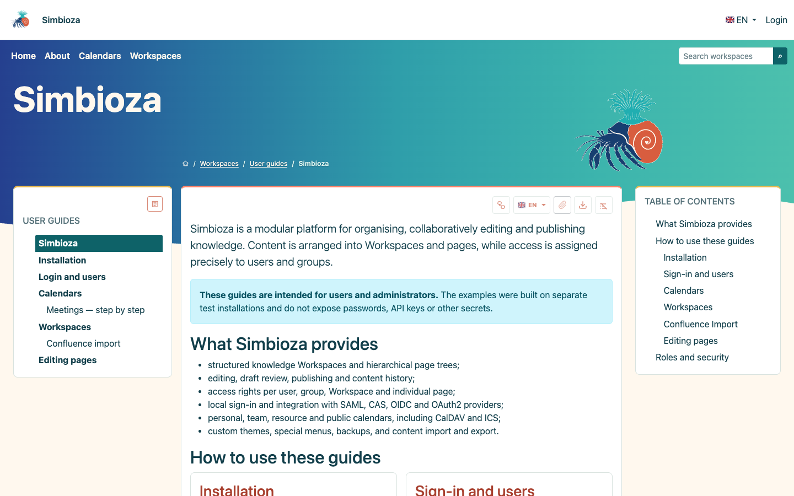

# Simbioza


[Croatian version](README_hr.md)

> Knowledge that lives together.

Simbioza is an open-source, self-hosted **wiki/CMS hybrid** for building a
knowledge base that people can actually maintain and use. A wiki makes it easy
to create and connect information; a CMS brings structure, presentation, and
control over what is published. Simbioza brings both into one application for
internal documentation, procedures, user guides, project knowledge, and public
information sites. Your content and installation remain under your control.

## A complete application, with modular flexibility

Simbioza brings pages and a searchable team Wiki, calendars and meetings,
surveys, tasks, comments, notifications and integrations together in one
environment. **Simbioza** is Croatian for **symbiosis**: distinct modules
complement one another within a shared application.

For those who need fewer features, the modular HeartPhrame framework also
allows a focused HTML website, Calendar, Wiki or Survey installation. The
installer includes the selected modules and their required dependencies.
Every installation shares Auth, ORM, Menu, Theme, Backup and Audit; API and
accessibility can be included as needed. Focused installations can be combined
or extended later while retaining their existing content.

See [modular installation options](docs/modularity_en.md). With Wiki, the manual
remains in its User guides Workspace; without Wiki, the same chapter-based
HTML manual is available through **Guides**.

**Try Simbioza:** Visit the [public demo](https://piko.webhop.me/demo/) to explore
the application and try it with the published demo accounts. Demo changes are
reset every five hours.



*A public User Guides Workspace, with its page tree, article, and table of contents.*

## Built on HeartPhrame

Simbioza is built on [HeartPhrame Framework](https://gitlab.opencode.hr/srce/aai-eduhr/heartphrame),
a lightweight, modular PHP framework. The development of Simbioza has also
produced a collection of reusable HeartPhrame modules for content management,
authentication, APIs, calendars, tasks, notifications, and more. These modules
are maintained separately and can be used in other HeartPhrame applications
with their required dependencies. Simbioza brings them together into one
wiki/CMS. See the [module dependency matrix](docs/module-dependencies_en.md)
and [authors and framework credits](AUTHORS.md).

## Optional Confluence import

Moving a knowledge base to your own server? The optional **Confluence Import**
module imports a Confluence XML ZIP export into a Simbioza Workspace, preserving
the page tree, internal links, current attachments, and supported macros. Review
identity and permission mappings before starting; page and attachment history
are imported only when explicitly selected. The import report identifies
unsupported macros and files that need attention.

Watch the export, import, and result in this short walkthrough, with British
English narration and English captions. Confluence's table-of-contents macro
is not duplicated: Simbioza already provides a built-in page outline.

https://github.com/user-attachments/assets/528b8ac8-5298-460a-b06f-2aeb4ac636d2

[Try the migration demo](https://piko.webhop.me/demo/workspace/simbioza-demo/confluence-import)
or read the [Confluence import guide](https://piko.webhop.me/demo/workspace/korisnicke-upute/confluence-import?lang=en).

## Knowledge has a place to live

Organize content into **Workspaces**: each can have its own address, page tree,
members, permissions, navigation, and visual identity. Teams can work in a
shared Workspace, while restricted or personal Workspaces keep other material
in the right hands. Pages, links, breadcrumbs, and Workspace Search help readers
find their way through growing collections of information.

Authors can prepare drafts, request review, and publish when content is ready.
Readers continue to see the last published version while new work is in
progress. Editing and publishing are governed by roles and inherited
permissions, including page-level restrictions. Files belong alongside the
pages that explain them; their uploader, time, and current version are visible,
while authorized editors can inspect and download earlier versions.

## More than plain text

The full-featured visual **HTML Editor** supports formatted content, images, media,
tables with optional sorting and pagination, and document versions. It also provides reusable, dynamic elements:
include another page, build charts and timelines, or arrange content in tabs,
accordions, cards, and dropdowns. With the relevant modules enabled, pages can
also contain live calendars, tasks, and Workspace-aware search and page tables.
These elements are part of the same editor and obey the same access and
publication rules as the surrounding page.

Simbioza is **multilingual** in both its interface and its content. A page can
have language-specific versions and publication states; readers select their
language, while a configurable fallback keeps content accessible when a
translation is not yet available. New interface languages can be added with a
consolidated language pack instead of changing every module separately.

## Make it yours, without fragmenting the experience

Customize the site theme, light and dark appearance, header, and menus. A
Workspace manager can give their Workspace its own theme and special top or
side menus without changing the rest of the site. The page tree and document
outline can be tuned to suit the content. Navigation, permissions, the editor,
search, and notifications then work together rather than feeling like separate
tools.

Simbioza is modular beneath that unified experience. Install the capabilities
your site needs and add optional ones later:

- **Content and discovery:** Workspace, Workspace Search, HTML Editor, Survey, Task,
  and Comment.
- **People and communication:** Auth, Simbioza User, Notification, and E-mail.
- **Presentation and planning:** Menu, Theme, and Calendar.
- **Integration and operations:** API, Audit, Backup, and ORM.

For example, a review request can notify publishers in the application and,
when E-mail is enabled, by mail; Backup can include the data of installed
modules; and the API exposes permitted content without bypassing its access
rules. The optional Confluence importer can bring existing pages and
attachments into Workspaces. Modules extend the same application without
forcing every installation to use every feature.

Start with the [installation guide](docs/installation_en.md) or explore the
[documentation](docs/index_en.md). The interface and guides are also available
in [Croatian](README_hr.md).

## Install and operate

Choose one complete walkthrough: [Apache mod_php](docs/installation_mod_php_en.md), [ordinary PHP-FPM](docs/installation_fpm_en.md), or [secured PHP-FPM](docs/installation_fpm_secured_en.md). [Docker](docs/docker_en.md) is an additional deployment option with persistent runtime and database volumes.

Every Simbioza installation includes **Auth, ORM, Menu, Theme, Backup and Audit**. The installer resolves the required dependencies of any optional features you select. Composer's root production manifest contains the mandatory foundation; [the module catalog and dependency matrix](docs/module-dependencies_en.md) describe optional packages and their compatible versions. These Simbioza profiles are distinct from testing an individual reusable module in a minimal HeartPhrame host.

The minimum PHP version is **8.2**. Use Composer 2 and the PHP extensions required by your selected modules and database. The Framework dependency remains `aaieduhr/heartphrame-framework:^0.0.25`; its source is maintained upstream. [Configuration](docs/configuration_en.md) documents private paths and settings. Expose only `public/` through your web server.

For a classic installation, run updates as its documented code/deploy owner from the application directory:

```bash
php update.php --check
php update.php
```

A correctly configured secured FPM installation also offers GUI updates. Ordinary FPM alone does not enable them. Docker deployments update by replacing the versioned image and explicitly applying migrations. Back up the application data and required private/host configuration before maintenance. [Troubleshooting and operations](docs/troubleshooting_en.md) explain which logs and checks to use.

The supported application line is 0.3.x. A site on 0.2.x needs a fresh installation; its old Simbioza backup is not an upgrade path. Normal 0.3.x updates preserve your selected optional modules, content and settings. New optional modules become available for explicit installation.

The current container image is `ghcr.io/kmihalj/simbioza:0.3.42`. Configure persistent data and secrets using the [Docker guide](docs/docker_en.md); review [release 0.3.42](docs/release-0.3.42_en.md) before upgrading.

## Use the modules in your own application

The modules are reusable in other HeartPhrame projects. To let a form field store formatted HTML, use the editor's **component mode**: open its modal from a textarea, apply the edited value, and save it through your own form handler. You do not need to turn the field into a Wiki page. The [form-field integration guide](docs/html-editor-forms_en.md) links a complete controller, template and JavaScript example, including sanitization and CSRF handling.

For external integrations, use the [API contract](docs/api-v1-contract_en.md). Keys restrict operations and never bypass the owner's content permissions. Use the documentation for each enabled module's routes and scopes.

## Documentation

- [Documentation index](docs/index_en.md): instructions grouped by user, administrator and developer needs.
- [User guide with and without Wiki](docs/bundled-manual_en.md): the same manual is available in the User guides Workspace or through **Guides**.
- [Modularity and adding Workspaces to an existing HTML site](docs/modularity_en.md).
- [All 26 themes](docs/theme-gallery_en.md), [collection import](docs/theme-collection_en.md), and [personal appearance](docs/personal-appearance_en.md).
- [Configuration](docs/configuration_en.md), [language packs](docs/localization_en.md), [Workspace storage](docs/workspace-data_en.md), and [logs](docs/logging_en.md).
- [Release history](docs/releases_en.md). Historical changes are separate from current usage instructions.

## Development checks

Production dependencies exclude QA tools. In an isolated development checkout, prepare the QA manifest and run the checks:

```bash
php scripts/build_ci_composer.php
COMPOSER=composer.ci.json composer update --with-all-dependencies
COMPOSER=composer.ci.json composer on-commit
npm ci
php scripts/run_e2e.php --local --keep
```

The E2E wrapper prepares its isolated fixture and browser dependencies. See [E2E verification](docs/end-to-end-testing_en.md) for supported switches and databases. With `build_ci_composer.php --local`, sibling modules can be tested without publishing them; `HPH_LOCAL_MODULE_ROOT` selects their parent directory. It does not modify the Framework.

Composer package requirements and the JavaScript lock file are the source of truth for dependencies. Do not copy hard-coded versions from old release notes. Private configuration, runtime data and generated reports do not belong in Git. [Documentation checks](docs/documentation-quality_en.md) cover language pairs, links and examples.
