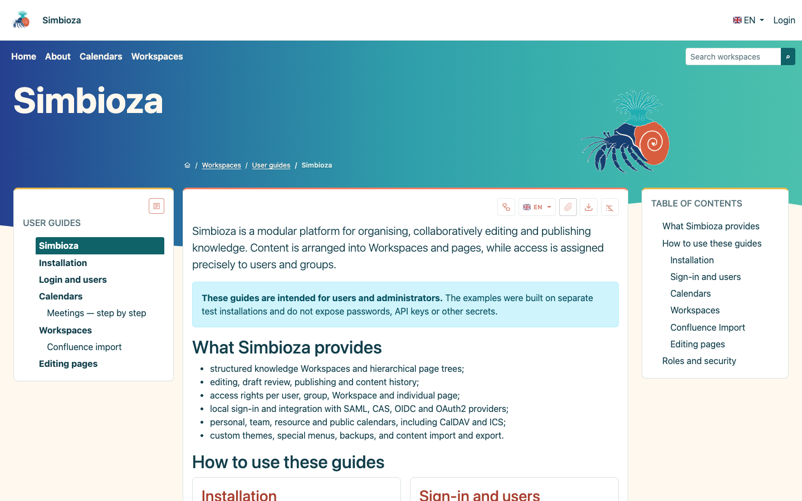

# Simbioza

> Simbioza 0.3.2 fixes fresh secured-FPM setup without extra configuration layers. Complete installation guides use this release directly. Public modules remain at 0.3.0 and HeartPhrame Framework is unchanged. See the [release notes](docs/release-0.3.2_en.md).

[Croatian version](README_hr.md)

> Knowledge that lives together.

Simbioza is an open-source, self-hosted **wiki/CMS hybrid** for building a
knowledge base that people can actually maintain and use. A wiki makes it easy
to create and connect information; a CMS brings structure, presentation, and
control over what is published. Simbioza brings both into one application for
internal documentation, procedures, user guides, project knowledge, and public
information sites. Your content and installation remain under your control.

**Try Simbioza:** Visit the [public demo](https://piko.webhop.me/demo/) to explore
the application and try it with the published demo accounts. Demo changes are
reset every five hours.



*A public User Guides Workspace, with its page tree, article, and table of contents.*

## Built on HeartPhrame

Simbioza is built on [HeartPhrame Framework](https://gitlab.opencode.hr/srce/aai-eduhr/heartphrame),
a lightweight, modular PHP framework. The development of Simbioza has also
produced a collection of reusable HeartPhrame modules for content management,
authentication, APIs, calendars, tasks, notifications, and more. These modules
are maintained separately and can be used in other HeartPhrame applications
with their required dependencies. Simbioza brings them together into one
wiki/CMS. See the [module dependency matrix](docs/module-dependencies_en.md)
and [authors and framework credits](AUTHORS.md).

## Optional Confluence import

Moving a knowledge base to your own server? The optional **Confluence Import**
module imports a Confluence XML ZIP export into a Simbioza Workspace, preserving
the page tree, internal links, current attachments, and supported macros. Review
identity and permission mappings before starting; page and attachment history
are imported only when explicitly selected. The import report identifies
unsupported macros and files that need attention.

Watch the export, import, and result in this short walkthrough, with British
English narration and English captions. Confluence's table-of-contents macro
is not duplicated: Simbioza already provides a built-in page outline.

https://github.com/user-attachments/assets/528b8ac8-5298-460a-b06f-2aeb4ac636d2

[Try the migration demo](https://piko.webhop.me/demo/workspace/simbioza-demo/confluence-import)
or read the [Confluence import guide](https://piko.webhop.me/demo/workspace/korisnicke-upute/confluence-import?lang=en).

## Knowledge has a place to live

Organize content into **Workspaces**: each can have its own address, page tree,
members, permissions, navigation, and visual identity. Teams can work in a
shared Workspace, while restricted or personal Workspaces keep other material
in the right hands. Pages, links, breadcrumbs, and Workspace Search help readers
find their way through growing collections of information.

Authors can prepare drafts, request review, and publish when content is ready.
Readers continue to see the last published version while new work is in
progress. Editing and publishing are governed by roles and inherited
permissions, including page-level restrictions. Files belong alongside the
pages that explain them; their uploader, time, and current version are visible,
while authorized editors can inspect and download earlier versions.

## More than plain text

The full-featured visual **HTML Editor** supports formatted content, images, media,
tables, and document versions. It also provides reusable, dynamic elements:
include another page, build charts and timelines, or arrange content in tabs,
accordions, cards, and dropdowns. With the relevant modules enabled, pages can
also contain live calendars, tasks, and Workspace-aware search and page tables.
These elements are part of the same editor and obey the same access and
publication rules as the surrounding page.

Simbioza is **multilingual** in both its interface and its content. A page can
have language-specific versions and publication states; readers select their
language, while a configurable fallback keeps content accessible when a
translation is not yet available. New interface languages can be added with a
consolidated language pack instead of changing every module separately.

## Make it yours, without fragmenting the experience

Customize the site theme, light and dark appearance, header, and menus. A
Workspace manager can give their Workspace its own theme and special top or
side menus without changing the rest of the site. The page tree and document
outline can be tuned to suit the content. Navigation, permissions, the editor,
search, and notifications then work together rather than feeling like separate
tools.

Simbioza is modular beneath that unified experience. Install the capabilities
your site needs and add optional ones later:

- **Content and discovery:** Workspace, Workspace Search, HTML Editor, Task,
  and Comment.
- **People and communication:** Auth, Simbioza User, Notification, and E-mail.
- **Presentation and planning:** Menu, Theme, and Calendar.
- **Integration and operations:** API, Audit, Backup, and ORM.

For example, a review request can notify publishers in the application and,
when E-mail is enabled, by mail; Backup can include the data of installed
modules; and the API exposes permitted content without bypassing its access
rules. The optional Confluence importer can bring existing pages and
attachments into Workspaces. Modules extend the same application without
forcing every installation to use every feature.

Start with the [installation guide](docs/installation_en.md) or explore the
[documentation](docs/index_en.md). The interface and guides are also available
in [Croatian](README_hr.md).

## Dependencies

Simbioza is built on [HeartPhrame Framework](https://gitlab.opencode.hr/srce/aai-eduhr/heartphrame)
and its independently maintained modules. Application work belongs here and in
module repositories; the Framework is consumed from its tagged `v0.0.25`
release and is not developed as part of this repository.

Every HeartPhrame module requires `aaieduhr/heartphrame-framework:^0.0.25`.
Required module order and optional capabilities are listed in
[the dependency matrix](docs/module-dependencies_en.md).

The smallest verified installations are Framework only, Framework + Theme,
Framework + Menu, and Framework + Theme + Menu. Database-backed modules add ORM
and their documented domain dependencies. Composer resolves all transitive
dependencies automatically.

## Requirements

- PHP 8.2 or newer
- Composer 2
- PDO SQLite for the default local setup
- Git access to the listed module repositories

## Dependency policy

The Framework is constrained to `^0.0.25`, while Simbioza modules use the
compatible `^0.3.0` release line. This application does not commit
`composer.lock`; each CI run resolves the latest compatible tagged releases and
executes the complete quality suite. Production deployments may retain their
own verified lock file outside the source repository.

Committed Composer metadata uses VCS repositories so a clean CI checkout works
without sibling directories. For local work with symlinked module checkouts,
use an untracked `composer.local.json` through the `COMPOSER` environment
variable; do not commit local `path` repositories into the shared manifest.

## Installation and verification

Choose one complete guide: [Apache mod_php](docs/installation_mod_php_en.md),
[ordinary PHP-FPM](docs/installation_fpm_en.md) or
[secured PHP-FPM](docs/installation_fpm_secured_en.md). Each starts from an
administrator terminal and includes the full installation procedure.

The public immutable image `ghcr.io/kmihalj/simbioza:0.3.2` is an additional
Docker/Colima route, with one runtime configuration/data volume and a separate
PostgreSQL volume. See the [Docker guide](docs/docker_en.md) for initialization,
explicit migrations and optional SimpleSAMLphp.

### Development verification

```bash
composer update --with-all-dependencies
composer check-platform-reqs
npm install --no-package-lock
npx playwright install chromium
composer e2e
```

Production dependencies intentionally exclude QA tools. In an isolated developer
copy, prepare the QA manifest before running static analysis and unit tests:

```bash
php scripts/build_ci_composer.php
COMPOSER=composer.ci.json composer update --with-all-dependencies
COMPOSER=composer.ci.json composer on-commit
```

Use `--local` with `build_ci_composer.php` to verify unpublished sibling modules;
`HPH_LOCAL_MODULE_ROOT` selects their parent directory when the QA copy lives
elsewhere. This does not change the production manifest or replace the Framework.
See [E2E and local verification](docs/end-to-end-testing_en.md).

A deployed release may intentionally omit `.git` and retain its own verified
`composer.lock`.

**0.3.0 is the clean initial release.** Use a new database and the current
configuration/data layout. Upgrades from 0.2.x and old Simbioza backup archives
are not supported. Demo and test sites must be reinstalled; external Confluence
exports remain supported.

From 0.3.0 onward, GUI and CLI updates first check the latest stable updater.
When needed, they replace it atomically and continue in a **new PHP process**
before changing application code, modules, configuration, or database schemas.
Then check and install application and compatible module tags normally:

```bash
php update.php --check
php update.php
```

The FPM and Apache mod_php installation paths, including GUI and CLI update
procedures, are documented in [Installing Simbioza](docs/installation_en.md).

Application configuration, migrations, module order, and API integration are
described in the [English documentation](docs/index_en.md). The Croatian
documentation has a separate [Croatian index](docs/index_hr.md).

Installation settings, module selection, and language administration use the
shared configuration paths described in the [configuration guide](docs/configuration_en.md).
Installed language packs are data-only JSON in `data/languages/catalogs/`;
packaged `lang/` stays read-only code. Language GUI/CLI changes and application-settings
backup use this runtime storage; see [localization](docs/localization_en.md).
Auth, Email, HTML Editor and Workspace store active settings under `HPH_CONFIG_PATH`
in `auth/auth.json`, `email/email.json`, `editor-html/editor-html.json` and
`workspace/workspace.json`. Generic modules allow manual configuration without the
Simbioza GUI; Workspace remains a Simbioza module with its existing GUI.
Documented starting examples are [auth.json.dist](config/auth.json.dist),
[email.json.dist](config/email.json.dist),
[editor-html.json.dist](config/editor-html.json.dist), and
[workspace.json.dist](config/workspace.json.dist). Each contains bilingual
`_documentation` descriptions. Copy only the needed example to its module's
active path when configuring a new installation; never overwrite migrated
settings. See [example rules](docs/configuration_en.md#examples).
Calendar retains its GUI, database and PHP format; it now reads
`HPH_CONFIG_PATH/calendar/calendar.php` and the configured override layers. Its current
example is [calendar.php.dist](config/calendar.php.dist). GUI disablement is
optional only where meaningful, not a requirement for every module.
Menu and Theme keep their GUI and read valid manual edits from their own
`HPH_CONFIG_PATH/menu/` and `HPH_CONFIG_PATH/theme/` folders. Global JSON and
PHP options are configuration; special menus and theme assets remain data.
Workspace-owned HTML, attachments, special menus and private theme files use
`data/workspaces/<storage-slug>--<ID>/`, with page payloads below
`pages/<page-label>--<document-UUID>/`. Readable labels are retained independently
of later public slug/title changes; the ID and full UUID prevent collisions.
Database HTML stays in the database. See [workspace data storage](docs/workspace-data_en.md)
for upgrades, Confluence imports, driver changes and portable backups.
There are no Menu/Theme `.dist` templates. Backup/import accepts existing JSON
archives and resolves destination-local paths. See [Menu and Theme settings](docs/configuration_en.md#data-is-separate-from-configuration).
Backup policy and host providers use `HPH_CONFIG_PATH/backup/`, and API installation
policy uses `HPH_CONFIG_PATH/api/api.php`. Both can be configured without a GUI.
Audit uses shared application/log settings; ORM and the framework share root-level
`HPH_CONFIG_PATH/database.php`. See [current module paths](docs/configuration_en.md#configuration-ownership).
Comment, Task and Notification keep necessary document/user state in the database;
Accessibility keeps personal choices in the browser. They have no separate global
configuration files or empty module config directories. Shared host settings and
module selection already follow `HPH_CONFIG_PATH`; their existing GUI remains.
See [configuration and data boundaries](docs/configuration_en.md#modules-without-separate-policy-files).
The updater and application settings backup/restore also follow these paths;
restore preserves dynamic bootstrap code and writes approved settings into the
final layer. The [configuration guide](docs/configuration_en.md) describes the
current fresh-install layout. The earlier [configuration plan](docs/configuration-migration-plan_en.md)
is a historical implementation record; the [0.3.0 audit](docs/pre-release-audit-0.3.0_en.md)
records the initial release checks. Current documentation changes are listed in
the [0.3.2 release notes](docs/release-0.3.2_en.md).

## Documentation

- Main index (EN): [docs/index_en.md](docs/index_en.md)
- Main index (HR): [docs/index_hr.md](docs/index_hr.md)
- [Installation](docs/installation_en.md)
- [Secured-FPM fix release 0.3.2](docs/release-0.3.2_en.md)
- [Documentation release 0.3.1](docs/release-0.3.1_en.md)
- [Clean initial release 0.3.0](docs/initial-release-0.3.0_en.md)
- [Ordinary PHP-FPM installation](docs/installation_fpm_en.md)
- [Secured PHP-FPM installation](docs/installation_fpm_secured_en.md)
- [Apache mod_php installation](docs/installation_mod_php_en.md)
- [Six clean installations and screenshots](docs/installation-lab_en.md)
- [Module dependencies](docs/module-dependencies_en.md)
- [Database configuration](docs/database_en.md)
- [Framework parameters and module configuration](docs/configuration_en.md)
- [Unified configuration plan and continuation point](docs/configuration-migration-plan_en.md)
- [API v1 contract](docs/api-v1-contract_en.md)
- [End-to-end testing](docs/end-to-end-testing_en.md)
- [Brand identity and theme](docs/branding_en.md)

### Historical release notes

These notes describe older releases, not the fresh 0.3.0 installation or upgrade procedure.

- [Release 0.2.8: notifications stay clear of the accessibility widget](docs/release-0.2.8_en.md)
- [Release 0.2.7: expanded first-party accessibility widget in six languages](docs/release-0.2.7_en.md)
- [Release 0.2.6: complete installation guides and all modules selected by default](docs/release-0.2.6_en.md)
- [Release 0.2.4: reliable long-running isolated FPM setup](docs/release-0.2.4_en.md)
- [Release 0.2.3: reliable multi-site FPM setup and installation guidance](docs/release-0.2.3_en.md)
- [Release 0.2.2: import recovery and document layout fixes](docs/release-0.2.2_en.md)
- [Release 0.2.1: reliable large Confluence imports](docs/release-0.2.1_en.md)
- [Release 0.2.0: resumable permanent Workspace deletion](docs/release-0.2.0_en.md)
- [Release 0.1.99: installation-private module support](docs/release-0.1.99_en.md)
- [Release 0.1.98: FPM-safe application update and rollback](docs/release-0.1.98_en.md)
- [Release 0.1.97: safe concurrent editing and remembered language](docs/release-0.1.97_en.md)
- [Release 0.1.96: optional settings follow module installation](docs/release-0.1.96_en.md)
- [Release 0.1.95: reliable optional settings and installer checks](docs/release-0.1.95_en.md)
- [Optional-module-safe updater in 0.1.77](docs/release-0.1.77_en.md)
- [FPM-safe CLI updater delegation in 0.1.76](docs/release-0.1.76_en.md)
- [Effective module lifecycle and dual-mode CLI in 0.1.75](docs/release-0.1.75_en.md)
- [FPM-safe persistent settings update in 0.1.74](docs/release-0.1.74_en.md)
- [Attachment layout, safe settings merge, and release checks in 0.1.73](docs/release-0.1.73_en.md)
- [Meeting planning and bundled guides in release 0.1.68](docs/release-0.1.68_en.md)

## Verification

The E2E suite includes non-sensitive ORM and HTTP measurements plus durable
budgets for SQL count, request duration, peak memory, and response size. The
same complete suite runs on SQLite, PostgreSQL, and MySQL in CI.

Workspace maintenance optimizes existing images as a persistent, resumable job
with a visible progress bar. Images are processed in bounded batches so a large
site never holds one HTTP request open for the entire collection; source files
remain unchanged.

## Personal preferences and module integration

Simbioza User adds following, notification delivery rules, and restricted
personal Workspaces created at first sign-in under an administrator-controlled
policy. It also provides a personal light/dark/automatic/system choice while
the global Theme policy is automatic. Modules keep ownership of their domain
rules; the application composes them and supplies deployment settings.

## Licence

This work is published under the
[European Union Public Licence (EUPL) v1.2](LICENSE).

## Donations and professional services

Simbioza and its modules are open source. All features are available to
everyone under their applicable open-source licences: there is no paid edition
and no functionality unlocked by a donation. Voluntary donations through
[GitHub Sponsors](https://github.com/sponsors/kmihalj) help sustain development.

If you need hands-on help, on-site installation and configuration, migration
of content and data from existing systems, and custom modules or integrations
are available as paid work by agreement. The fee is for the work, not for
access to Simbioza's features. For an inquiry or estimate, contact
[kmihalj@me.com](mailto:kmihalj@me.com).

## Community

<a href="https://alternativeto.net/software/simbioza/about/?utm_source=badge&amp;utm_medium=referral" target="_blank">
  
</a>

- [Authors](AUTHORS.md)
- [Get support](SUPPORT.md)
- [Report a security vulnerability privately](SECURITY.md)
- [Contribute](CONTRIBUTING.md)
