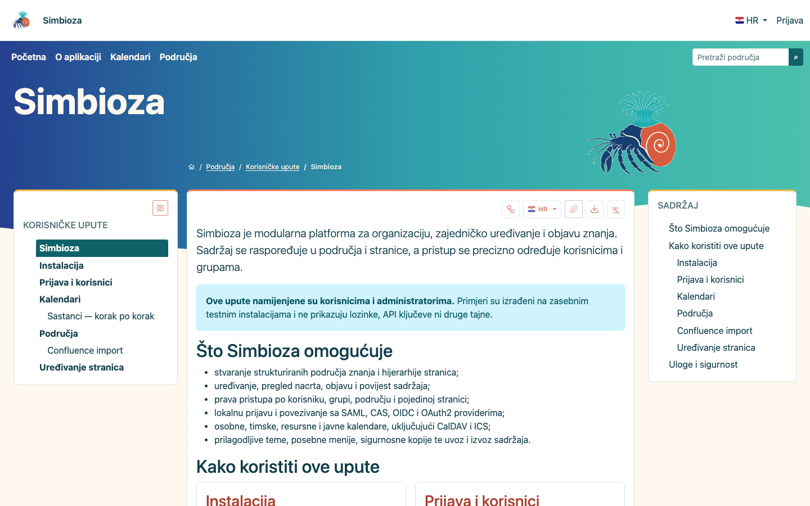

# Simbioza

> Simbioza 0.3.28 donosi kontrolirane skripte stranica, prevedene WYSIWYG upute i lokalni aplikacijski JavaScript. Vidi [bilješke izdanja](docs/release-0.3.28_hr.md).

[Engleska verzija](README.md)

> Znanje koje živi zajedno.

Simbioza je otvorena aplikacija za vlastiti poslužitelj: **hibrid wikija i
CMS-a** za izgradnju baze znanja koju je lako održavati i koristiti. Wiki
olakšava stvaranje i povezivanje informacija, a CMS daje strukturu, izgled i
kontrolu nad objavljenim sadržajem. Simbioza spaja oboje u jednu aplikaciju za
internu dokumentaciju, postupke, korisničke upute, projektno znanje i javne
informacijske stranice. Instalacija i podaci ostaju pod vašom kontrolom.

## Cjelovita aplikacija uz modularnu prilagodljivost

Simbioza povezuje stranice i pretraživi timski Wiki, kalendare i sastanke,
ankete, zadatke, komentare, obavijesti i integracije u jednom okruženju.
**Simbioza** znači zajednički život različitih organizama: ovdje se različiti
moduli međusobno nadopunjuju unutar iste aplikacije.

Za one kojima treba manje funkcionalnosti, modularnost HeartPhrame frameworka
omogućuje i užu instalaciju HTML weba, Kalendara, Wikija ili Anketa. Installer
uključuje odabrane module i njihove nužne ovisnosti. Svaka instalacija dijeli
Auth, ORM, Menu, Theme, Backup i Audit; API i pristupačnost mogu se uključiti
prema potrebi. Uže instalacije mogu se kombinirati ili kasnije proširiti uz
zadržavanje postojećeg sadržaja.

Vidi [mogućnosti modularne instalacije](docs/modularity_hr.md). Uz Wiki, upute
ostaju u području Korisničke upute; bez Wikija isti HTML priručnik s navigacijom
po poglavljima dostupan je preko stavke **Upute**.

**Isprobajte Simbiozu:** Posjetite [javni demo](https://piko.webhop.me/demo/),
istražite aplikaciju i isprobajte je s objavljenim demo računima. Promjene na
demu poništavaju se svakih pet sati.



*Javno područje Korisničke upute sa stablom stranica, člankom i kazalom.*

## Izgrađeno na HeartPhrameu

Simbioza je izgrađena na [HeartPhrame Frameworku](https://gitlab.opencode.hr/srce/aai-eduhr/heartphrame),
laganom, modularnom PHP frameworku. Uz razvoj Simbioze nastao je i skup
višekratno upotrebljivih modula za HeartPhrame: za upravljanje sadržajem,
autentikaciju, API-je, kalendare, zadatke, obavijesti i druge mogućnosti.
Moduli se održavaju zasebno i mogu se koristiti u drugim HeartPhrame
aplikacijama uz svoje obavezne ovisnosti. Simbioza ih povezuje u jedan
wiki/CMS. Pogledajte [matricu ovisnosti modula](docs/module-dependencies_hr.md)
i [autore i zasluge za framework](AUTHORS_hr.md).

## Opcionalni uvoz iz Confluencea

Želite preseliti bazu znanja na vlastiti poslužitelj? Opcionalni modul
**Confluence Import** uvozi Confluence XML ZIP izvoz u područje Simbioze,
uz očuvanje stabla stranica, internih poveznica, aktualnih privitaka i podržanih
makroa. Prije pokretanja pregledajte mapiranje identiteta i ovlasti; povijest
stranica i privitaka uvozi se samo ako je izričito odaberete. Izvješće uvoza
navodi nepodržane makroe i datoteke koje zahtijevaju provjeru.

U kratkom videu pogledajte izvoz, uvoz i rezultat, uz naraciju na britanskom
engleskom i engleske titlove. Confluenceov makro za kazalo ne prenosi se kao
zaseban blok: Simbioza već ima ugrađeno kazalo stranice.

https://github.com/user-attachments/assets/528b8ac8-5298-460a-b06f-2aeb4ac636d2

[Isprobajte demo prijelaza](https://piko.webhop.me/demo/workspace/simbioza-demo/confluence-import?lang=hr)
ili pročitajte [uputu za Confluence uvoz](https://piko.webhop.me/demo/workspace/korisnicke-upute/confluence-import?lang=hr).

## Znanje ima svoje mjesto

Sadržaj organizirajte u **područja**: svako može imati vlastitu adresu, stablo
stranica, članove, ovlasti, navigaciju i vizualni identitet. Timovi mogu raditi
u zajedničkom području, dok ograničena i osobna područja čuvaju ostale
materijale za one kojima su namijenjeni. Stranice, poveznice, putanja kroz
sadržaj i pretraživanje područja pomažu čitateljima snaći se i u velikoj bazi
znanja.

Autori mogu pripremiti nacrt, zatražiti pregled i objaviti sadržaj kada je
spreman. Čitatelji i dalje vide posljednju objavljenu verziju dok nastaju
izmjene. Uređivanje i objavljivanje uređuju uloge i naslijeđene ovlasti, uz
mogućnost ograničenja pojedinih stranica. Datoteke su uz stranice kojima
pripadaju; vidljivo je tko ih je i kada učitao te koja je inačica aktualna,
dok ovlašteni urednici mogu pregledati i preuzeti starije inačice.

## Više od običnog teksta

Cjeloviti vizualni **HTML editor** podržava oblikovanje sadržaja, slike,
multimediju, tablice i inačice dokumenata. Ima i napredne dinamičke elemente:
uključivanje sadržaja druge stranice, grafikone, vremenske crte te sadržaj
organiziran u kartice (tabove), harmonike, kartične blokove i padajuće blokove. Uz
odgovarajuće module u stranice se mogu umetnuti i živi kalendari, zadaci te
pretraživanje i tablice stranica vezane uz područje. Sve se uređuje na jednom
mjestu i poštuje iste ovlasti i pravila objavljivanja kao ostatak stranice.

Simbioza je **višejezična** u sučelju i sadržaju. Stranica može imati zasebne
inačice i stanja objave po jeziku; čitatelj bira jezik, a podesivi pričuvni
jezik pomaže kada prijevod još ne postoji. Novi jezik sučelja može se dodati
objedinjenim jezičnim paketom, bez zasebnog mijenjanja svakog modula.

## Prilagodite je sebi, bez razbijanja cjeline

Prilagodite temu, svijetli i tamni prikaz, zaglavlje i izbornike cijele
aplikacije. Upravitelj područja može svojem području dati zasebnu temu te
posebne gornje ili bočne izbornike, bez promjene ostatka sustava. Vidljivost
stabla stranica i kazala također se može prilagoditi vrsti građe.
Navigacija, ovlasti, editor, pretraživanje i obavijesti pritom rade kao jedna
cjelina, a ne kao skup nepovezanih alata.

Ispod jedinstvenog sučelja Simbioza je modularna. Instalirajte ono što je
potrebno, a opcionalne mogućnosti dodajte poslije:

- **Sadržaj i pronalaženje:** Workspace (područja), Workspace Search, HTML
  Editor, Task i Comment.
- **Korisnici i komunikacija:** Auth, Simbioza User, Notification i E-mail.
- **Izgled i planiranje:** Menu, Theme i Calendar.
- **Integracija i održavanje:** API, Audit, Backup i ORM.

Primjerice, zahtjev za pregled može obavijestiti objavljivače u aplikaciji i,
ako je uključen E-mail, poštom; Backup može obuhvatiti podatke
instaliranih modula; a API izlaže dopušteni sadržaj uz iste provjere ovlasti.
Opcionalni Confluence importer može prenijeti postojeće stranice i privitke u
područja. Moduli proširuju istu aplikaciju, ali svaka instalacija ne mora
koristiti baš sve mogućnosti.

Počnite s [uputom za instalaciju](docs/installation_hr.md) ili pregledajte
[dokumentaciju](docs/index_hr.md). Sučelje i upute dostupni su i na
[engleskom](README.md).

## Ovisnosti

Simbioza je izgrađena na [HeartPhrame Frameworku](https://gitlab.opencode.hr/srce/aai-eduhr/heartphrame)
i njegovim samostalno održavanim modulima. Aplikacijski razvoj pripada ovdje i
u repozitorije modula; Framework se koristi iz označenog izdanja `v0.0.25`
i ne razvija se u ovom repozitoriju.

Svaki HeartPhrame modul zahtijeva
`aaieduhr/heartphrame-framework:^0.0.25`. Obavezni redoslijed modula i
opcionalne mogućnosti navedeni su
u [matrici ovisnosti](docs/module-dependencies_hr.md).

Najmanje provjerene instalacije su samo Framework, Framework + Theme,
Framework + Menu te Framework + Theme + Menu. Moduli s bazom dodaju ORM i svoje
dokumentirane domenske ovisnosti. Composer automatski razrješava sve tranzitivne
ovisnosti.

## Preduvjeti

- PHP 8.2 ili noviji
- Composer 2
- PDO SQLite za zadanu lokalnu instalaciju
- Git pristup navedenim repozitorijima modula

## Politika ovisnosti

Framework je ograničen na `^0.0.25`. HTML Editor, Menu, Email i Theme traže najmanje
`0.3.2`, Backup/Auth/API najmanje `0.3.1`, a ostali moduli kompatibilnu
liniju izdanja `^0.3.0`. Aplikacija ne sprema `composer.lock`; svaki CI dohvaća
najnovija kompatibilna označena izdanja i pokreće cijeli skup provjera kvalitete.
Produkcijski deployment može izvan izvornog repozitorija čuvati vlastiti
provjereni lock.

Spremljeni Composer metapodaci koriste VCS repozitorije kako bi čista CI kopija
radila bez susjednih direktorija. Za lokalni rad sa simbolički povezanim
modulima koristi se nespremljeni `composer.local.json` preko varijable
`COMPOSER`; lokalni `path` repozitoriji ne spremaju se u zajednički manifest.

## Instalacija i provjera

Odaberite jednu cjelovitu uputu: [Apache mod_php](docs/installation_mod_php_hr.md),
[obični PHP-FPM](docs/installation_fpm_hr.md) ili
[sigurni PHP-FPM](docs/installation_fpm_secured_hr.md). Svaka počinje na
administratorskom terminalu i sadrži cijeli postupak instalacije.

Javni nepromjenjivi image `ghcr.io/kmihalj/simbioza:0.3.28` dodatni je
Docker/Colima način instalacije, s jednim runtime volumenom za konfiguraciju/podatke
te zasebnim PostgreSQL volumenom. [Docker upute](docs/docker_hr.md) opisuju
inicijalizaciju, izričite migracije i opcionalni SimpleSAMLphp.

### Razvojna provjera

```bash
composer update --with-all-dependencies
composer check-platform-reqs
npm install --no-package-lock
npx playwright install chromium
composer e2e
```

Produkcijske ovisnosti namjerno ne uključuju QA alate. U izoliranoj razvojnoj
kopiji prvo pripremite QA manifest pa pokrenite statičku analizu i jedinične testove:

```bash
php scripts/build_ci_composer.php
COMPOSER=composer.ci.json composer update --with-all-dependencies
COMPOSER=composer.ci.json composer on-commit
```

Opcija `--local` uz `build_ci_composer.php` provjerava neobjavljene susjedne module;
`HPH_LOCAL_MODULE_ROOT` određuje njihov nadređeni direktorij ako je QA kopija drugdje.
To ne mijenja produkcijski manifest niti zamjenjuje Framework.
Vidi [E2E i lokalne provjere](docs/end-to-end-testing_hr.md).

Poslužiteljska release instalacija smije namjerno biti bez `.git` direktorija i
čuvati vlastiti provjereni `composer.lock`.

**0.3.0 je čisto početno izdanje.** Koristite novu bazu i aktualni raspored
konfiguracije/podataka. Nadogradnje s 0.2.x i stare Simbiozine backup arhive
nisu podržane. Za postojeće 0.2.x siteove potrebna je nova instalacija; vanjski
Confluence izvozi ostaju podržani.

Od 0.3.0 nadalje GUI i CLI prvo provjeravaju updater najnovijeg stabilnog izdanja.
Ako je potrebno, atomski ga zamjenjuju i nastavljaju u **novom PHP procesu**,
prije promjena aplikacijskog koda, modula, konfiguracija ili sheme baze.
Zatim provjeravajte i instalirajte izdanja aplikacije i kompatibilnih modula:

```bash
php update.php --check
php update.php
```

Cijeli postupak release instalacije i nadogradnje opisan je u
[uputama za instalaciju](docs/installation_hr.md).
Nakon početnog podešavanja redovna nadogradnja ne zahtijeva `sudo`; uputa
opisuje zasebne postupke za FPM i instalacije bez FPM-a.

Konfiguracija aplikacije, migracije, redoslijed modula i API integracija opisani
su u [hrvatskoj dokumentaciji](docs/index_hr.md). Engleska dokumentacija ima
zaseban [engleski indeks](docs/index_en.md).

Instalacijske postavke, odabir modula i administracija jezika koriste zajedničke
config putanje opisane u [konfiguracijskoj uputi](docs/configuration_hr.md).
Instalirani jezični paketi su podatkovni JSON u `data/languages/catalogs/`;
paketni `lang/` ostaje read-only kod. GUI/CLI za jezike i backup postavki aplikacije
koriste tu runtime pohranu; vidi [lokalizaciju](docs/localization_hr.md).
Auth, Email, HTML Editor i Workspace spremaju aktivne postavke pod `HPH_CONFIG_PATH`
u `auth/auth.json`, `email/email.json`, `editor-html/editor-html.json` i
`workspace/workspace.json`. Generički moduli mogu se ručno podesiti bez Simbiozina
GUI-ja; Workspace ostaje Simbiozin modul s postojećim GUI-jem.
Dokumentirani početni primjeri su [auth.json.dist](config/auth.json.dist),
[email.json.dist](config/email.json.dist),
[editor-html.json.dist](config/editor-html.json.dist) i
[workspace.json.dist](config/workspace.json.dist). Svaki sadrži dvojezične opise
`_documentation`. Potrebni primjer kopiraj na aktivnu putanju modula samo pri
novom podešavanju; ne prepisuj migrirane postavke. Vidi
[pravila za primjere](docs/configuration_hr.md#primjeri).
Calendar zadržava GUI, bazu i PHP format; sada čita
`HPH_CONFIG_PATH/calendar/calendar.php` i podešene override slojeve. Aktualni primjer je
[calendar.php.dist](config/calendar.php.dist). Isključivanje GUI-ja opcionalno
je samo gdje ima smisla, ne zahtjev za svaki modul.
Menu i Theme zadržavaju GUI i čitaju ispravne ručne izmjene iz vlastitih
direktorija `HPH_CONFIG_PATH/menu/` i `HPH_CONFIG_PATH/theme/`. Globalni JSON i
PHP postavke su konfiguracija; posebni meniji i asseti tema ostaju podaci.

HTML, privitci, posebni meniji i privatne teme koji pripadaju području koriste
`data/workspaces/<oznaka-pohrane>--<ID>/`, a datoteke stranice nalaze se pod
`pages/<oznaka-stranice>--<UUID-dokumenta>/`. Čitljive oznake ne mijenjaju se s
kasnijim javnim slugom/naslovom; ID i potpuni UUID sprječavaju sukobe.
HTML u baznom driveru ostaje u bazi. Raspored, promjena drivera, Confluence uvoz
i backup opisani su u [organizaciji podataka](docs/workspace-data_hr.md).
Nema Menu/Theme `.dist` predložaka. Backup/import prihvaća postojeće JSON arhive
i koristi lokalne putanje odredišta. Vidi [postavke Menija i Tema](docs/configuration_hr.md#podatci-su-odvojeni-od-konfiguracije).
Backup politika i host provideri koriste `HPH_CONFIG_PATH/backup/`, a API politika
instalacije koristi `HPH_CONFIG_PATH/api/api.php`. Obje se podešavaju i bez GUI-ja.
Audit koristi zajedničke aplikacijske/log postavke; ORM i framework dijele
`HPH_CONFIG_PATH/database.php` u korijenu. Vidi [aktualne putanje modula](docs/configuration_hr.md#vlasništvo-konfiguracije).
Comment, Task i Notification čuvaju nužno stanje dokumenata/korisnika u bazi;
Accessibility čuva osobne odabire u pregledniku. Nemaju zasebne globalne datoteke
konfiguracije niti prazne config direktorije. Zajedničke postavke i odabir modula
već prate `HPH_CONFIG_PATH`; njihov postojeći GUI ostaje.
Vidi [granice konfiguracije i podataka](docs/configuration_hr.md#moduli-bez-zasebne-politike).
Updater i backup/vraćanje aplikacijskih postavki također prate te putanje;
povrat čuva dinamički kod pokretanja i odobrene postavke zapisuje u završni sloj.
[Konfiguracijske upute](docs/configuration_hr.md) opisuju aktualni raspored čiste
instalacije. Raniji [plan konfiguracije](docs/configuration-migration-plan_hr.md)
povijesni je zapis implementacije; [audit 0.3.0](docs/pre-release-audit-0.3.0_hr.md)
bilježi provjere početnog izdanja. Aktualne promjene dokumentacije navedene su u
[bilješkama izdanja 0.3.28](docs/release-0.3.28_hr.md).

## Dokumentacija

- [Izvorni gradijenti i neobavezne sjene teksta u 0.3.28](docs/release-0.3.28_hr.md)
- [Navigacija pune aplikacije u 0.3.21](docs/release-0.3.21_hr.md)
- [Modularne instalacije i premještanje HTML stranica u 0.3.20](docs/release-0.3.20_hr.md)

- [Očuvanje tema/postavki i odabranih boja u 0.3.10](docs/release-0.3.10_hr.md)
- [Prenosive poveznice uputa i povrat na isti site u 0.3.12](docs/release-0.3.12_hr.md)
- [Revizije ugrađenih jezika u 0.3.7](docs/release-0.3.7_hr.md)
- [Provjerena instalacija sigurnog FPM-a u 0.3.6](docs/release-0.3.6_hr.md)
- [Zaštita privatnih konfiguracijskih direktorija u 0.3.5](docs/release-0.3.5_hr.md)
- [Sigurnosno Docker izdanje 0.3.3](docs/release-0.3.3_hr.md)
- [Runtime prava sigurnog FPM-a u 0.3.4](docs/release-0.3.4_hr.md)
- [Izdanje 0.3.2 s ispravkom secured-FPM setupa](docs/release-0.3.2_hr.md)
- [Dokumentacijsko izdanje 0.3.1](docs/release-0.3.1_hr.md)
- [Čisto početno izdanje 0.3.0](docs/initial-release-0.3.0_hr.md)

- Glavni indeks (HR): [docs/index_hr.md](docs/index_hr.md)
- Glavni indeks (EN): [docs/index_en.md](docs/index_en.md)
- [Instalacija](docs/installation_hr.md)
- [Ankete i zajednički HTML Editor u 0.3.18](docs/release-0.3.18_hr.md)
- [Ispravak vlasništva pri FPM nadogradnji jezika i aplikacije u 0.3.17](docs/release-0.3.17_hr.md)
- [Paginacija, log workera i rotacija u 0.3.16](docs/release-0.3.16_hr.md)
- [Vlasništvo, rotacija i čuvanje logova](docs/logging_hr.md)
- [Automatska i ručna boja teksta gumba u 0.3.15](docs/release-0.3.15_hr.md)
- [Jasan pregled nadogradnji u Setupu i Email limit workera u 0.3.14](docs/release-0.3.14_hr.md)
- [Osvježene javne instalacijske upute u 0.3.13](docs/release-0.3.13_hr.md)
- [Instalacija s običnim PHP-FPM-om](docs/installation_fpm_hr.md)
- [Instalacija sa secured PHP-FPM-om](docs/installation_fpm_secured_hr.md)
- [Instalacija s Apache mod_php modulom](docs/installation_mod_php_hr.md)
- [Zapis šest čistih instalacija i screenshotovi](docs/installation-lab_hr.md)
- [Ovisnosti modula](docs/module-dependencies_hr.md)
- [Konfiguracija baze](docs/database_hr.md)
- [Framework parametri i konfiguracija modula](docs/configuration_hr.md)
- [Plan jedinstvene konfiguracije i točka nastavka](docs/configuration-migration-plan_hr.md)
- [API v1 ugovor](docs/api-v1-contract_hr.md)
- [End-to-end testiranje](docs/end-to-end-testing_hr.md)
- [Vizualni identitet i tema](docs/branding_hr.md)

### Povijesne bilješke izdanja

Ove bilješke opisuju starija izdanja, ne instalaciju ni nadogradnju čiste osnove 0.3.0.

- [Izdanje 0.2.8: obavijesti više ne prekriva widget pristupačnosti](docs/release-0.2.8_hr.md)
- [Izdanje 0.2.7: prošireni vlastiti widget pristupačnosti na šest jezika](docs/release-0.2.7_hr.md)
- [Izdanje 0.2.6: potpune instalacijske upute i unaprijed odabrani svi moduli](docs/release-0.2.6_hr.md)
- [Izdanje 0.2.4: pouzdan dugotrajan izolirani FPM setup](docs/release-0.2.4_hr.md)
- [Izdanje 0.2.3: pouzdano postavljanje više FPM instalacija i instalacijske upute](docs/release-0.2.3_hr.md)
- [Izdanje 0.2.2: oporavak importa i ispravak rasporeda dokumenta](docs/release-0.2.2_hr.md)
- [Izdanje 0.2.1: pouzdaniji uvoz velikih Confluence arhiva](docs/release-0.2.1_hr.md)
- [Izdanje 0.2.0: nastavivo trajno brisanje područja](docs/release-0.2.0_hr.md)
- [Izdanje 0.1.99: podrška za privatne module instalacije](docs/release-0.1.99_hr.md)
- [Izdanje 0.1.98: sigurna nadogradnja i povratak za FPM](docs/release-0.1.98_hr.md)
- [Izdanje 0.1.97: sigurno istodobno uređivanje i zapamćeni jezik](docs/release-0.1.97_hr.md)
- [Izdanje 0.1.96: postavke prate instalaciju modula](docs/release-0.1.96_hr.md)
- [Izdanje 0.1.95: pouzdane postavke modula i provjere instalacije](docs/release-0.1.95_hr.md)
- [Planiranje sastanaka i isporučene upute u izdanju 0.1.68](docs/release-0.1.68_hr.md)

## Provjere

E2E skup uključuje neosjetljiva ORM i HTTP mjerenja te trajne budžete za broj
SQL upita, trajanje zahtjeva, vršnu memoriju i veličinu odgovora. Isti potpuni
skup u CI-ju se pokreće na SQLiteu, PostgreSQL-u i MySQL-u.

Održavanje područja optimizira postojeće slike kao trajni i nastavivi posao s
vidljivim progress barom. Slike se obrađuju u ograničenim serijama, pa veliki
site više ne drži jedan HTTP zahtjev otvorenim tijekom cijele obrade; izvorne
datoteke ostaju nepromijenjene.

## Osobne postavke i povezivanje modula

Simbioza User dodaje praćenja, pravila dostave obavijesti i ograničena osobna
područja koja se mogu izraditi pri prvoj prijavi prema administratorskom
pravilu. Dodaje i osobni svijetli/tamni/automatski/sistemski odabir dok je
globalni način modula Theme automatski. Moduli zadržavaju svoja domenska
pravila, a aplikacija ih povezuje i daje postavke instalacije.

## Licencija

Ovaj rad objavljen je pod
[Javnom licencijom Europske unije (EUPL) v1.2](LICENSE).

## Donacije i profesionalne usluge

Simbioza i njezini moduli otvorenog su koda. Sve mogućnosti dostupne su svima
pod pripadajućim licencijama otvorenog koda: nema plaćenog izdanja ni funkcija
koje se otključavaju donacijom. Dobrovoljne donacije putem
[GitHub Sponsors](https://github.com/sponsors/kmihalj) pomažu održati razvoj.

Ako vam treba praktična pomoć, instalacija i podešavanje na lokaciji korisnika,
prijenos sadržaja i podataka iz postojećih sustava te izrada prilagođenih
modula ili integracija mogu se ugovoriti kao plaćene usluge. Naplaćuje se rad,
a ne pristup mogućnostima Simbioze. Za dogovor ili ponudu pišite na
[kmihalj@me.com](mailto:kmihalj@me.com).

## Zajednica

<a href="https://alternativeto.net/software/simbioza/about/?utm_source=badge&amp;utm_medium=referral" target="_blank">
  
</a>

- [Autori](AUTHORS_hr.md)
- [Podrška](SUPPORT_hr.md)
- [Privatna prijava sigurnosne ranjivosti](SECURITY_hr.md)
- [Doprinos projektu](CONTRIBUTING_hr.md)
