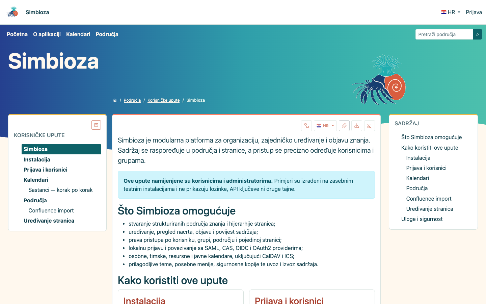

# Simbioza


[Engleska verzija](README.md)

> Znanje koje živi zajedno.

Simbioza je otvorena aplikacija za vlastiti poslužitelj: **hibrid wikija i
CMS-a** za izgradnju baze znanja koju je lako održavati i koristiti. Wiki
olakšava stvaranje i povezivanje informacija, a CMS daje strukturu, izgled i
kontrolu nad objavljenim sadržajem. Simbioza spaja oboje u jednu aplikaciju za
internu dokumentaciju, postupke, korisničke upute, projektno znanje i javne
informacijske stranice. Instalacija i podaci ostaju pod vašom kontrolom.

## Cjelovita aplikacija uz modularnu prilagodljivost

Simbioza povezuje stranice i pretraživi timski Wiki, kalendare i sastanke,
ankete, zadatke, komentare, obavijesti i integracije u jednom okruženju.
**Simbioza** znači zajednički život različitih organizama: ovdje se različiti
moduli međusobno nadopunjuju unutar iste aplikacije.

Za one kojima treba manje funkcionalnosti, modularnost HeartPhrame frameworka
omogućuje i užu instalaciju HTML weba, Kalendara, Wikija ili Anketa. Installer
uključuje odabrane module i njihove nužne ovisnosti. Svaka instalacija dijeli
Auth, ORM, Menu, Theme, Backup i Audit; API i pristupačnost mogu se uključiti
prema potrebi. Uže instalacije mogu se kombinirati ili kasnije proširiti uz
zadržavanje postojećeg sadržaja.

Vidi [mogućnosti modularne instalacije](docs/modularity_hr.md). Uz Wiki, upute
ostaju u području Korisničke upute; bez Wikija isti HTML priručnik s navigacijom
po poglavljima dostupan je preko stavke **Upute**.

**Isprobajte Simbiozu:** Posjetite [javni demo](https://piko.webhop.me/demo/),
istražite aplikaciju i isprobajte je s objavljenim demo računima. Promjene na
demu poništavaju se svakih pet sati.



*Javno područje Korisničke upute sa stablom stranica, člankom i kazalom.*

## Izgrađeno na HeartPhrameu

Simbioza je izgrađena na [HeartPhrame Frameworku](https://gitlab.opencode.hr/srce/aai-eduhr/heartphrame),
laganom, modularnom PHP frameworku. Uz razvoj Simbioze nastao je i skup
višekratno upotrebljivih modula za HeartPhrame: za upravljanje sadržajem,
autentikaciju, API-je, kalendare, zadatke, obavijesti i druge mogućnosti.
Moduli se održavaju zasebno i mogu se koristiti u drugim HeartPhrame
aplikacijama uz svoje obavezne ovisnosti. Simbioza ih povezuje u jedan
wiki/CMS. Pogledajte [matricu ovisnosti modula](docs/module-dependencies_hr.md)
i [autore i zasluge za framework](AUTHORS_hr.md).

## Opcionalni uvoz iz Confluencea

Želite preseliti bazu znanja na vlastiti poslužitelj? Opcionalni modul
**Confluence Import** uvozi Confluence XML ZIP izvoz u područje Simbioze,
uz očuvanje stabla stranica, internih poveznica, aktualnih privitaka i podržanih
makroa. Prije pokretanja pregledajte mapiranje identiteta i ovlasti; povijest
stranica i privitaka uvozi se samo ako je izričito odaberete. Izvješće uvoza
navodi nepodržane makroe i datoteke koje zahtijevaju provjeru.

U kratkom videu pogledajte izvoz, uvoz i rezultat, uz naraciju na britanskom
engleskom i engleske titlove. Confluenceov makro za kazalo ne prenosi se kao
zaseban blok: Simbioza već ima ugrađeno kazalo stranice.

https://github.com/user-attachments/assets/528b8ac8-5298-460a-b06f-2aeb4ac636d2

[Isprobajte demo prijelaza](https://piko.webhop.me/demo/workspace/simbioza-demo/confluence-import?lang=hr)
ili pročitajte [uputu za Confluence uvoz](https://piko.webhop.me/demo/workspace/korisnicke-upute/confluence-import?lang=hr).

## Znanje ima svoje mjesto

Sadržaj organizirajte u **područja**: svako može imati vlastitu adresu, stablo
stranica, članove, ovlasti, navigaciju i vizualni identitet. Timovi mogu raditi
u zajedničkom području, dok ograničena i osobna područja čuvaju ostale
materijale za one kojima su namijenjeni. Stranice, poveznice, putanja kroz
sadržaj i pretraživanje područja pomažu čitateljima snaći se i u velikoj bazi
znanja.

Autori mogu pripremiti nacrt, zatražiti pregled i objaviti sadržaj kada je
spreman. Čitatelji i dalje vide posljednju objavljenu verziju dok nastaju
izmjene. Uređivanje i objavljivanje uređuju uloge i naslijeđene ovlasti, uz
mogućnost ograničenja pojedinih stranica. Datoteke su uz stranice kojima
pripadaju; vidljivo je tko ih je i kada učitao te koja je inačica aktualna,
dok ovlašteni urednici mogu pregledati i preuzeti starije inačice.

## Više od običnog teksta

Cjeloviti vizualni **HTML editor** podržava oblikovanje sadržaja, slike,
multimediju, tablice s opcionalnim sortiranjem i paginacijom te inačice dokumenata. Ima i napredne dinamičke elemente:
uključivanje sadržaja druge stranice, grafikone, vremenske crte te sadržaj
organiziran u kartice (tabove), harmonike, kartične blokove i padajuće blokove. Uz
odgovarajuće module u stranice se mogu umetnuti i živi kalendari, zadaci te
pretraživanje i tablice stranica vezane uz područje. Sve se uređuje na jednom
mjestu i poštuje iste ovlasti i pravila objavljivanja kao ostatak stranice.

Simbioza je **višejezična** u sučelju i sadržaju. Stranica može imati zasebne
inačice i stanja objave po jeziku; čitatelj bira jezik, a podesivi pričuvni
jezik pomaže kada prijevod još ne postoji. Novi jezik sučelja može se dodati
objedinjenim jezičnim paketom, bez zasebnog mijenjanja svakog modula.

## Prilagodite je sebi, bez razbijanja cjeline

Prilagodite temu, svijetli i tamni prikaz, zaglavlje i izbornike cijele
aplikacije. Upravitelj područja može svojem području dati zasebnu temu te
posebne gornje ili bočne izbornike, bez promjene ostatka sustava. Vidljivost
stabla stranica i kazala također se može prilagoditi vrsti građe.
Navigacija, ovlasti, editor, pretraživanje i obavijesti pritom rade kao jedna
cjelina, a ne kao skup nepovezanih alata.

Ispod jedinstvenog sučelja Simbioza je modularna. Instalirajte ono što je
potrebno, a opcionalne mogućnosti dodajte poslije:

- **Sadržaj i pronalaženje:** Workspace (područja), Workspace Search, HTML
  Editor, Survey, Task i Comment.
- **Korisnici i komunikacija:** Auth, Simbioza User, Notification i E-mail.
- **Izgled i planiranje:** Menu, Theme i Calendar.
- **Integracija i održavanje:** API, Audit, Backup i ORM.

Primjerice, zahtjev za pregled može obavijestiti objavljivače u aplikaciji i,
ako je uključen E-mail, poštom; Backup može obuhvatiti podatke
instaliranih modula; a API izlaže dopušteni sadržaj uz iste provjere ovlasti.
Opcionalni Confluence importer može prenijeti postojeće stranice i privitke u
područja. Moduli proširuju istu aplikaciju, ali svaka instalacija ne mora
koristiti baš sve mogućnosti.

Počnite s [uputom za instalaciju](docs/installation_hr.md) ili pregledajte
[dokumentaciju](docs/index_hr.md). Sučelje i upute dostupni su i na
[engleskom](README.md).

## Instalirajte i održavajte

Odaberite jedan cjelovit postupak: [Apache mod_php](docs/installation_mod_php_hr.md), [obični PHP-FPM](docs/installation_fpm_hr.md) ili [secured PHP-FPM](docs/installation_fpm_secured_hr.md). [Docker](docs/docker_hr.md) dodatni je način postavljanja s trajnim volumenima za runtime podatke i bazu.

Svaka Simbioza uključuje **Auth, ORM, Menu, Theme, Backup i Audit**. Installer dodaje nužne ovisnosti opcionalnih mogućnosti koje odaberete. Korijenski produkcijski Composer manifest sadrži obavezni temelj; [katalog i matrica ovisnosti](docs/module-dependencies_hr.md) opisuju opcionalne pakete i njihove kompatibilne verzije. Ti predlošci Simbioze razlikuju se od provjere pojedinačnog višekratno upotrebljivog modula u minimalnoj HeartPhrame aplikaciji.

Najmanja verzija PHP-a je **8.2**. Koristite Composer 2 i PHP ekstenzije potrebne odabranim modulima i bazi. Ovisnost o Frameworku ostaje `aaieduhr/heartphrame-framework:^0.0.25`; njegov se izvor održava uzvodno. [Konfiguracija](docs/configuration_hr.md) opisuje privatne putanje i postavke. Web-poslužitelj smije izlagati samo `public/`.

Klasičnu instalaciju nadograđujte dokumentiranim računom vlasnika koda/deploya iz direktorija aplikacije:

```bash
php update.php --check --lang=hr
php update.php --lang=hr
```

Ispravno podešena secured FPM instalacija podržava i GUI nadogradnju. Obični FPM sam po sebi ne daje tu mogućnost. Docker se nadograđuje zamjenom verzioniranog imagea i izričitom primjenom migracija. Prije održavanja kopirajte podatke aplikacije te potrebnu privatnu i poslužiteljsku konfiguraciju. [Rješavanje problema i održavanje](docs/troubleshooting_hr.md) opisuje odgovarajuće logove i provjere.

Podržana linija aplikacije je 0.3.x. Site s verzijom 0.2.x zahtijeva novu instalaciju; njegov stari Simbioza backup nije put nadogradnje. Redovne 0.3.x nadogradnje čuvaju odabrane opcionalne module, sadržaj i postavke. Novi opcionalni modul postaje dostupan za izričitu instalaciju.

Aktualna kontejnerska slika je `ghcr.io/kmihalj/simbioza:0.3.47`. Trajne podatke i tajne podesite prema [Docker uputi](docs/docker_hr.md), a prije nadogradnje pregledajte [izdanje 0.3.47](docs/release-0.3.47_hr.md).

## Koristite module u vlastitoj aplikaciji

Moduli se mogu koristiti i u drugim HeartPhrame projektima. Za spremanje oblikovanog HTML-a u polju forme koristite **komponentni način** editora: otvorite njegov modal iz tekstualnog polja, primijenite uređenu vrijednost i spremite je svojim obrađivačem forme. Polje ne morate pretvoriti u Wiki stranicu. [Uputa za integraciju polja](docs/html-editor-forms_hr.md) vodi do cjelovitog primjera kontrolera, predloška i JavaScripta, sa sanitizacijom i CSRF obradom.

Za vanjsko povezivanje koristite [API ugovor](docs/api-v1-contract_hr.md). Ključ ograničava radnje i ne zaobilazi prava svojeg vlasnika na sadržaj. Za rute i opsege pojedinih uključenih modula pogledajte njihovu dokumentaciju.

## Dokumentacija

- [Glavni indeks](docs/index_hr.md): upute prema potrebama korisnika, administratora i razvojnih programera.
- [Korisničke upute s Wikijem i bez njega](docs/bundled-manual_hr.md): isti je priručnik u području Korisničke upute ili kroz stavku **Upute**.
- [Modularnost i naknadno dodavanje Područja HTML webu](docs/modularity_hr.md).
- [Svih 26 tema](docs/theme-gallery_hr.md), [uvoz kolekcije](docs/theme-collection_hr.md) i [osobni izgled](docs/personal-appearance_hr.md).
- [Konfiguracija](docs/configuration_hr.md), [jezici](docs/localization_hr.md), [pohrana područja](docs/workspace-data_hr.md) i [logovi](docs/logging_hr.md).
- [Povijest izdanja](docs/releases_hr.md). Povijesne promjene odvojene su od aktualnih uputa za korištenje.

## Razvojne provjere

Produkcijske ovisnosti ne sadrže QA alate. U izoliranoj razvojnoj kopiji pripremite QA manifest i pokrenite provjere:

```bash
php scripts/build_ci_composer.php
COMPOSER=composer.ci.json composer update --with-all-dependencies
COMPOSER=composer.ci.json composer on-commit
npm ci
php scripts/run_e2e.php --local --keep
```

E2E omotač priprema izdvojenu instalaciju i ovisnosti preglednika. Podržane opcije i baze opisane su u [E2E provjerama](docs/end-to-end-testing_hr.md). Opcija `build_ci_composer.php --local` provjerava susjedne module bez njihove objave; `HPH_LOCAL_MODULE_ROOT` određuje njihov nadređeni direktorij. Framework se ne mijenja.

Izvor istine za ovisnosti jesu zahtjevi Composer paketa i JavaScript lock datoteka. Nemojte preuzimati fiksne verzije iz starih bilježaka izdanja. Privatna konfiguracija, runtime podatci i generirani izvještaji ne spremaju se u Git. [Provjere dokumentacije](docs/documentation-quality_hr.md) obuhvaćaju jezične parove, poveznice i primjere.
