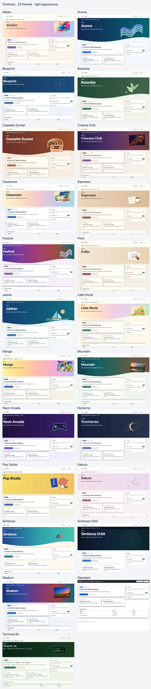
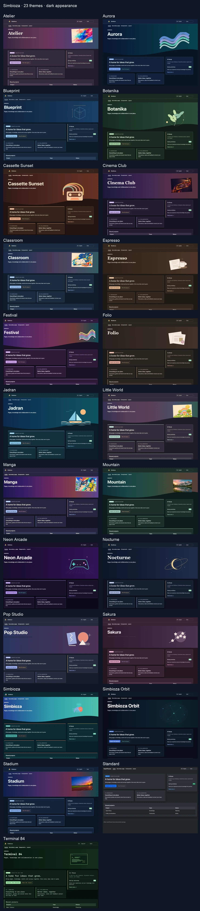

# Simbioza – Wissen, Inhalte und Zusammenarbeit an einem Ort

> Die Bildschirmaufnahmen zeigen die englische Benutzeroberfläche.

Simbioza vereint das Veröffentlichen von Seiten, Teamwissen im Wiki, die Planung von Terminen und Besprechungen, Umfragen sowie die Zusammenarbeit mit Aufgaben, Kommentaren und Benachrichtigungen. Alle Werkzeuge nutzen dieselbe Navigation, Benutzer- und Gruppenberechtigungen, Darstellung, Sicherung und Aktivitätsprotokollierung.

**Simbioza** bedeutet auf Kroatisch **Symbiose**, das Zusammenleben verschiedener Organismen. Der Name beschreibt, wie sich die Werkzeuge ergänzen: Inhalte, Wissen, Termine, Umfragen und Zusammenarbeit bilden eine gemeinsame Anwendung auf dem modularen HeartPhrame-Framework.

## Die Werkzeuge der vollständigen Simbioza-Installation

- **Seiten und ein Wiki:** Inhalte veröffentlichen, in Arbeitsbereichen organisieren, Seiten verbinden und nach Teamwissen suchen.
- **Kalender und Besprechungen:** Planen Sie Veranstaltungen, verwalten Sie gemeinsame Ressourcen und verbinden Sie Kalender-Clients über CalDAV.
- **Umfragen:** Erstellen Sie mehrsprachige Fragen und Verzweigungen, wählen Sie Zielgruppen aus, sammeln Sie Antworten und überprüfen Sie die Ergebnisse.
- **Zusammenarbeit:** Verknüpfen Sie Aufgaben, Kommentare und Benachrichtigungen mit den Inhalten, die Ihr Team verwendet.
- **Verwaltung und Integrationen:** Verwalten Sie Zugriff, Darstellung, Backups, Aktivitätsprotokolle und API Verbindungen in derselben Umgebung.

Der Zugriff auf Inhalte hängt von Benutzer- und Gruppenberechtigungen ab. Verschiedene Tools arbeiten zusammen, während private Inhalte geschützt bleiben.

## Wenn Sie einen kleineren Funktionsumfang benötigen

Das modulare HeartPhrame-Framework ermöglicht auch eine gezielte Simbioza-Installation für diejenigen, die nicht die vollständige Anwendung benötigen. Dies sind optionale Bereitstellungsoptionen:

| Ihr Bedarf | Auszuwählende Module | Ergebnis |
| --- | --- | --- |
| Eine HTML-Website | HTML Editor | Bearbeiten und Veröffentlichen von Seiten mit Text, Bildern und Videos. |
| Ein Kalender | Calendar | Veranstaltungen, Meetings und Kalender-Client-Verbindungen über CalDAV. |
| Ein Wiki | Workspace, Workspace Search und Simbioza User | Wissensbereiche, verbundene Seiten, Such- und Teamberechtigungen. |
| Umfragen | Survey | Mehrsprachige Umfragen, bedingte Fragen, Zielgruppen, Antworten und Ergebnisse. |

Das Installationsprogramm berücksichtigt die erforderlichen Abhängigkeiten der gewählten Module. Jede Installation baut auf **Auth, ORM, Menu, Theme, Backup und Audit** auf. API und Barrierefreiheit können bei Bedarf ergänzt werden.

Auch Kombinationen wie eine Website mit einem Kalender oder ein Wiki mit Umfragen sind möglich. Eine fokussierte Installation kann später um weitere Module erweitert werden, bis hin zum kompletten Simbioza, unter Beibehaltung vorhandener Inhalte.

Wenn Arbeitsbereiche zu einer bestehenden HTML-Website hinzugefügt werden, funktionieren deren Seiten zunächst eigenständig weiter. Ein Administrator kann sie unter **Einstellungen des HTML-Editors** ausdrücklich in einen Arbeitsbereich verschieben, einschließlich Übersetzungen, Verlauf und Anhängen. Danach gelten die Berechtigungen des Zielarbeitsbereichs.

## Der Einstieg

- **Anwendung installieren oder warten?** Wählen Sie unter [Installation](installation_de.md) die Bereitstellungsmethode und das modulare Profil aus. Es umfasst auch spätere Erweiterungs- und GUI-Updates für korrekt konfiguriertes gesichertes FPM oder CLI-Updates für andere klassische Installationen.
- **Seiten oder ein Wiki bearbeiten?** Öffnen Sie [Arbeitsbereiche](/workspace/korisnicke-upute/podrucja?lang=en) und [Inhalt bearbeiten](/workspace/korisnicke-upute/uredivanje-stranica?lang=en).
- **Kalender verwalten?** Öffnen Sie [Kalender](/workspace/korisnicke-upute/kalendari?lang=en).
- **Eine Umfrage erstellen oder abschließen?** Öffnen Sie [Umfragen](/workspace/korisnicke-upute/ankete?lang=en); für Befragte, Autoren, Administratoren und Entwickler stehen separate Anleitungen zur Verfügung.

Wenn das Wiki installiert ist, erscheinen diese Anleitungen als Seiten im Arbeitsbereich **Benutzeranleitungen**. Ohne Wiki stehen dieselben Inhalte unter **Anleitungen** mit einer Kapitelnavigation zur Verfügung. Angeboten werden nur Sprachen, die in der Anwendung installiert und aktiviert sind.

HeartPhrame und seine Module können auch als Grundlage einer eigenen Anwendung dienen. Nutzen Sie die vorhandenen Funktionen für Anmeldung, Datenzugriff, Navigation, Darstellung und API, anstatt alles neu zu entwickeln.

## Ein Erscheinungsbild für Ihre Gemeinschaft

Simbioza enthält **26 vorgefertigte Designs**, jedes mit hellem und dunklem Erscheinungsbild. Wählen Sie eines unter **Einstellungen → Design → Aktives Design** aus. Passen Sie Farben, Bilder, Höhe des Hero-Bereichs, Karten, Schatten, Navigation und Typografie an. Durch die Auswahl eines Designs werden weder Inhalte noch Berechtigungen geändert.

Ab Version 0.3.36 werden durch Upgrades einmalig fehlende gebündelte Designs hinzugefügt. Bestehende Designs und die aktive Auswahl bleiben erhalten. Das Löschen eines zusätzlichen Designs verhindert, dass es bei späteren Upgrades wiederhergestellt wird. Der Importbeleg wird in der Design-Konfiguration gespeichert und in die Site-Sicherung/Wiederherstellung einbezogen. Sie können ein Design weiterhin manuell aus seinem ZIP erneut importieren.

[Laden Sie die ZIP-Sammlung aller 26 Designs herunter](https://github.com/kmihalj/Simbioza/releases/download/0.3.40/Simbioza-0.3.40-themes.zip)

Extrahieren Sie die Sammlung und wählen Sie dann unter **Komplettes Design importieren** ein einzelnes ZIP aus `themes/` aus. Die Sammlung enthält auch eine Galerie, die offline geöffnet werden kann. Laden Sie nicht die gesamte Sammlung als einzelnes Design hoch.

[Zum Vergrößern klicken: Alle Designs – helles Erscheinungsbild](images/theme-gallery/overview-light-en.webp)

[Zum Vergrößern klicken: Alle Designs – dunkles Erscheinungsbild](images/theme-gallery/overview-dark-en.webp)

