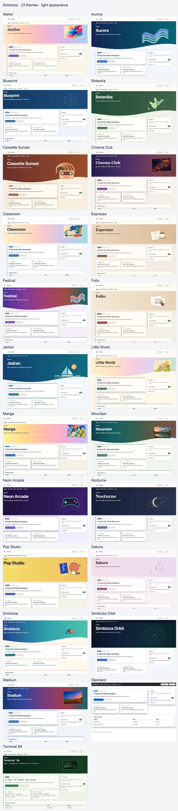
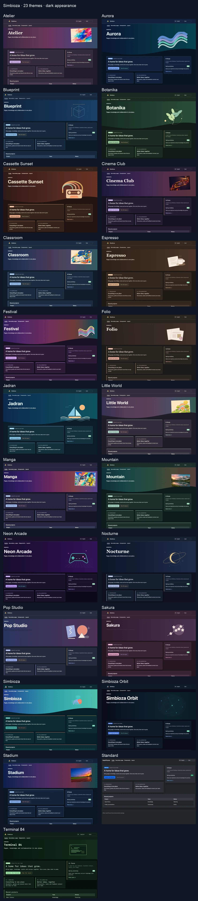

# Simbioza — knowledge, content and collaboration in one place

Simbioza is a complete environment for publishing pages, organizing team knowledge in a Wiki, planning events and meetings, collecting survey responses and collaborating through tasks, comments and notifications. Its tools share navigation, user and group permissions, appearance, backups and activity logs.

**Simbioza** is Croatian for **symbiosis**, the shared life of different organisms. The name expresses how its tools complement one another: content, knowledge, events, surveys and collaboration work together in one application built on the modular HeartPhrame framework.

## Connected tools in the complete Simbioza

- **Pages and a Wiki:** publish content, organize it into Workspaces, connect pages and search team knowledge.
- **Calendars and meetings:** plan events, manage shared resources and connect calendar clients through CalDAV.
- **Surveys:** create multilingual questions and branching, choose audiences, collect responses and review results.
- **Collaboration:** connect tasks, comments and notifications to the content your team uses.
- **Administration and integrations:** manage access, appearance, backups, activity logs and API connections in the same environment.

Access to content depends on user and group permissions. Different tools work together while private content remains protected.

## An additional option when you need fewer features

The modular HeartPhrame framework also allows a focused Simbioza installation for those who do not need the complete application. These are optional deployment choices:

| Your specific need | Modules to select | What you get |
| --- | --- | --- |
| An HTML website | HTML Editor | Editing and publishing pages with text, images and video. |
| A calendar | Calendar | Events, meetings and calendar-client connections through CalDAV. |
| A Wiki | Workspace, Workspace Search and Simbioza User | Knowledge areas, connected pages, search and team permissions. |
| Surveys | Survey | Multilingual surveys, conditional questions, audiences, responses and results. |

The installer includes the selected modules' required dependencies. Every installation has **Auth, ORM, Menu, Theme, Backup and Audit** as its foundation. API and accessibility can be included as needed.

Combinations such as a website with a calendar or a Wiki with surveys are also possible. A focused installation can later be extended with more modules, up to the complete Simbioza, while retaining existing content.

When adding Workspaces to an existing HTML website, its pages keep working independently. An administrator can explicitly move them into a Workspace from **HTML editor settings**, together with translations, history and attachments. The destination’s permissions then apply.

## Where to start

- **Installing or maintaining the application?** In [Installation](installation_en.md), choose the deployment method and modular profile. It also covers later expansion and GUI updates for correctly configured secured FPM, or CLI updates for other classic installations.
- **Editing pages or a Wiki?** Open [Workspaces](/workspace/korisnicke-upute/podrucja?lang=en) and [Editing content](/workspace/korisnicke-upute/uredivanje-stranica?lang=en).
- **Managing a calendar?** Open [Calendars](/workspace/korisnicke-upute/kalendari?lang=en).
- **Creating or completing a survey?** Open [Surveys](/workspace/korisnicke-upute/ankete?lang=en); separate guidance is available for respondents, authors, administrators and developers.

With Wiki installed, these guides are pages in the **User guides** Workspace. Without Wiki, the same content is available from **Guides**, with chapter navigation. Only languages installed and enabled in the application are offered.

HeartPhrame and its modules can also provide the foundation for a custom application: reuse authentication, data access, navigation, appearance and the API instead of rebuilding everything from scratch.

## A look for your community

Simbioza includes **26 ready-made themes**, each with light and dark appearances. Select one under **Settings → Theme → Active theme**. Customize colours, images, hero height, cards, shadows, navigation and typography. Choosing a theme does not change content or permissions.

Starting with release 0.3.36, upgrades add missing bundled themes once. Existing themes and the active selection are preserved. Deleting an additional theme prevents later upgrades from restoring it. The import receipt is stored in Theme configuration and included in site backup/restore. You can still reimport a theme manually from its ZIP.

[Download the ZIP collection of all 26 themes](https://github.com/kmihalj/Simbioza/releases/download/0.3.42/Simbioza-0.3.42-themes.zip)

Extract the collection, then select an individual ZIP from `themes/` in **Import complete theme**. The collection also contains a gallery that opens offline. Do not upload the whole collection as a single theme.

[Click to enlarge: All themes — light appearance](images/theme-gallery/overview-light-en.webp)

[Click to enlarge: All themes — dark appearance](images/theme-gallery/overview-dark-en.webp)

