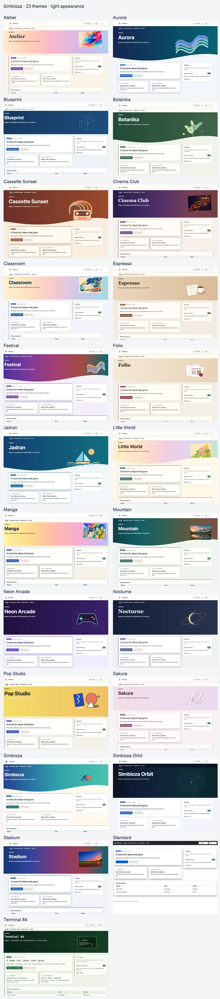
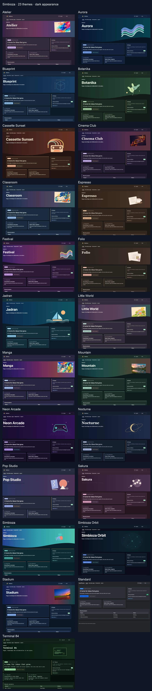

# Simbioza: conocimiento, contenidos y colaboración en un solo lugar

> Las capturas de pantalla muestran la interfaz en inglés.

Simbioza es un entorno completo para publicar páginas, organizar el conocimiento del equipo en un Wiki, planificar eventos y reuniones, recopilar respuestas a encuestas y colaborar a través de tareas, comentarios y notificaciones. Sus herramientas comparten navegación, permisos de usuarios y grupos, apariencia, copias de seguridad y registros de actividad.

**Simbioza** en croata significa **simbiosis**, la vida compartida de diferentes organismos. El nombre expresa cómo sus herramientas se complementan entre sí: contenido, conocimiento, eventos, encuestas y colaboración trabajan juntos en una aplicación construida sobre el marco modular HeartPhrame.

## Herramientas conectadas en el Simbioza completo

- **Páginas y un Wiki:** publique contenido, organícelo en espacios de trabajo, conecte páginas y busque el conocimiento del equipo.
- **Calendarios y reuniones:** planifique eventos, administre recursos compartidos y conecte clientes de calendario a través de CalDAV.
- **Encuestas:** cree preguntas multilingües y ramifique, elija audiencias, recopile respuestas y revise resultados.
- **Colaboración:** conecta tareas, comentarios y notificaciones con el contenido que utiliza su equipo.
- **Administración e integraciones:** gestiona el acceso, la apariencia, las copias de seguridad, los registros de actividad y las conexiones API en el mismo entorno.

El acceso al contenido depende de los permisos del usuario y del grupo. Diferentes herramientas funcionan juntas mientras el contenido privado permanece protegido.

## Una opción adicional cuando necesitas menos funciones

El marco modular HeartPhrame también permite una instalación Simbioza enfocada para aquellos que no necesitan la aplicación completa. Estas son opciones de implementación opcionales:

| Tu necesidad específica | Módulos para seleccionar | lo que obtiene |
| --- | --- | --- |
| Un sitio web HTML | HTML Editor | Edición y publicación de páginas con texto, imágenes y vídeo. |
| un calendario | Calendar | Eventos, reuniones y conexiones calendario-cliente a través de CalDAV. |
| Una wiki | Workspace, Workspace Search y Simbioza User | Áreas de conocimiento, páginas conectadas, búsqueda y permisos de equipo. |
| Encuestas | Survey | Encuestas multilingües, preguntas condicionales, audiencias, respuestas y resultados. |

El instalador incluye las dependencias necesarias de los módulos seleccionados. Todas las instalaciones tienen **Auth, ORM, Menu, Theme, Backup y Audit** como base. Se pueden añadir API y accesibilidad según sea necesario.

También son posibles combinaciones como un sitio web con un calendario o un Wiki con encuestas. Una instalación enfocada se puede ampliar posteriormente con más módulos, hasta el Simbioza completo, conservando el contenido existente.

Al agregar espacios de trabajo a un sitio web HTML existente, sus páginas siguen funcionando de forma independiente. Un administrador puede moverlos explícitamente a un espacio de trabajo desde **HTML configuración del editor**, junto con las traducciones, el historial y los archivos adjuntos. Entonces se aplican los permisos del destino.

## Por donde empezar

- **¿Instalar o mantener la aplicación?** En [Instalación](installation_es.md), elija el método de implementación y el perfil modular. También cubre expansiones posteriores y actualizaciones de GUI para FPM seguro configurado correctamente, o actualizaciones CLI para otras instalaciones clásicas.
- **¿Editar páginas o un Wiki?** Abra [Espacios de trabajo](/workspace/korisnicke-upute/podrucja?lang=en) y [Editar contenido](/workspace/korisnicke-upute/uredivanje-stranica?lang=en).
- **¿Administrando un calendario?** Abra [Calendarios](/workspace/korisnicke-upute/kalendari?lang=en).
- **¿Creando o completando una encuesta?** Abra [Encuestas](/workspace/korisnicke-upute/ankete?lang=en); Hay guías separadas disponibles para encuestados, autores, administradores y desarrolladores.

Con Wiki instalado, estas guías son páginas en el espacio de trabajo **Guías de usuario**. Sin Wiki, el mismo contenido está disponible en **Guías**, con navegación por capítulos. Sólo se ofrecen los idiomas instalados y habilitados en la aplicación.

HeartPhrame y sus módulos también pueden proporcionar la base para una aplicación personalizada: reutilizar autenticación, acceso a datos, navegación, apariencia y API en lugar de reconstruir todo desde cero.

## Una mirada para su comunidad

Simbioza incluye **26 temas ya preparados**, cada uno con apariencias claras y oscuras. Seleccione uno en **Configuración → Tema → Tema activo**. Personalice colores, imágenes, altura del elemento principal, tarjetas, sombras, navegación y tipografía. Elegir un tema no cambia el contenido ni los permisos.

A partir de la versión 0.3.36, las actualizaciones agregan los temas incluidos que faltan una vez. Se conservan los temas existentes y la selección activa. Eliminar un tema adicional evita que actualizaciones posteriores lo restauren. El recibo de importación se almacena en la configuración del tema y se incluye en la copia de seguridad/restauración del sitio. Aún puede volver a importar un tema manualmente desde su ZIP.

[Descargue la colección ZIP de los 26 temas](https://github.com/kmihalj/Simbioza/releases/download/0.3.42/Simbioza-0.3.42-themes.zip)

Extraiga la colección, luego seleccione un ZIP individual de `themes/` en **Importar tema completo**. La colección también contiene una galería que se abre sin conexión. No subas toda la colección como un solo tema.

[Haga clic para ampliar: Todos los temas: apariencia clara](images/theme-gallery/overview-light-en.webp)

[Haga clic para ampliar: Todos los temas: apariencia oscura](images/theme-gallery/overview-dark-en.webp)

