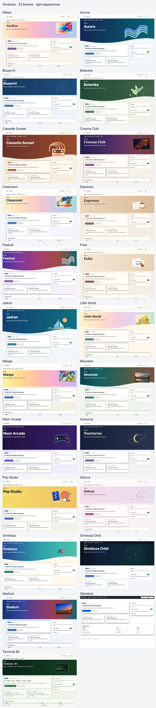
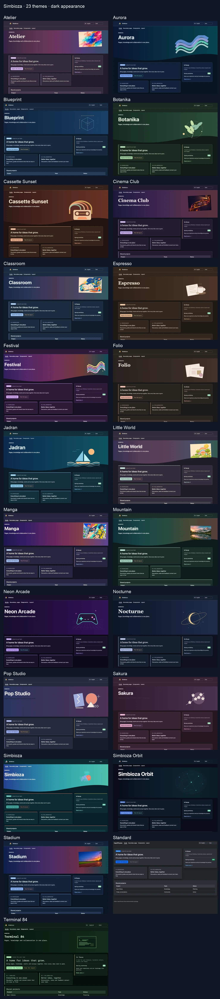

# Simbioza — connaissances, contenu et collaboration réunis

> Les captures d’écran présentent l’interface en anglais.

Simbioza est un environnement complet pour publier des pages, organiser les connaissances d’une équipe dans un wiki, planifier des événements et des réunions, recueillir les réponses à des sondages et collaborer au moyen de tâches, de commentaires et de notifications. Ses outils partagent la navigation, les droits des utilisateurs et des groupes, l’apparence, les sauvegardes et les journaux d’activité.

**Simbioza** signifie **symbiose** en croate : la vie en commun d’organismes différents. Ce nom exprime la complémentarité de ses outils : contenu, connaissances, événements, sondages et collaboration se réunissent dans une application construite sur le framework modulaire HeartPhrame.

## Des outils reliés dans la version complète de Simbioza

- **Pages et wiki :** publiez du contenu, organisez-le en espaces de travail, reliez les pages et effectuez des recherches dans les connaissances de l’équipe.
- **Calendriers et réunions :** planifiez des événements, gérez les ressources partagées et connectez des applications de calendrier par CalDAV.
- **Sondages :** créez des questions multilingues et des parcours conditionnels, choisissez le public, recueillez les réponses et consultez les résultats.
- **Collaboration :** associez des tâches, des commentaires et des notifications au contenu utilisé par votre équipe.
- **Administration et intégrations :** gérez les accès, l’apparence, les sauvegardes, les journaux d’activité et les connexions API dans le même environnement.

L’accès au contenu dépend des droits des utilisateurs et des groupes. Les différents outils fonctionnent ensemble tout en protégeant le contenu privé.

## Une option supplémentaire lorsque vous avez besoin de moins de fonctions

Le framework modulaire HeartPhrame permet également une installation ciblée de Simbioza pour les personnes qui n’ont pas besoin de l’application complète. Ces choix de déploiement sont facultatifs :

| Votre besoin précis | Modules à sélectionner | Ce que vous obtenez |
| --- | --- | --- |
| Un site HTML | HTML Editor | Modification et publication de pages contenant du texte, des images et des vidéos. |
| Un calendrier | Calendar | Événements, réunions et connexions aux applications de calendrier par CalDAV. |
| Un wiki | Workspace, Workspace Search et Simbioza User | Espaces de connaissances, pages reliées, recherche et droits d’équipe. |
| Des sondages | Survey | Sondages multilingues, questions conditionnelles, publics, réponses et résultats. |

Le programme d’installation inclut les dépendances nécessaires aux modules sélectionnés. Chaque installation repose sur **Auth, ORM, Menu, Theme, Backup et Audit**. L’API et l’accessibilité peuvent être ajoutées selon les besoins.

Il est aussi possible de combiner un site avec un calendrier ou un wiki avec des sondages, par exemple. Une installation ciblée peut ensuite recevoir d’autres modules, jusqu’à constituer la version complète de Simbioza, tout en conservant le contenu existant.

Lors de l’ajout des espaces de travail à un site HTML existant, ses pages continuent à fonctionner de manière autonome. Un administrateur peut les déplacer explicitement dans un espace de travail depuis les **Paramètres de l’éditeur HTML**, avec leurs traductions, leur historique et leurs pièces jointes. Les droits de l’espace de destination s’appliquent alors.

## Par où commencer

- **Vous installez ou entretenez l’application ?** Dans [Installation](installation_fr.md), choisissez la méthode de déploiement et le profil modulaire. Ce guide présente également l’ajout ultérieur de fonctions et les mises à jour depuis l’interface pour une installation FPM sécurisée correctement configurée, ou en ligne de commande pour les autres installations classiques.
- **Vous modifiez des pages ou un wiki ?** Ouvrez [Espaces de travail](/workspace/korisnicke-upute/podrucja?lang=en) et [Modification du contenu](/workspace/korisnicke-upute/uredivanje-stranica?lang=en).
- **Vous gérez un calendrier ?** Ouvrez [Calendriers](/workspace/korisnicke-upute/kalendari?lang=en).
- **Vous créez un sondage ou souhaitez y répondre ?** Ouvrez [Sondages](/workspace/korisnicke-upute/ankete?lang=en) ; des guides distincts sont disponibles pour les participants, les auteurs, les administrateurs et les développeurs.

Lorsque le wiki est installé, ces guides sont des pages de l’espace de travail **Guides d’utilisation**. Sans wiki, le même contenu est disponible depuis **Guides**, avec une navigation par chapitre. Seules les langues installées et activées dans l’application sont proposées.

HeartPhrame et ses modules peuvent également servir de base à une application sur mesure : réutilisez l’authentification, l’accès aux données, la navigation, l’apparence et l’API au lieu de tout reconstruire.

## Une apparence pour votre communauté

Simbioza comprend **26 thèmes prêts à l’emploi**, chacun avec une apparence claire et sombre. Sélectionnez-en un dans **Paramètres → Thème → Thème actif**. Personnalisez les couleurs, les images, la hauteur du bandeau principal, les cartes, les ombres, la navigation et la typographie. Le choix d’un thème ne modifie ni le contenu ni les droits d’accès.

À partir de la version 0.3.36, les mises à niveau ajoutent une seule fois les thèmes fournis qui manquent. Les thèmes existants et la sélection active sont conservés. La suppression d’un thème supplémentaire empêche les mises à niveau ultérieures de le restaurer. Le reçu d’importation est conservé dans la configuration du module Theme et inclus dans la sauvegarde et la restauration du site. Vous pouvez toujours réimporter un thème manuellement à partir de son ZIP.

[Télécharger la collection ZIP des 26 thèmes](https://github.com/kmihalj/Simbioza/releases/download/0.3.43/Simbioza-0.3.43-themes.zip)

Extrayez la collection, puis sélectionnez un ZIP individuel dans `themes/`, sous **Importer un thème complet**. La collection contient également une galerie consultable hors connexion. Ne téléversez pas toute la collection comme un seul thème.

[Cliquer pour agrandir : tous les thèmes — apparence claire](images/theme-gallery/overview-light-en.webp)

[Cliquer pour agrandir : tous les thèmes — apparence sombre](images/theme-gallery/overview-dark-en.webp)

