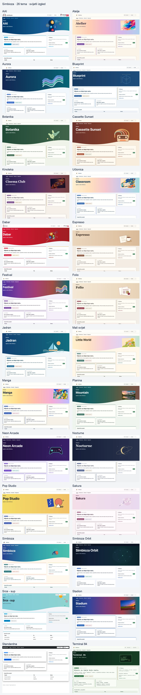
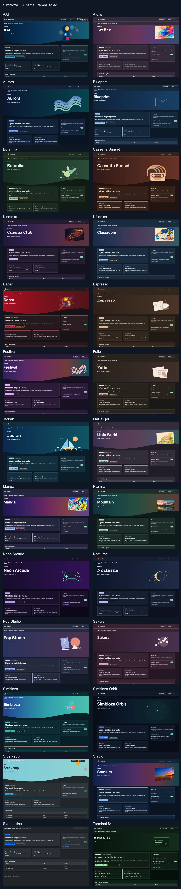

# Simbioza — znanje, sadržaj i suradnja na jednom mjestu

Simbioza je cjelovito okruženje za objavu stranica, organiziranje timskog znanja u Wikiju, planiranje događaja i sastanaka, prikupljanje odgovora na ankete te suradnju kroz zadatke, komentare i obavijesti. Njezini alati dijele navigaciju, ovlasti korisnika i grupa, izgled, sigurnosne kopije i dnevnike aktivnosti.

Riječ **simbioza** znači zajednički život različitih organizama. Naziv opisuje kako se alati međusobno nadopunjuju: sadržaj, znanje, događaji, ankete i suradnja rade zajedno u jednoj aplikaciji, izgrađenoj na modularnom HeartPhrame frameworku.

## Povezani alati cjelovite Simbioze

- **Stranice i Wiki:** objavite sadržaj, organizirajte ga u područja, povežite stranice i pretražujte timsko znanje.
- **Kalendari i sastanci:** planirajte događaje, upravljajte zajedničkim resursima i povežite kalendarske klijente putem CalDAV-a.
- **Ankete:** izradite višejezična pitanja i grananje, odaberite publiku, prikupite odgovore i pregledajte rezultate.
- **Suradnja:** povežite zadatke, komentare i obavijesti sa sadržajem kojim se tim koristi.
- **Administracija i integracije:** upravljajte pristupom, izgledom, sigurnosnim kopijama, dnevnicima i API vezama u istom okruženju.

Pristup sadržaju ovisi o ovlastima korisnika i grupa. Različiti alati rade zajedno, uz zaštitu privatnog sadržaja.

## Dodatna mogućnost kada trebate manje funkcionalnosti

Modularnost HeartPhrame frameworka omogućuje i užu instalaciju Simbioze za one kojima nije potrebna cijela aplikacija. To su dodatni načini korištenja:

| Vaša posebna potreba | Moduli koje odabirete | Što dobivate |
| --- | --- | --- |
| HTML web | HTML Editor | Uređivanje i objavu stranica s tekstom, slikama i videom. |
| Kalendar | Calendar | Događaje, sastanke i povezivanje kalendarskih klijenata putem CalDAV-a. |
| Wiki | Workspace, Workspace Search i Simbioza User | Područja, povezane stranice, pretraživanje i ovlasti za timsko znanje. |
| Ankete | Survey | Višejezične ankete, uvjetna pitanja, publiku, odgovore i rezultate. |

Installer uključuje nužne ovisnosti odabranih modula. Svaka instalacija ima zajedničku osnovu: **Auth, ORM, Menu, Theme, Backup i Audit**. API i pristupačnost mogu se uključiti prema potrebi.

Moguće su i kombinacije poput weba s kalendarom ili Wikija s anketama. Užu instalaciju možete kasnije proširiti dodatnim modulima, sve do cjelovite Simbioze, uz zadržavanje postojećeg sadržaja.

Kada postojećem HTML webu dodate Područja, njegove stranice nastavljaju raditi samostalno. Administrator ih iz **Postavki HTML editora** može izričito premjestiti u područje, zajedno s prijevodima, poviješću i privitcima. Tada vrijede prava odredišta.

## Gdje početi

- **Instalirate ili održavate aplikaciju?** U poglavlju [Instalacija](installation_hr.md) odaberite način instalacije i modularni profil. Tamo su opisani i kasnije proširenje te nadogradnja kroz GUI za pravilno podešen secured FPM, odnosno kroz CLI za ostale klasične instalacije.
- **Uređujete stranice ili Wiki?** Otvorite [Područja](/workspace/korisnicke-upute/podrucja?lang=hr) i [Uređivanje sadržaja](/workspace/korisnicke-upute/uredivanje-stranica?lang=hr).
- **Vodite kalendar?** Otvorite [Kalendari](/workspace/korisnicke-upute/kalendari?lang=hr).
- **Sastavljate ili ispunjavate anketu?** Otvorite [Ankete](/workspace/korisnicke-upute/ankete?lang=hr); upute su odvojene za ispitanike, autore, administratore i razvojne programere.

Ako je Wiki instaliran, ove su upute stranice u području **Korisničke upute**. Bez Wikija isti je sadržaj dostupan preko stavke **Upute**, s navigacijom po poglavljima. Prikazuju se samo jezici instalirani i aktivni u aplikaciji.

HeartPhrame i njegovi moduli mogu poslužiti i kao temelj prilagođene aplikacije: ponovno iskoristite prijavu, rad s podacima, navigaciju, izgled i API umjesto izrade svega od početka.

## Izgled po mjeri vaše zajednice

Simbioza uključuje **26 gotovih tema**, svaku sa svijetlim i tamnim izgledom. Odaberite temu u **Postavke → Tema → Aktivna tema**. Boje, slike, visinu hero elementa, kartice, sjene, navigaciju i tipografiju možete dodatno prilagoditi. Odabir teme ne mijenja sadržaj ni ovlasti.

Nadogradnja od izdanja 0.3.36 dodaje nedostajuće priložene teme samo jednom. Postojeće teme i aktivni odabir ostaju sačuvani. Nakon što izbrišete dodatnu temu, sljedeće je nadogradnje neće vratiti. Evidencija uvoza nalazi se u konfiguraciji Tema i uključena je u backup/restore sitea. Temu možete ponovno ručno uvesti iz ZIP-a.

[Preuzmi ZIP kolekciju svih 26 tema](https://github.com/kmihalj/Simbioza/releases/download/0.3.39/Simbioza-0.3.39-themes.zip)

Raspakirajte kolekciju, pa u obrascu **Uvezi cijelu temu** odaberite pojedinačni ZIP iz direktorija `themes/`. Kolekcija sadrži i galeriju koju možete otvoriti bez interneta. Nemojte cijelu kolekciju učitati kao jednu temu.

[Kliknite za povećanje: Sve teme — svijetli izgled](images/theme-gallery/overview-light-hr.webp)

[Kliknite za povećanje: Sve teme — tamni izgled](images/theme-gallery/overview-dark-hr.webp)

