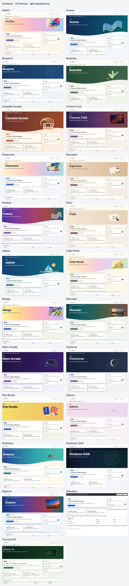
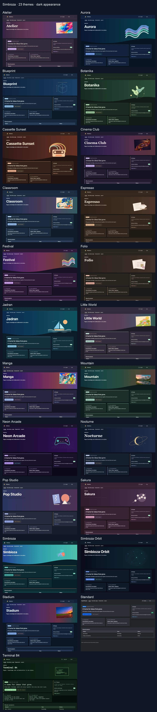

# Simbioza — conoscenza, contenuti e collaborazione in un unico luogo

> Le immagini mostrano l'interfaccia in inglese.

Simbioza è un ambiente completo per pubblicare pagine, organizzare le conoscenze del gruppo in una Wiki, pianificare eventi e riunioni, raccogliere risposte ai sondaggi e collaborare attraverso attività, commenti e notifiche. I suoi strumenti condividono navigazione, autorizzazioni di utenti e gruppi, aspetto, copie di sicurezza e registri delle attività.

**Simbioza** in croato significa **simbiosi**, la vita in comune di organismi diversi. Il nome esprime il modo in cui i suoi strumenti si completano: contenuti, conoscenze, eventi, sondaggi e collaborazione lavorano insieme in un'unica applicazione basata sul framework modulare HeartPhrame.

## Strumenti collegati nella versione completa di Simbioza

- **Pagine e Wiki:** pubblicare contenuti, organizzarli in aree di lavoro, collegare pagine e cercare le conoscenze del gruppo.
- **Calendari e riunioni:** pianificare eventi, gestire risorse condivise e collegare applicazioni di calendario tramite CalDAV.
- **Sondaggi:** creare domande multilingue e percorsi condizionali, scegliere i destinatari, raccogliere risposte e consultare i risultati.
- **Collaborazione:** collegare attività, commenti e notifiche ai contenuti utilizzati dal gruppo.
- **Amministrazione e integrazioni:** gestire accessi, aspetto, copie di sicurezza, registri delle attività e collegamenti API nello stesso ambiente.

L'accesso ai contenuti dipende dalle autorizzazioni di utenti e gruppi. I diversi strumenti lavorano insieme, mantenendo protetti i contenuti privati.

## Un'opzione aggiuntiva quando servono meno funzionalità

Il framework modulare HeartPhrame permette anche un'installazione mirata di Simbioza per chi non ha bisogno dell'applicazione completa. Si tratta di scelte di installazione facoltative:

| Esigenza specifica | Moduli da selezionare | Funzionalità disponibili |
| --- | --- | --- |
| Un sito HTML | HTML Editor | Modifica e pubblicazione di pagine con testo, immagini e video. |
| Un calendario | Calendar | Eventi, riunioni e collegamenti ad applicazioni di calendario tramite CalDAV. |
| Una Wiki | Workspace, Workspace Search e Simbioza User | Aree di conoscenza, pagine collegate, ricerca e autorizzazioni del gruppo. |
| Sondaggi | Survey | Sondaggi multilingue, domande condizionali, destinatari, risposte e risultati. |

Il programma di installazione include le dipendenze necessarie ai moduli selezionati. Ogni installazione si basa su **Auth, ORM, Menu, Theme, Backup e Audit**. API e accessibilità possono essere incluse secondo necessità.

Sono possibili anche combinazioni, come un sito con calendario o una Wiki con sondaggi. Un'installazione mirata può essere ampliata successivamente con altri moduli, fino alla versione completa di Simbioza, mantenendo i contenuti esistenti.

Quando si aggiungono le aree di lavoro a un sito HTML esistente, le sue pagine continuano a funzionare in modo indipendente. Un amministratore può spostarle esplicitamente in un'area di lavoro da **Impostazioni dell'editor HTML**, insieme a traduzioni, cronologia e allegati. Si applicano quindi le autorizzazioni della destinazione.

## Da dove iniziare

- **Installare o gestire l'applicazione?** In [Installazione](installation_it.md), scegliere il metodo di installazione e il profilo modulare. Sono descritti anche gli ampliamenti successivi e gli aggiornamenti dall'interfaccia per FPM protetto configurato correttamente, oppure gli aggiornamenti da riga di comando per le altre installazioni classiche.
- **Modificare pagine o una Wiki?** Aprire [Aree di lavoro](/workspace/korisnicke-upute/podrucja?lang=en) e [Modifica dei contenuti](/workspace/korisnicke-upute/uredivanje-stranica?lang=en).
- **Gestire un calendario?** Aprire [Calendari](/workspace/korisnicke-upute/kalendari?lang=en).
- **Creare o compilare un sondaggio?** Aprire [Sondaggi](/workspace/korisnicke-upute/ankete?lang=en); sono disponibili istruzioni distinte per partecipanti, autori, amministratori e sviluppatori.

Con Wiki installato, queste guide sono pagine dell'area di lavoro **Guide utente**. Senza Wiki, gli stessi contenuti sono disponibili da **Guide**, con navigazione tra i capitoli. Vengono proposte soltanto le lingue installate e abilitate nell'applicazione.

HeartPhrame e i suoi moduli possono anche costituire la base di un'applicazione personalizzata: riutilizzare autenticazione, accesso ai dati, navigazione, aspetto e API permette di evitare di ricostruire tutto da zero.

## Un aspetto per la propria comunità

Simbioza include **26 temi pronti all'uso**, ciascuno con aspetto chiaro e scuro. Selezionarne uno in **Impostazioni → Tema → Tema attivo**. È possibile personalizzare colori, immagini, altezza della sezione principale, schede, ombre, navigazione e caratteri. La scelta del tema non cambia contenuti o autorizzazioni.

A partire dalla versione 0.3.36, gli aggiornamenti aggiungono una sola volta i temi inclusi mancanti. I temi esistenti e la selezione attiva vengono mantenuti. Eliminando un tema aggiuntivo, gli aggiornamenti successivi non lo ripristinano. La registrazione dell'importazione viene conservata nella configurazione Theme e inclusa nel backup e nel ripristino del sito. È comunque possibile importare nuovamente un tema a mano dal suo ZIP.

[Scaricare la raccolta ZIP di tutti i 26 temi](https://github.com/kmihalj/Simbioza/releases/download/0.3.41/Simbioza-0.3.41-themes.zip)

Estrarre la raccolta, quindi selezionare un singolo ZIP da `themes/` in **Importa tema completo**. La raccolta contiene anche una galleria consultabile senza connessione. Non caricare l'intera raccolta come un unico tema.

[Cliccare per ingrandire: tutti i temi — aspetto chiaro](images/theme-gallery/overview-light-en.webp)

[Cliccare per ingrandire: tutti i temi — aspetto scuro](images/theme-gallery/overview-dark-en.webp)

