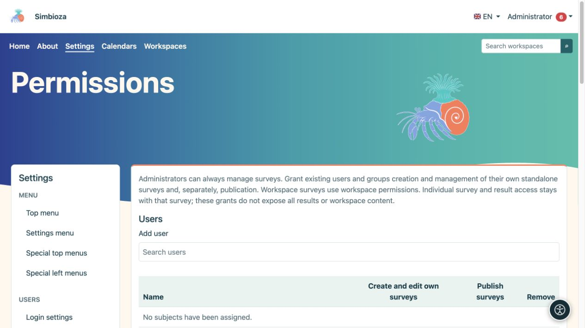
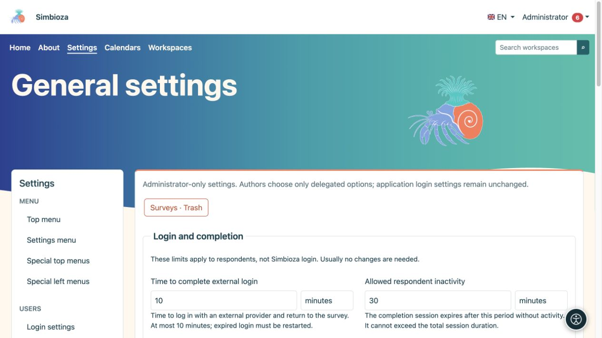
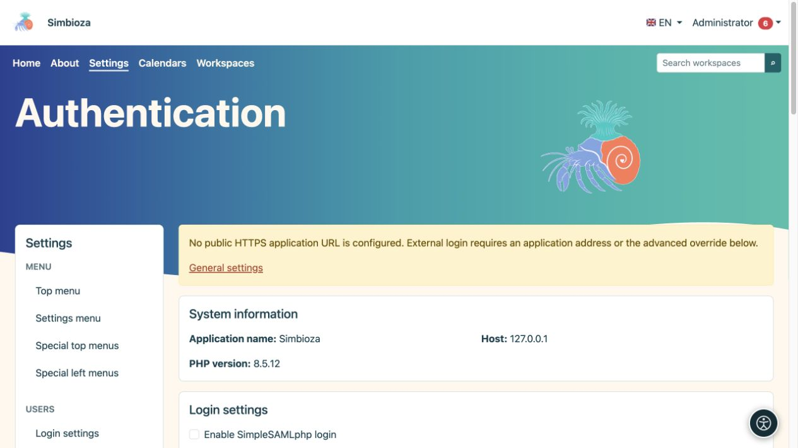

# Umfragen verwalten

> Die Bildschirmaufnahmen zeigen die englische Benutzeroberfläche.

**Zielgruppe:** der Administrator der gesamten Installation. **Einstellungen → Umfragen** trennt allgemeine Beschränkungen, Anmeldung der Befragten und Berechtigungen. Gewähren Sie einem Autor die erforderlichen Umfrageberechtigungen anstelle eines Administratorkontos.

Informationen zum Verfassen, zur Veröffentlichung und zu den Ergebnissen finden Sie unter [Umfragen](ankete_de.md). Eine detaillierte Anbieterkonfiguration wird in [Anmeldung externer Befragter](ankete-autentikacija_de.md) behandelt.

## Entscheiden Sie, wer erstellt und wer veröffentlicht

*Das Erstellen eigener Umfragen und das Veröffentlichen sind zwei separate Berechtigungen.*

1. Öffnen Sie **Umfragen → Berechtigungen**.
2. Suchen und wählen Sie Personen oder Gruppen unter **Benutzer** oder **Gruppen** aus.
3. Wählen Sie die Berechtigung zur Umfrageverwaltung und separat die Berechtigung zur Veröffentlichung für die erforderliche Rolle aus.
4. Speichern Sie die Berechtigungen und überprüfen Sie sie mit einem anderen Konto.

**Ergebnis:** Die ausgewählte Person kann im gewährten Umfang arbeiten. Das Verfassen unterscheidet sich von der Veröffentlichung, Teilnahme oder dem Zugriff auf Ergebnisse. Arbeitsbereiche verfügen auch über vererbte und umfragespezifische Rechte; Durch die Gewährung globaler Rechte an einen Autor werden private Inhalte nicht öffentlich.

## Allgemeine Einstellungen

*Umfragegrenzen werden neben jedem Feld in lesbaren Zeiteinheiten erläutert.*

Installationsbeschränkungen ersetzen nicht die Daten, Zielgruppen oder Datenschutzoptionen einer einzelnen Umfrage. Wählen Sie jeden Wert zusammen mit seiner Einheit.

| Gruppe / Einstellung | Was es einschränkt; Standard |
|---|---|
| Gültigkeit des Anmeldeablaufs | Wie lange ein externer Anmeldeversuch gültig bleibt; 10 Minuten, maximal 10 Minuten. |
| Inaktivität des Befragten | Zulässige Inaktivität bei der Anmeldung des Befragten; 30 Minuten. |
| Absolute Befragtensitzung | Maximale Gesamtlebensdauer dieser Anmeldung; 8 Stunden. Das Leerlauflimit darf das absolute Limit nicht überschreiten. |
| Maximale Seiten/Fragen | Umfragegröße; 50 Seiten und 300 Fragen. |
| Maximale Bindung | Größe der Umfragedatei; 64 MB. |
| Mindestanzahl öffentlicher Zellen | Schutzschwelle für Kleingruppen in öffentlichen Einrichtungen; 5. Ein größerer Schwellenwert verbirgt mehr kleine Gruppen. |
| Öffentliches Cookie | Maximale Lebensdauer des öffentlichen Cookies; 365 Tage. Es ist nicht das Enddatum der Umfrage. |
| Definition/Anfragegröße | Technisches Anforderungsinhaltslimit; 1 MB. |
| Letztes Einreichungsfenster | Zeit für die endgültige öffentliche Einreichung nach der Prüfung; 15 Minuten. |

Im technischen Abschnitt wird die von der Anwendung geerbte öffentliche URL angezeigt. Lassen Sie die Überschreibung leer, wenn Umfragen dieselbe öffentliche URL wie Simbioza verwenden. Für die externe Anmeldung ist die korrekte Adresse HTTPS einschließlich aller Unterverzeichnisse erforderlich. Dabei handelt es sich weder um ein Passwort noch um die eigene Adresse des Anbieters.

## Externe Anmeldung

*Für die Anmeldung externer Befragter gelten separate Einstellungen. Die Warnung erklärt, wenn noch keine öffentliche HTTPS-Adresse konfiguriert wurde.*

Aktivieren Sie unter **Authentifizierung** die erforderlichen Protokolle und speichern Sie. Konfigurieren Sie dann ein bestimmtes Profil, Identitäts-/E-Mail-Zuordnungen und obligatorische Einschränkungen und testen Sie es. Autoren können nur verfügbare, vom Administrator genehmigte Profile auswählen. Durch die Anmeldung des Befragten ändert sich weder die Anmeldung von Simbioza noch werden automatisch Anwendungskonten erstellt.

Verwenden Sie für einen Proxy das entsprechende Profil oder Unterprofil. Quellenauswahl und erweiterte Regeln schränken verifizierte Daten weiter ein; Füllen Sie sie nicht mit erratenen Namen. Der [Authentifizierungsleitfaden](ankete-autentikacija_de.md) erläutert das Verfahren und Beispiele.

## Gelöschte Umfragen, Berichte und Backups

Öffnen Sie in den **Allgemeinen Einstellungen** **Umfragen · Papierkorb** für die Wiederherstellung durch den Administrator. Eine unveröffentlichte Umfrage erscheint als Entwurf; eine zuvor veröffentlichte Umfrage wird geschlossen. Durch das Wiederherstellen wird die Antwortsammlung nicht erneut geöffnet und deaktivierte Berichte werden nicht erneut aktiviert. Überprüfen Sie den Zugriff und die Planung, bevor Sie erneut veröffentlichen.

Für die Berichtszustellung sind eine konfigurierte [E-Mail](admin-e-posta_de.md), ein ausgewählter Kanal und eine regelmäßige Verarbeitung erforderlich. Lesen Sie [Berichte](ankete-poslovi-izvjestaja_de.md) und [Umfragesicherungen](ankete-backup-detalji_de.md). Der Export von Arbeitsbereich HTML schließt interaktive Umfragen bewusst aus; Backups umfassen sie mit den zugehörigen Daten.
