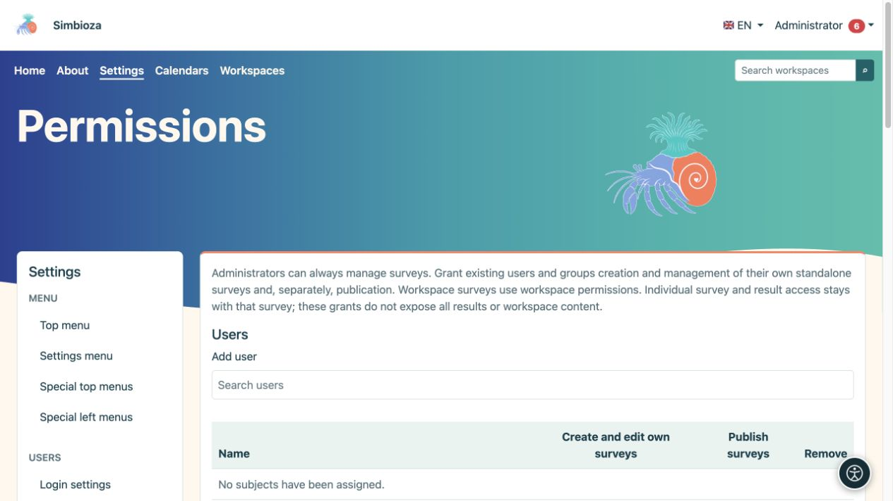
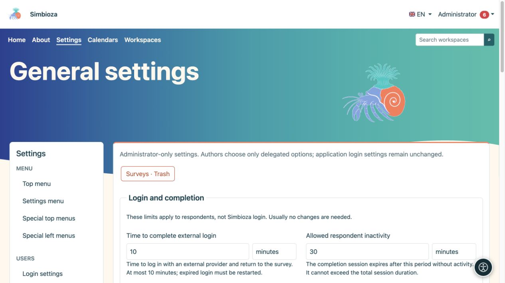
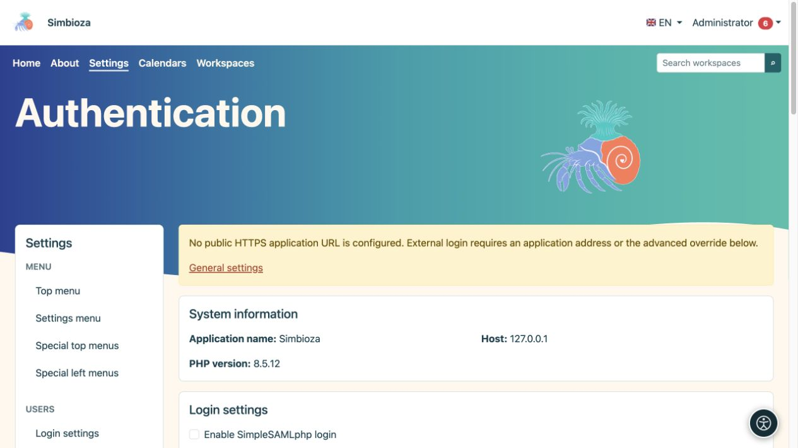

# Survey administration

**Audience:** the administrator of the entire installation. **Settings → Surveys** separates general limits, respondent sign-in, and permissions. Grant an author the required survey privileges rather than an administrator account.

For authoring, publication, and results, read [Surveys](ankete_en.md). Detailed provider configuration is covered in [External respondent sign-in](ankete-autentikacija_en.md).

## Decide who creates and who publishes

*Creating your own surveys and publishing are two separate permissions.*

1. Open **Surveys → Permissions**.
2. Find and select people or groups under **Users** or **Groups**.
3. Select survey-management permission and, separately, publication permission for the required role.
4. Save permissions and check with another account.

**Result:** the selected person can work within the granted scope. Authoring is different from publication, participation, or results access. Workspaces also have inherited and survey-specific rights; granting an author global privileges does not make private content public.

## General settings

*Survey limits are explained beside each field using readable time units.*

Installation limits do not replace an individual survey's dates, audience, or privacy choices. Choose each value together with its unit.

| Group / setting | What it limits; default |
|---|---|
| Sign-in flow validity | How long an external sign-in attempt remains valid; 10 minutes, maximum 10 minutes. |
| Respondent inactivity | Permitted inactivity of respondent sign-in; 30 minutes. |
| Absolute respondent session | Maximum total lifetime of that sign-in; 8 hours. The idle limit cannot exceed the absolute limit. |
| Maximum pages / questions | Survey size; 50 pages and 300 questions. |
| Maximum attachment | Survey file size; 64 MB. |
| Minimum public cell count | Small-group protection threshold in public aggregates; 5. A larger threshold hides more small groups. |
| Public cookie | Maximum lifetime of the public cookie; 365 days. It is not the survey's closing date. |
| Definition/request size | Technical request-content limit; 1 MB. |
| Final submission window | Time for final public submission after review; 15 minutes. |

The technical section displays the public URL inherited from the application. Leave the override empty when surveys use the same public URL as Simbioza. External sign-in requires the correct HTTPS address, including any subdirectory; this is neither a password nor the provider's own address.

## External sign-in

*External respondent login has separate settings; the warning explains when a public HTTPS address has not yet been configured.*

Under **Authentication**, enable the required protocols and save. Then configure a particular profile, identity/email mappings, and mandatory restrictions, and test it. Authors can choose only available administrator-approved profiles. Respondent sign-in does not change Simbioza sign-in or automatically create application accounts.

For a proxy, use the appropriate profile or subprofile. Source selection and advanced rules further restrict verified data; do not fill them with guessed names. The [authentication guide](ankete-autentikacija_en.md) explains the procedure and examples.

## Deleted surveys, reports, and backups

From **General settings**, open **Surveys · Trash** for administrator restoration. An unpublished survey returns as a draft; a previously published survey returns closed. Restoring does not reopen response collection or re-enable disabled reports. Check access and scheduling before republishing.

Report delivery requires configured [Email](admin-e-posta_en.md), a selected channel, and regular processing. Read [reports](ankete-poslovi-izvjestaja_en.md) and [survey backups](ankete-backup-detalji_en.md). Workspace HTML export deliberately excludes interactive surveys; backups include them with their associated data.
