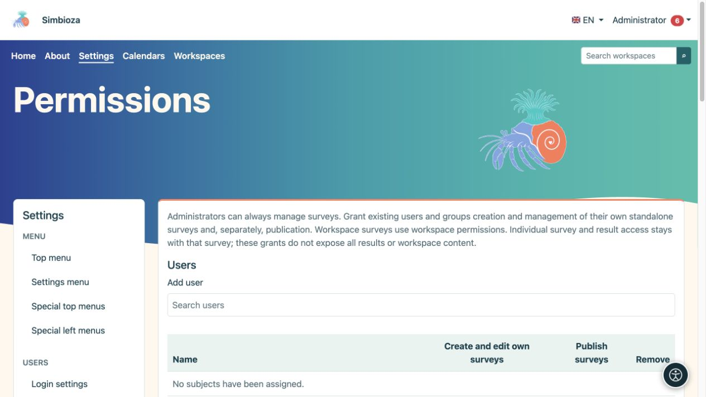
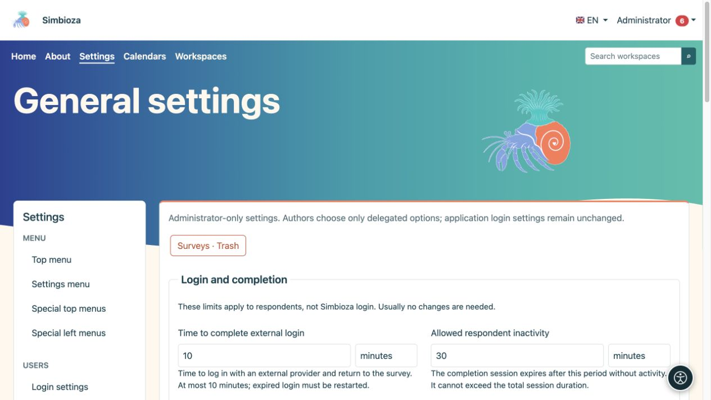
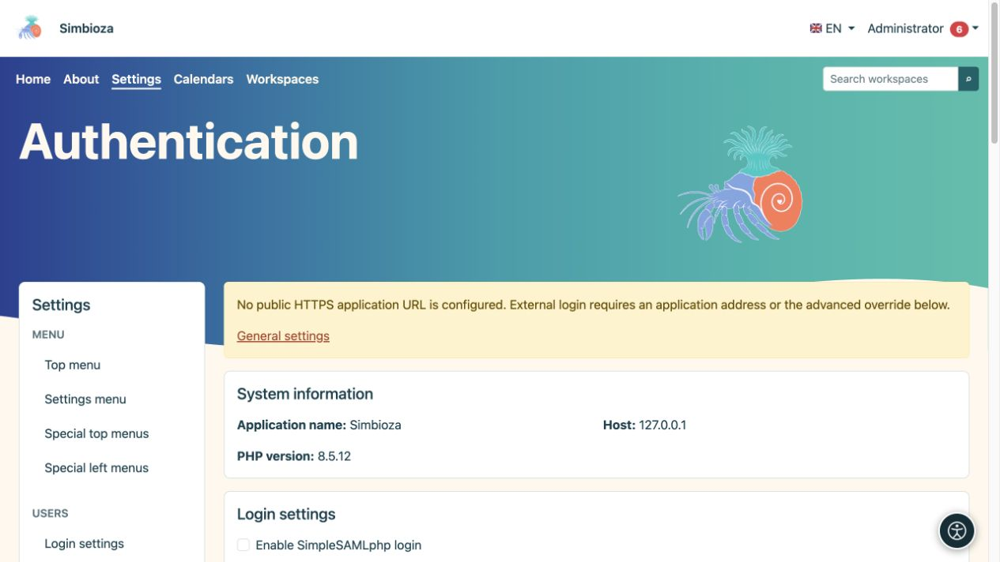

# Administrar encuestas

> Las capturas de pantalla muestran la interfaz en inglés.

**Audiencia:** el administrador de toda la instalación. **Configuración → Encuestas** separa los límites generales, el inicio de sesión de los encuestados y los permisos. Otorgue a un autor los privilegios de encuesta necesarios en lugar de una cuenta de administrador.

Para autoría, publicación y resultados, lea [Encuestas](ankete_es.md). La configuración detallada del proveedor se trata en [Inicio de sesión de encuestado externo](ankete-autentikacija_es.md).

## Decidir quién crea y quién publica

*Crear sus propias encuestas y publicarlas son dos permisos separados.*

1. Abra **Encuestas → Permisos**.
2. Busque y seleccione personas o grupos en **Usuarios** o **Grupos**.
3. Seleccione el permiso de gestión de encuestas y, por separado, el permiso de publicación para el rol requerido.
4. Guarde los permisos y consulte con otra cuenta.

**Resultado:** la persona seleccionada puede trabajar dentro del alcance otorgado. La autoría es diferente de la publicación, la participación o el acceso a los resultados. Los espacios de trabajo también tienen derechos heredados y específicos de la encuesta; Otorgar privilegios globales a un autor no convierte el contenido privado en público.

## Configuraciones generales

*Los límites de la encuesta se explican al lado de cada campo utilizando unidades de tiempo legibles.*

Los límites de instalación no reemplazan las fechas, la audiencia o las opciones de privacidad de una encuesta individual. Elija cada valor junto con su unidad.

| Grupo / entorno | Lo que limita; por defecto |
|---|---|
| Validez del flujo de inicio de sesión | Cuánto tiempo sigue siendo válido un intento de inicio de sesión externo; 10 minutos, máximo 10 minutos. |
| Inactividad del encuestado | Inactividad permitida del inicio de sesión del encuestado; 30 minutos. |
| Sesión absoluta del encuestado | Duración total máxima de ese inicio de sesión; 8 horas. El límite de inactividad no puede exceder el límite absoluto. |
| Máximo de páginas/preguntas | Tamaño de la encuesta; 50 páginas y 300 preguntas. |
| Fijación máxima | Tamaño del archivo de la encuesta; 64 MB. |
| Recuento mínimo de células públicas | Umbral de protección de grupos pequeños en agregados públicos; 5. Un umbral más grande esconde más grupos pequeños. |
| Cookie pública | Vida útil máxima de la cookie pública; 365 días. No es la fecha de cierre de la encuesta. |
| Definición/tamaño de solicitud | Límite de contenido de solicitud técnica; 1MB. |
| Ventana de envío final | Tiempo para la presentación pública final después de la revisión; 15 minutos. |

La sección técnica muestra la URL pública heredada de la aplicación. Deje la anulación vacía cuando las encuestas utilicen la misma URL pública que Simbioza. El inicio de sesión externo requiere la dirección HTTPS correcta, incluido cualquier subdirectorio; No se trata de una contraseña ni de la dirección del propio proveedor.

## Inicio de sesión externo

*El inicio de sesión de encuestado externo tiene configuraciones separadas; la advertencia explica cuándo aún no se ha configurado una dirección pública HTTPS.*

En **Autenticación**, habilite los protocolos requeridos y guarde. Luego configure un perfil particular, asignaciones de identidad/correo electrónico y restricciones obligatorias, y pruébelo. Los autores solo pueden elegir perfiles disponibles aprobados por el administrador. El inicio de sesión del encuestado no cambia el inicio de sesión de Simbioza ni crea automáticamente cuentas de aplicación.

Para un proxy, utilice el perfil o subperfil apropiado. La selección de fuentes y las reglas avanzadas restringen aún más los datos verificados; no los llene con nombres adivinados. La [guía de autenticación](ankete-autentikacija_es.md) explica el procedimiento y los ejemplos.

## Encuestas, informes y copias de seguridad eliminados

Desde **Configuración general**, abra **Encuestas · Papelera** para la restauración del administrador. Una encuesta inédita regresa como borrador; una encuesta publicada anteriormente regresa cerrada. La restauración no vuelve a abrir la recopilación de respuestas ni vuelve a habilitar los informes deshabilitados. Verifique el acceso y la programación antes de volver a publicar.

La entrega del informe requiere [Correo electrónico](admin-e-posta_es.md) configurado, un canal seleccionado y un procesamiento regular. Lea [informes](ankete-poslovi-izvjestaja_es.md) y [copias de seguridad de la encuesta](ankete-backup-detalji_es.md). La exportación del espacio de trabajo HTML excluye deliberadamente las encuestas interactivas; las copias de seguridad los incluyen con sus datos asociados.
