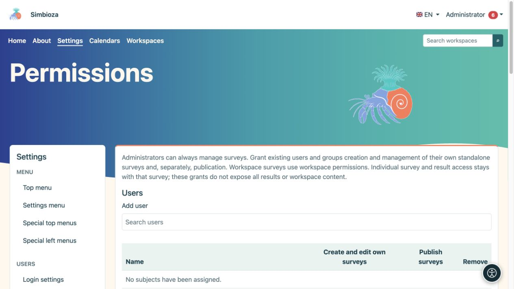
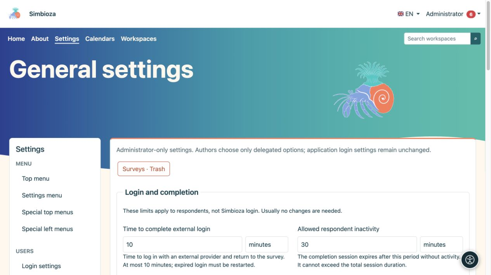
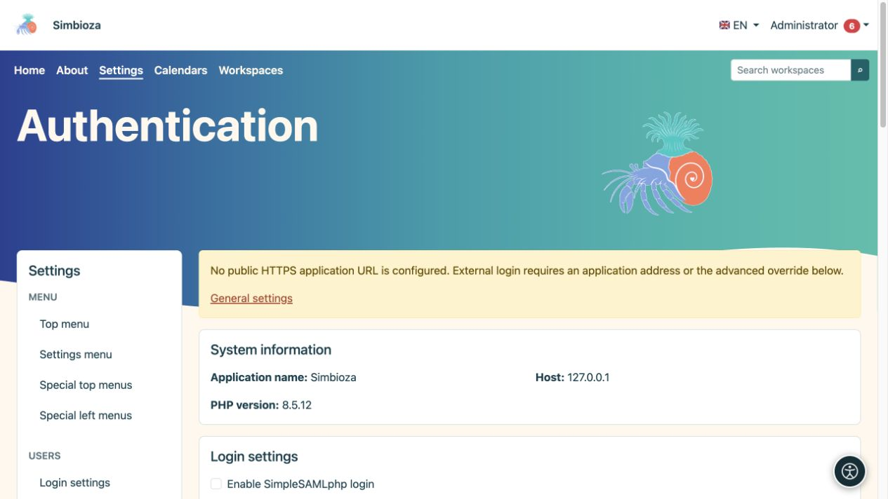

# Administration des sondages

> Les captures d’écran présentent l’interface en anglais.

**Public :** l'administrateur de l'ensemble de l'installation. **Paramètres → Sondages** sépare les limites générales, la connexion des répondants et les autorisations. Accordez à un auteur les privilèges de sondage requis plutôt qu'un compte administrateur.

Pour la création, la publication et les résultats, lisez [Sondages](ankete_fr.md). La configuration détaillée du fournisseur est couverte dans [Connexion du répondant externe](ankete-autentikacija_fr.md).

## Décidez qui crée et qui publie

*La création de vos propres sondages et la publication sont deux autorisations distinctes.*

1. Ouvrez **Sondages → Autorisations**.
2. Recherchez et sélectionnez des personnes ou des groupes sous **Utilisateurs** ou **Groupes**.
3. Sélectionnez l'autorisation de gestion des sondages et, séparément, l'autorisation de publication pour le rôle requis.
4. Enregistrez les autorisations et vérifiez avec un autre compte.

**Résultat :** la personne sélectionnée peut travailler dans le cadre accordé. La création est différente de la publication, de la participation ou de l’accès aux résultats. Les espaces de travail disposent également de droits hérités et spécifiques aux sondages ; accorder à un auteur des privilèges globaux ne rend pas public le contenu privé.

## Paramètres généraux

*Les limites du sondage sont expliquées à côté de chaque champ en utilisant des unités de temps lisibles.*

Les limites d'installation ne remplacent pas les dates, l'audience ou les choix de confidentialité d'un sondage individuel. Choisissez chaque valeur avec son unité.

| Groupe / paramètre | Ce que cela limite ; défaut |
|---|---|
| Validité du flux de connexion | Combien de temps une tentative de connexion externe reste valide ; 10 minutes, maximum 10 minutes. |
| Inactivité du répondant | Inactivité autorisée de la connexion du répondant ; 30 minutes. |
| Session de répondant absolu | Durée de vie totale maximale de cette connexion ; 8 heures. La limite de ralenti ne peut pas dépasser la limite absolue. |
| Nombre maximum de pages/questions | Taille du sondage ; 50 pages et 300 questions. |
| Attachement maximal | Taille du fichier de sondage ; 64 Mo. |
| Nombre minimum de cellules publiques | Seuil de protection des petits groupes dans les agrégats publics ; 5. Un seuil plus grand cache davantage de petits groupes. |
| Cookie public | Durée de vie maximale du cookie public ; 365 jours. Ce n'est pas la date de clôture du scrutin. |
| Définition/taille de la demande | Limite du contenu des demandes techniques ; 1 Mo. |
| Fenêtre de soumission finale | Délai de soumission publique finale après examen ; 15 minutes. |

La section technique affiche l'URL publique héritée de l'application. Laissez le champ de remplacement vide lorsque les sondages utilisent la même URL publique que Simbioza. La connexion externe nécessite l'adresse HTTPS correcte, y compris tout sous-répertoire ; il ne s'agit ni d'un mot de passe ni de l'adresse propre du fournisseur.

## Connexion externe

*La connexion du répondant externe a des paramètres distincts ; l'avertissement explique lorsqu'une adresse publique HTTPS n'a pas encore été configurée.*

Sous **Authentification**, activez les protocoles requis et enregistrez. Configurez ensuite un profil particulier, des mappages identité/e-mail et des restrictions obligatoires, puis testez-le. Les auteurs peuvent choisir uniquement les profils disponibles approuvés par l'administrateur. La connexion du répondant ne modifie pas la connexion Simbioza et ne crée pas automatiquement des comptes d'application.

Pour un proxy, utilisez le profil ou sous-profil approprié. La sélection des sources et les règles avancées restreignent davantage les données vérifiées ; ne les remplissez pas de noms devinés. Le [guide d'authentification](ankete-autentikacija_fr.md) explique la procédure et des exemples.

## Sondages, rapports et sauvegardes supprimés

Dans **Paramètres généraux**, ouvrez **Sondages · Corbeille** pour la restauration de l'administrateur. Un sondage non publié revient sous forme de brouillon ; un sondage précédemment publié revient fermé. La restauration ne rouvre pas la collecte de réponses ni ne réactive les rapports désactivés. Vérifiez l’accès et la planification avant de republier.

L’envoi des rapports nécessite un [courriel configuré](admin-e-posta_fr.md), un canal sélectionné et un traitement régulier. Consultez les [rapports](ankete-poslovi-izvjestaja_fr.md) et les [sauvegardes des sondages](ankete-backup-detalji_fr.md). L’exportation HTML d’un espace de travail exclut délibérément les sondages interactifs ; les sauvegardes les incluent avec leurs données associées.
