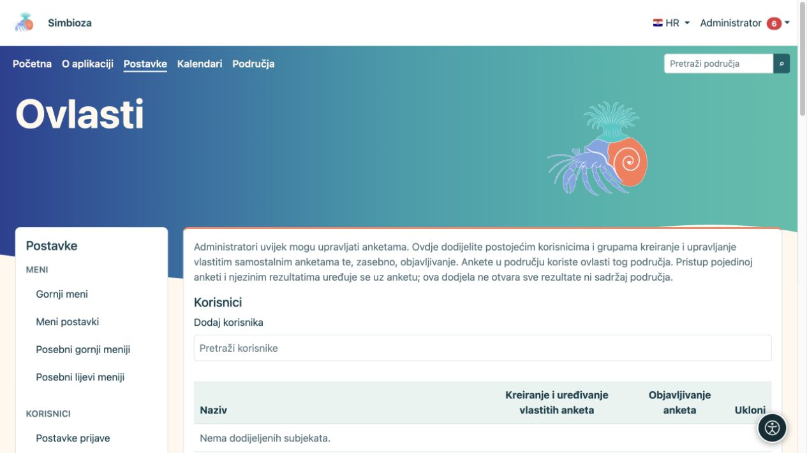
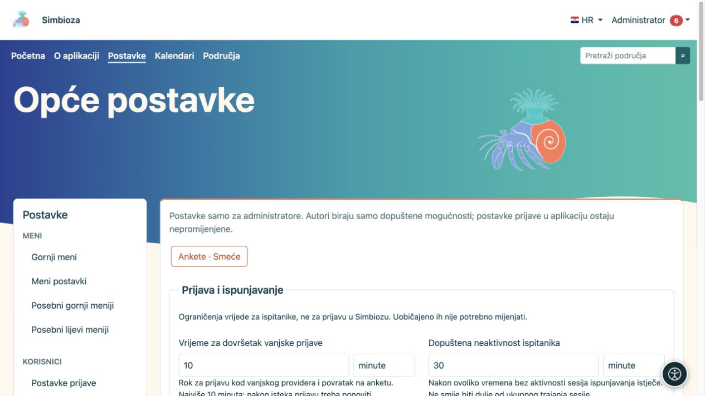
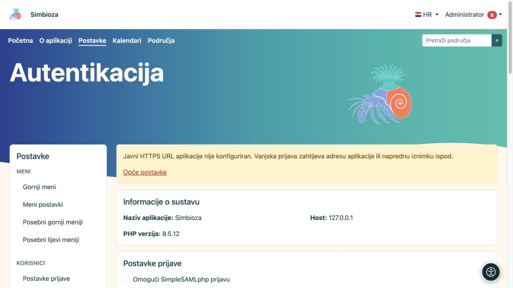

# Administracija anketa

**Za koga:** administrator cijele instalacije. **Postavke → Ankete** razdvajaju opća ograničenja, prijavu ispitanika i ovlasti. Sastavljaču ankete dodijelite potrebne ovlasti; ne treba mu administratorski račun.

Za cijeli postupak izrade, objave i rezultata otvorite [Ankete](ankete_hr.md). Detaljno podešavanje providera ostaje u [Vanjska prijava ispitanika](ankete-autentikacija_hr.md).

## Dodijelite tko sastavlja i tko objavljuje

*Stvaranje vlastitih anketa i objavljivanje dvije su zasebne ovlasti.*

1. Otvorite **Ankete → Ovlasti**.
2. U odjeljku **Korisnici** ili **Grupe** pronađite i odaberite osobe odnosno grupe.
3. Označite pravo upravljanja anketama i, zasebno, pravo objave prema potrebnoj ulozi.
4. Spremite ovlasti i provjerite ih drugim računom.

**Rezultat:** odabrana osoba može raditi u dodijeljenom opsegu. Pravo sastavljanja nije isto što i pravo objave, pravo ispunjavanja ili pravo pregleda rezultata. Područja imaju i vlastite naslijeđene/survey ovlasti; privatni sadržaj ne postaje javan globalnom dodjelom prava sastavljaču.

## Opće postavke

*Ograničenja anketa objašnjena su uz svako polje, s razumljivim vremenskim jedinicama.*

Ograničenja vrijede za instalaciju. Ne zamjenjuju datume, ciljanu skupinu ili privatnost pojedinačne ankete. U formularu se vrijednost i jedinica biraju zajedno.

| Skupina / postavka | Što ograničava; zadano |
|---|---|
| Valjanost toka prijave | Koliko vrijedi započeta vanjska prijava; 10 minuta, najviše 10 minuta. |
| Neaktivnost ispitanika | Koliko prijava ispitanika smije biti neaktivna; 30 minuta. |
| Ukupna sesija ispitanika | Najdulje ukupno trajanje te prijave; 8 sati. Rok neaktivnosti ne može biti dulji od ukupnog roka. |
| Najviše stranica / pitanja | Veličina ankete; 50 stranica i 300 pitanja. |
| Najveći privitak | Veličina datoteke ankete; 64 MB. |
| Najmanji javni zbroj | Prag zaštite malih skupina u javnom zbirnom rezultatu; 5. Povećavanje bolje skriva male skupine. |
| Javni kolačić | Najdulje trajanje javnog kolačića; 365 dana. To nije datum zatvaranja ankete. |
| Veličina definicije/zahtjeva | Tehnički limit sadržaja zahtjeva; 1 MB. |
| Vrijeme za konačnu predaju | Rok završne javne predaje nakon pregleda; 15 minuta. |

Tehnički odjeljak prikazuje javni URL preuzet iz aplikacije. Zasebno nadjačavanje ostavite prazno kada ankete koriste isti javni URL kao Simbioza. Za vanjsku prijavu treba ispravna HTTPS adresa uključujući poddirektorij; to nije lozinka ni adresa samog providera.

## Vanjska prijava

*Vanjska prijava ispitanika ima zasebne postavke; upozorenje objašnjava kada javna HTTPS adresa još nije podešena.*

U **Autentikacija** uključite protokole koje instalacija koristi i spremite. Zatim uredite konkretni profil, mapiranja identiteta/e-maila i obavezna ograničenja te provedite njegov test. Sastavljači mogu odabrati samo dostupne administrativno dopuštene profile. Prijava ispitanika ne mijenja prijavu u Simbiozu i ne dodaje automatski aplikacijske račune.

Za proxy koristite odgovarajući profil ili podprofil. Izvori i napredna pravila služe dodatnom ograničenju potvrđenih podataka; ne popunjavaju se nasumičnim nazivima. Postupak i primjeri objašnjeni su u [uputi za autentikaciju](ankete-autentikacija_hr.md).

## Obrisane ankete, izvještaji i kopije

Iz **Općih postavki** otvorite **Ankete · Smeće** za administratorski povrat. Neobjavljena anketa vraća se kao nacrt, a ranije objavljena kao zatvorena; povrat je ne otvara automatski za odgovore niti ponovno uključuje ugašene izvještaje. Prije nove objave provjerite pristup i raspored.

Za slanje izvještaja treba podešena [E-pošta](admin-e-posta_hr.md), odabran kanal i redovno izvršavanje obrade. Pogledajte [izvještaje](ankete-poslovi-izvjestaja_hr.md) i [sigurnosne kopije anketa](ankete-backup-detalji_hr.md). HTML izvoz područja namjerno ne izvozi interaktivne ankete; sigurnosna kopija obuhvaća ih s pripadajućim podacima.
