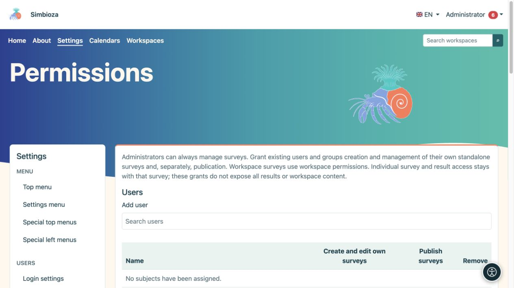
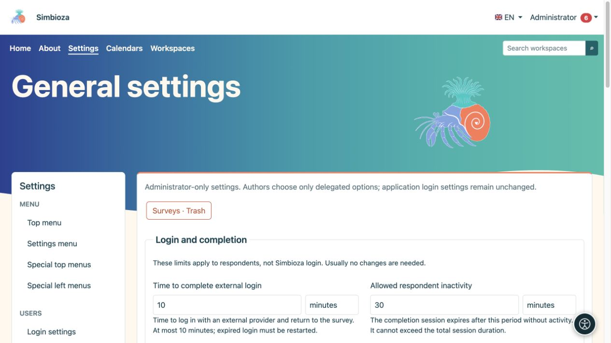
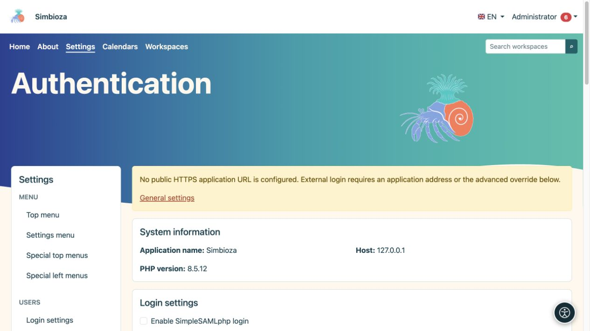

# Amministrazione dei sondaggi

> Le schermate mostrano l’interfaccia in inglese.

**Pubblico:** l'amministratore dell'intera installazione. **Impostazioni → Sondaggi** separa i limiti generali, l'accesso degli intervistati e le autorizzazioni. Concedi a un autore i privilegi del sondaggio richiesti anziché un account amministratore.

Per la creazione, la pubblicazione e i risultati, leggere [Sondaggi](ankete_it.md). La configurazione dettagliata del provider è trattata in [Accesso del rispondente esterno](ankete-autentikacija_it.md).

## Decidi chi crea e chi pubblica

*La creazione dei tuoi sondaggi e la pubblicazione sono due autorizzazioni separate.*

1. Apri **Sondaggi → Autorizzazioni**.
2. Trova e seleziona persone o gruppi in **Utenti** o **Gruppi**.
3. Seleziona l'autorizzazione alla gestione del sondaggio e, separatamente, l'autorizzazione alla pubblicazione per il ruolo richiesto.
4. Salva le autorizzazioni e verifica con un altro account.

**Risultato:** la persona selezionata può lavorare nell'ambito concesso. L'authoring è diverso dalla pubblicazione, dalla partecipazione o dall'accesso ai risultati. Anche le aree di lavoro hanno diritti ereditari e specifici del sondaggio; la concessione di privilegi globali a un autore non rende pubblici i contenuti privati.

## Impostazioni generali

*I limiti del sondaggio sono spiegati accanto a ciascun campo utilizzando unità di tempo leggibili.*

I limiti di installazione non sostituiscono le date, il pubblico o le scelte sulla privacy di un singolo sondaggio. Scegli ciascun valore insieme alla sua unità.

| Gruppo/impostazione | Cosa limita; predefinito |
|---|---|
| Validità del flusso di accesso | Per quanto tempo rimane valido un tentativo di accesso esterno; 10 minuti, massimo 10 minuti. |
| Inattività del rispondente | Inattività consentita dell'accesso del rispondente; 30 minuti. |
| Durata massima della sessione del partecipante | Durata totale massima di tale accesso; 8 ore. Il limite di inattività non può superare il limite assoluto. |
| Numero massimo di pagine/domande | Dimensione del sondaggio; 50 pagine e 300 domande. |
| Dimensione massima degli allegati | Dimensione del file del sondaggio; 64MB. |
| Conteggio minimo di celle pubbliche | Soglia di protezione dei piccoli gruppi negli aggregati pubblici; 5. Una soglia più grande nasconde più piccoli gruppi. |
| Cookie pubblico | Durata massima del cookie pubblico; 365 giorni. Non è la data di chiusura del sondaggio. |
| Definizione/dimensione della richiesta | Limite del contenuto della richiesta tecnica; 1 MB. |
| Finestra di invio finale | Tempo per la presentazione pubblica finale dopo la revisione; 15 minuti. |

La sezione tecnica visualizza l'URL pubblico ereditato dall'applicazione. Lascia vuoto l'override quando i sondaggi utilizzano lo stesso URL pubblico di Simbioza. L'accesso esterno richiede l'indirizzo HTTPS corretto, inclusa qualsiasi sottodirectory; questa non è né una password né l'indirizzo del provider.

## Accesso esterno

*L'accesso del rispondente esterno ha impostazioni separate; l'avviso spiega quando un indirizzo pubblico HTTPS non è stato ancora configurato.*

In **Autenticazione**, abilita i protocolli richiesti e salva. Quindi configura un profilo particolare, le mappature di identità/e-mail e le restrizioni obbligatorie e testalo. Gli autori possono scegliere solo i profili disponibili approvati dall'amministratore. L'accesso del rispondente non modifica l'accesso Simbioza né crea automaticamente gli account dell'applicazione.

Per un proxy, utilizzare il profilo o sottoprofilo appropriato. La selezione della fonte e le regole avanzate limitano ulteriormente i dati verificati; non riempirli con nomi indovinati. La [guida all'autenticazione](ankete-autentikacija_it.md) spiega la procedura e gli esempi.

## Sondaggi eliminati, rapporti e backup

Da **Impostazioni generali**, apri **Sondaggi · Cestino** per il ripristino da parte dell'amministratore. Un sondaggio mai pubblicato ritorna come bozza; uno pubblicato in precedenza ritorna chiuso. Il ripristino non riapre la raccolta delle risposte e non riabilita rapporti disabilitati. Controlla accesso e pianificazione prima di pubblicarlo nuovamente.

La consegna dei rapporti richiede un'[e-mail](admin-e-posta_it.md) configurata, un canale selezionato e un'elaborazione regolare. Leggere [rapporti](ankete-poslovi-izvjestaja_it.md) e [backup dei sondaggi](ankete-backup-detalji_it.md). L'esportazione dell'area di lavoro HTML esclude deliberatamente i sondaggi interattivi; i backup li includono con i dati associati.
