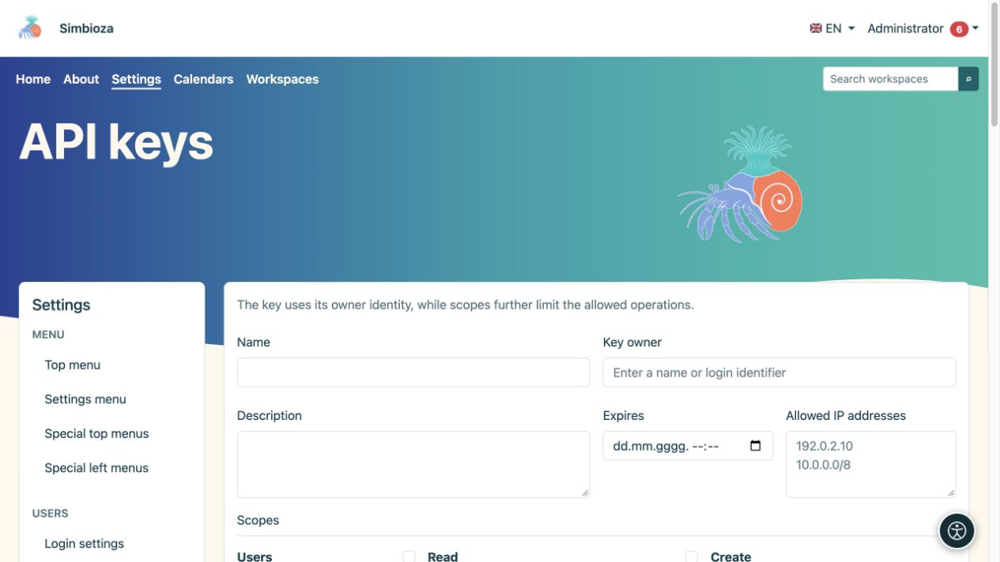
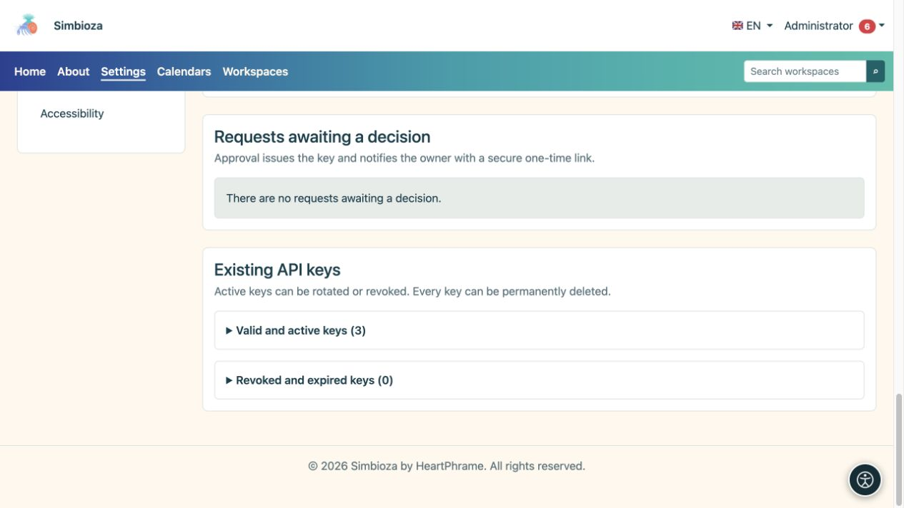

# API-Schlüssel verwalten

> Die Bildschirmaufnahmen zeigen die englische Benutzeroberfläche.

**Zielgruppe:** Administratoren genehmigen und geben Schlüssel aus; Angemeldete Benutzer können persönliche Anfragen stellen. Öffnen Sie **Einstellungen → Benutzer → API-Schlüssel**, wenn das Modul API installiert und aktiviert ist.

Ein API-Schlüssel erlaubt einem anderen Programm, mit den Rechten des **Schlüsselbesitzers** zu handeln. Scopes, Ablaufdatum und IP-Einschränkungen begrenzen den Zugriff zusätzlich; sie gewähren keine Rechte, die der Besitzer nicht hat. Wer nur Seiten bearbeitet oder eine Umfrage beantwortet, benötigt normalerweise keinen API-Schlüssel.

## Erstellen Sie einen Schlüssel

*Ein neuer API-Schlüssel hat einen Besitzer, ein Ablaufdatum, zulässige Adressen und separat ausgewählte Scopes.*

1. Geben Sie einen erkennbaren Namen und Zweck ein, beispielsweise den Namen des verbundenen Systems.
2. Suchen Sie den **Schlüsseleigentümer** und wählen Sie ihn aus. Wählen Sie einen Administrator nicht nur deshalb aus, weil er zuerst angezeigt wird.
3. Legen Sie **Ablauf** fest, wenn der Zugriff an einem bestimmten Datum enden soll.
4. Geben Sie die erforderlichen **Zulässigen IP-Adressen** ein; ein leeres Feld lässt alle IPs zu. Verwenden Sie gültige Einzeladressen oder Netzwerke im unterstützten Format.
5. Wählen Sie den kleinsten erforderlichen Satz an Scopes aus. Die verfügbaren Optionen hängen von den installierten und aktivierten Modulen ab.
6. Wählen Sie **API-Schlüssel erstellen** und kopieren/speichern Sie ihn sofort sicher im Zielsystem.

**Ergebnis:** Der Schlüssel wird erstellt und sein geheimer Wert nur einmal angezeigt. Auch nach dem Neuladen der Seite können Sie ihn nicht erneut abrufen. Schreiben Sie ihn niemals in Anleitungen, Bildschirmaufnahmen, gewöhnliche Kommentare oder öffentlich zugänglichen Code.

## Verarbeiten Sie die Anfrage eines Benutzers

*Anfragen, die auf eine Entscheidung warten, und bestehende aktive oder widerrufene Schlüssel sind vom Formular für neue Schlüssel getrennt.*

Ein Benutzer öffnet **Mein Konto → API-Zugriff**, beschreibt den Zweck, die angeforderten Scopes, den Ablauf und die IP-Einschränkungen und sendet dann eine Anfrage. Während eine Anfrage aussteht, kann keine weitere Anfrage eingereicht werden.

Unter **Ausstehende Anfragen** überprüfen Administratoren den Eigentümer und den angeforderten Scope und wählen dann **Anfrage genehmigen** oder **Anfrage ablehnen**. Die Ablehnung kann eine Notiz enthalten. Ein zugelassener Eigentümer erhält eine Benachrichtigung mit einem sicheren einmaligen Link zur Offenlegung des Schlüssels. Überprüfen Sie [Benachrichtigungen/E-Mail](admin-e-posta_de.md), wenn die erwartete Zustellung nicht eintrifft.

## Unterscheiden Sie zwischen Rotation, Widerruf und Löschung

| Aktion | Ergebnis |
|---|---|
| Erneuern (Rotation) | Gibt ein neues Geheimnis heraus; das vorherige Geheimnis funktioniert sofort nicht mehr. Speichern Sie das neue im angeschlossenen System. |
| Widerrufen | Stoppt den Schlüsselzugriff und behält seinen Datensatz bei. Verwenden Sie diese Option, wenn der Zugriff nicht mehr erforderlich ist oder das Geheimnis möglicherweise preisgegeben wurde. |
| Löschen | Entfernt den Schlüssel nach Bestätigung dauerhaft. Das separate Aktivitätsüberwachungsereignis bleibt bestehen. |

Vorhandene Schlüssel sind in gültige/aktive und widerrufene/abgelaufene Schlüssel unterteilt. **Zuletzt verwendet** hilft zu erkennen, ob ein Schlüssel genutzt wird; es ist kein Protokoll aller Anfragen. Der Wechsel der Ansicht aktiviert einen abgelaufenen oder widerrufenen Schlüssel nicht erneut.

## Zugriff überprüfen

Bitten Sie den Betreuer des verbundenen Programms, eine erlaubte und eine verbotene Aktion zu testen. Ein privater Arbeitsbereich muss für einen Eigentümer ohne Zugriff unlesbar bleiben, selbst wenn der Schlüssel den Scope zum Lesen von Arbeitsbereichen hat. Überprüfen Sie die Löschung oder den Widerruf mit einer anderen tatsächlichen Anfrage, anstatt nur eine fehlende Schaltfläche zu beobachten.

Auf diesem Bildschirm werden Anmeldeinformationen ausgegeben. Es handelt sich nicht um eine Programmierform zum Erstellen jeglicher Art von Inhalten. Für tatsächliche Anfragen und Antworten in allen Modulen lesen Sie den [vollständigen API-Leitfaden](api-koristenje_de.md); [Umfragespezifische Beispiele](ankete-api_de.md) sind ebenfalls verfügbar. Serverseitige API-Einstellungen, einschließlich Cross-Origin-Zugriff und Webhook-Bereitstellung, werden vom Installationsbetreuer konfiguriert; der Schlüsselbildschirm verfügt über keinen universellen Schalter, der Berechtigungsprüfungen ersetzt.
