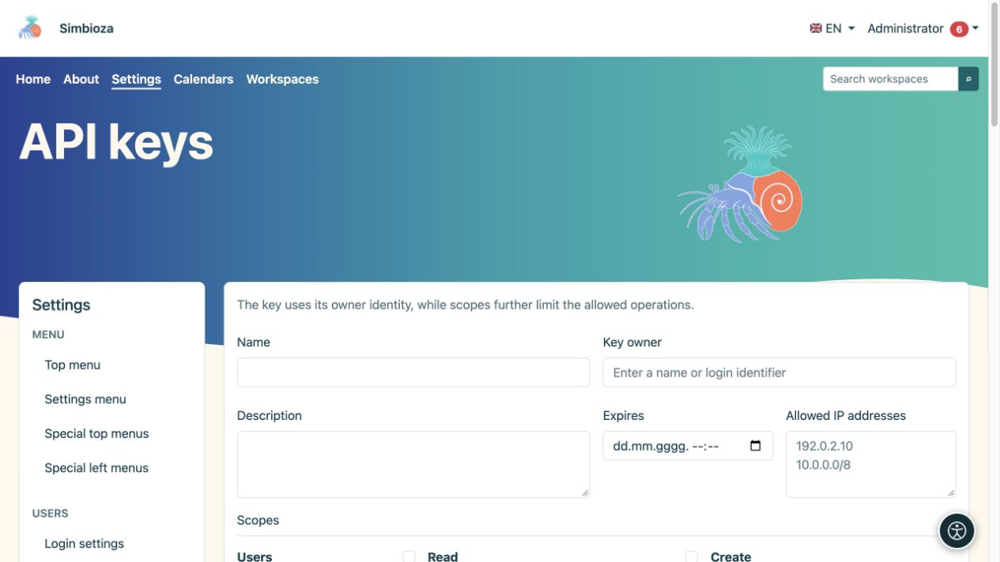
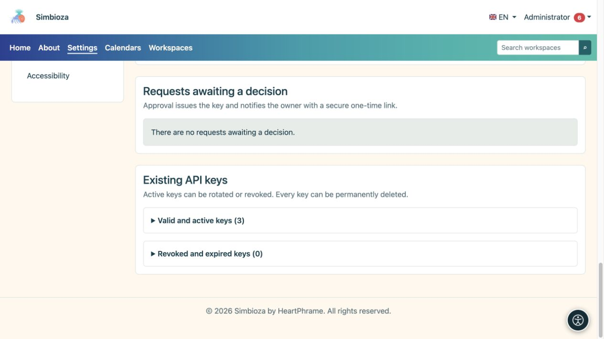

# API key administration

**Audience:** administrators approve and issue keys; signed-in users can submit personal requests. Open **Settings → Users → API keys** when the API module is installed and enabled.

An API key lets another program act as its **owner**. Scopes, expiry, and IP restrictions further limit it; they do not grant rights the owner lacks. Someone who only edits pages or answers a survey usually does not need an API key.

## Create a key

*A new API key has an owner, expiry, allowed addresses, and separately chosen scopes.*

1. Enter a recognisable name and purpose, such as the connected system's name.
2. Find and select the **Key owner**. Do not select an administrator merely because they appear first.
3. Set **Expires** when access should stop on a particular date.
4. Enter required **Allowed IP addresses**; an empty field permits all IPs. Use valid individual addresses or networks in the supported format.
5. Select the smallest necessary set of scopes. Available choices depend on installed and enabled modules.
6. Choose **Create API key** and immediately copy/store it securely in the destination system.

**Result:** the key is issued and its secret is shown only once. Refreshing does not let you read it again. Never place it in instructions, screenshots, ordinary comments, or public code.

## Process a user's request

*Requests awaiting a decision and existing active or revoked keys are separate from the new-key form.*

A user opens **My account → API access**, describes the purpose, requested scopes, expiry, and IP restrictions, then submits a request. Another request cannot be submitted while one is pending.

Under **Pending requests**, administrators review the owner and requested scope, then choose **Approve request** or **Reject request**. Rejection can include a note. An approved owner receives a notification containing a secure one-time link for revealing the key. Check [notifications/email](admin-e-posta_en.md) if the expected delivery does not arrive.

## Distinguish rotation, revocation, and deletion

| Action | Result |
|---|---|
| Rotate | Issues a new secret; the previous secret immediately stops working. Store the new one in the connected system. |
| Revoke | Stops key access while retaining its record. Use when access is no longer needed or the secret may have been exposed. |
| Delete | Permanently removes the key after confirmation. The separate activity-audit event remains. |

Existing keys are divided into valid/active and revoked/expired sections. **Last used** helps identify whether a key is in use; it is not a record of every request. An expired or revoked key is not reactivated by changing the view.

## Verify access

Ask the connected program's maintainer to test an allowed action and a forbidden one. A private workspace must remain unreadable to an owner without access even if the key has the workspace-read scope. Verify deletion or revocation with another actual request rather than merely observing a missing button.

This screen issues credentials; it is not a programming form for creating every kind of content. For actual requests and responses across all modules, read the [complete API guide](api-koristenje_en.md); [survey-specific examples](ankete-api_en.md) are also available. Server-side API settings, including cross-origin access and webhook delivery, are configured by the installation maintainer; the keys screen has no universal switch that replaces permission checks.
