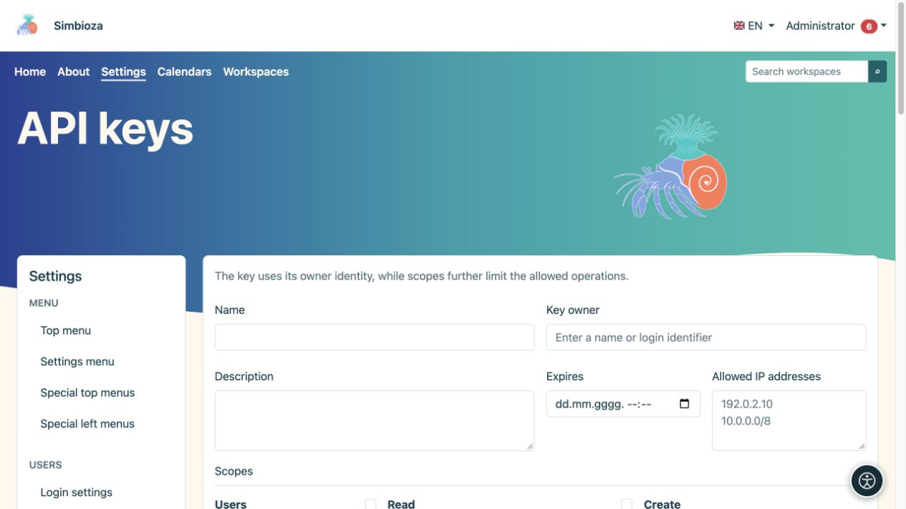
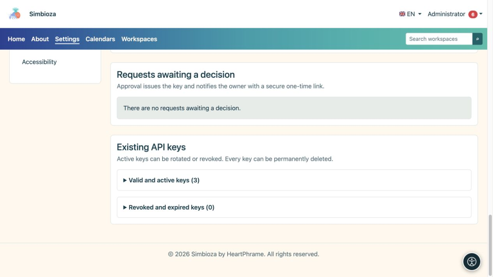

# Administrar claves de API

> Las capturas de pantalla muestran la interfaz en inglés.

**Audiencia:** los administradores aprueban y emiten claves; Los usuarios que hayan iniciado sesión pueden enviar solicitudes personales. Abra **Configuración → Usuarios → clave de APIs** cuando el módulo API esté instalado y habilitado.

Una clave de API permite que otro programa actúe con los derechos de su **propietario**. Los ámbitos, la caducidad y las restricciones de IP limitan aún más el acceso; no conceden derechos que el propietario no tenga. Quien solo edita páginas o responde encuestas normalmente no necesita una clave de API.

## Crear una clave

*Una nueva clave de API tiene propietario, caducidad, direcciones permitidas y ámbitos elegidos por separado.*

1. Introduzca un nombre y un propósito reconocibles, como el nombre del sistema conectado.
2. Busque y seleccione el **Propietario de la clave**. No seleccione un administrador simplemente porque aparece primero.
3. Establezca **Expira** cuando el acceso debe finalizar en una fecha particular.
4. Ingrese las **Direcciones IP permitidas** requeridas; un campo vacío permite todas las IP. Utilice direcciones o redes individuales válidas en el formato admitido.
5. Seleccione el conjunto de ámbitos más pequeño necesario. Las opciones disponibles dependen de los módulos instalados y habilitados.
6. Elija **Crear clave de API** e inmediatamente cópiela o guárdela de forma segura en el sistema de destino.

**Resultado:** se crea la clave y su valor secreto se muestra una sola vez. Recargar la página no permite volver a consultarlo. Nunca lo incluya en instrucciones, capturas de pantalla, comentarios ordinarios o código público.

## Procesar la solicitud de un usuario

*Las solicitudes en espera de una decisión y las claves existentes activas o revocadas son independientes del formulario de clave nueva.*

Un usuario abre **Mi cuenta → API acceso**, describe el propósito, los alcances solicitados, la caducidad y las restricciones de IP y luego envía una solicitud. No se puede enviar otra solicitud mientras una esté pendiente.

En **Solicitudes pendientes**, los administradores revisan el propietario y el alcance solicitado y luego eligen **Aprobar solicitud** o **Rechazar solicitud**. El rechazo puede incluir una nota. Un propietario aprobado recibe una notificación que contiene un enlace único seguro para revelar la clave. Marque [notificaciones/correo electrónico](admin-e-posta_es.md) si no llega la entrega esperada.

## Distinguir rotación, revocación y eliminación.

| Acción | Resultado |
|---|---|
| Renovar (rotación) | Publica un nuevo secreto; el secreto anterior deja de funcionar inmediatamente. Guarde el nuevo en el sistema conectado. |
| Revocar | Detiene el acceso a la clave mientras conserva su registro. Utilícelo cuando ya no sea necesario el acceso o cuando el secreto haya quedado expuesto. |
| Borrar | Elimina permanentemente la clave después de la confirmación. El evento separado de auditoría de actividades permanece. |

Las claves existentes se dividen en secciones válidas/activas y revocadas/caducadas. **Usado por última vez** ayuda a identificar si una clave está en uso; no es un registro de cada solicitud. Una clave caducada o revocada no se reactiva cambiando la vista.

## Verificar acceso

Pídale al mantenedor del programa conectado que pruebe una acción permitida y una prohibida. Un espacio de trabajo privado debe permanecer ilegible para un propietario sin acceso incluso si la clave tiene el alcance de lectura del espacio de trabajo. Verifique la eliminación o revocación con otra solicitud real en lugar de simplemente observar un botón que falta.

Esta pantalla emite credenciales; No es una forma de programación para crear todo tipo de contenidos. Para solicitudes y respuestas reales en todos los módulos, lea la [guía completa API](api-koristenje_es.md); [Ejemplos específicos de la encuesta](ankete-api_es.md) también están disponibles. El encargado de la instalación configura la configuración API del lado del servidor, incluido el acceso entre orígenes y la entrega de webhooks; La pantalla de claves no tiene un interruptor universal que reemplace las comprobaciones de permisos.
