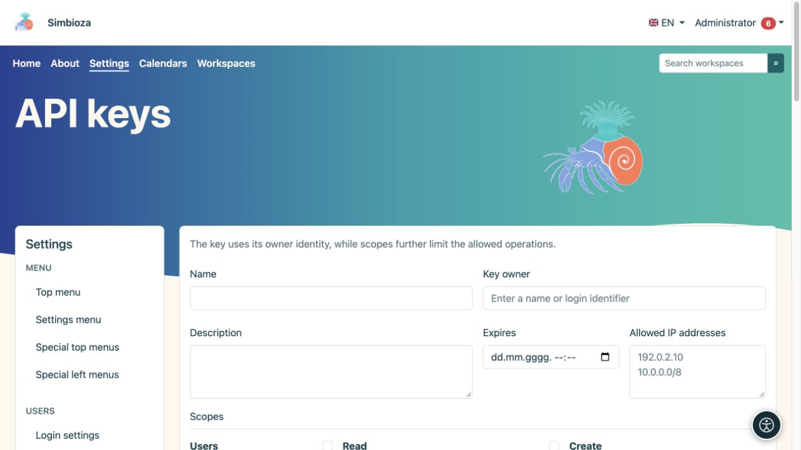
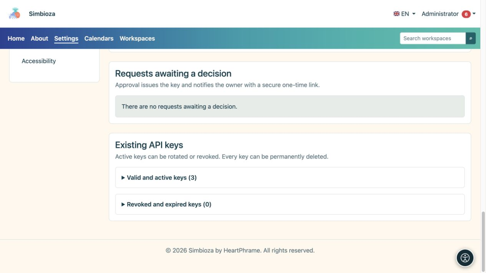

# Administration des clés API

> Les captures d’écran présentent l’interface en anglais.

**Public :** les administrateurs approuvent et délivrent les clés ; les utilisateurs connectés peuvent soumettre des demandes personnelles. Ouvrez **Paramètres → Utilisateurs → Touches API** lorsque le modul’API est installé et activé.

Une clé API permet à un autre programme d'agir en tant que **propriétaire**. Les portées, l'expiration et les restrictions IP le limitent davantage ; ils n'accordent pas de droits qui manquent au propriétaire. Une personne qui modifie uniquement des pages ou répond à un sondage n'a généralement pas besoin d'une clé API.

## Créer une clé

*Une nouvelle clé API a un propriétaire, une expiration, des adresses autorisées et des étendues choisies séparément.*

1. Saisissez un nom et un objectif reconnaissables, tels que le nom du système connecté.
2. Recherchez et sélectionnez le **Propriétaire de la clé**. Ne sélectionnez pas un administrateur simplement parce qu'il apparaît en premier.
3. Définissez **Expire** lorsque l'accès doit s'arrêter à une date particulière.
4. Entrez les **Adresses IP autorisées** requises ; un champ vide autorise toutes les adresses IP. Utilisez des adresses individuelles ou des réseaux valides dans le format pris en charge.
5. Sélectionnez le plus petit ensemble d’étendues nécessaire. Les choix disponibles dépendent des modules installés et activés.
6. Choisissez **Créer la clé API** et copiez/stockez-la immédiatement en toute sécurité dans le système de destination.

**Résultat :** la clé est émise et son secret n'est affiché qu'une seule fois. L'actualisation ne vous permet pas de le relire. Ne le placez jamais dans des instructions, des captures d'écran, des commentaires ordinaires ou un code public.

## Traiter la demande d'un utilisateur

*Les demandes en attente de décision et les clés actives ou révoquées existantes sont distinctes du formulaire de nouvelle clé.*

Un utilisateur ouvre **Mon compte → accès API**, décrit l'objectif, les étendues demandées, l'expiration et les restrictions IP, puis soumet une demande. Une autre demande ne peut pas être soumise alors qu’une autre est en attente.

Sous **Demandes en attente**, les administrateurs examinent le propriétaire et la portée demandée, puis choisissent **Approuver la demande** ou **Rejeter la demande**. Le rejet peut inclure une note. Un propriétaire approuvé reçoit une notification contenant un lien unique sécurisé pour révéler la clé. Vérifiez [notifications/e-mail](admin-e-posta_fr.md) si la livraison prévue n'arrive pas.

## Distinguer rotation, révocation et suppression

| Action | Résultat |
|---|---|
| Tourner | Émet un nouveau secret ; le secret précédent cesse immédiatement de fonctionner. Stockez le nouveau dans le système connecté. |
| Révoquer | Arrête l'accès à la clé tout en conservant son enregistrement. À utiliser lorsque l'accès n'est plus nécessaire ou que le secret peut avoir été révélé. |
| Supprimer | Supprime définitivement la clé après confirmation. L’événement distinct d’audit d’activité demeure. |

Les clés existantes sont divisées en sections valides/actives et révoquées/expirées. **Dernière utilisation** permet d'identifier si une clé est en cours d'utilisation ; ce n'est pas un enregistrement de chaque demande. Une clé expirée ou révoquée n'est pas réactivée en changeant la vue.

## Vérifier l'accès

Demandez au responsable du programme connecté de tester une action autorisée et une action interdite. Un espace de travail privé doit rester illisible pour un propriétaire sans accès, même si la clé a la portée de lecture de l'espace de travail. Vérifiez la suppression ou la révocation avec une autre demande réelle plutôt que de simplement observer un bouton manquant.

Cet écran délivre des informations d'identification ; ce n'est pas une forme de programmation pour créer tout type de contenu. Pour connaître les demandes et les réponses réelles dans tous les modules, lisez le [guid’API complet](api-koristenje_fr.md) ; [Des exemples spécifiques au sondage](ankete-api_fr.md) sont également disponibles. Les paramètres API côté serveur, y compris l'accès entre origines croisées et la livraison de webhooks, sont configurés par le responsable de l'installation ; l’écran des clés n'a pas de commutateur universel qui remplace les contrôles d'autorisation.
