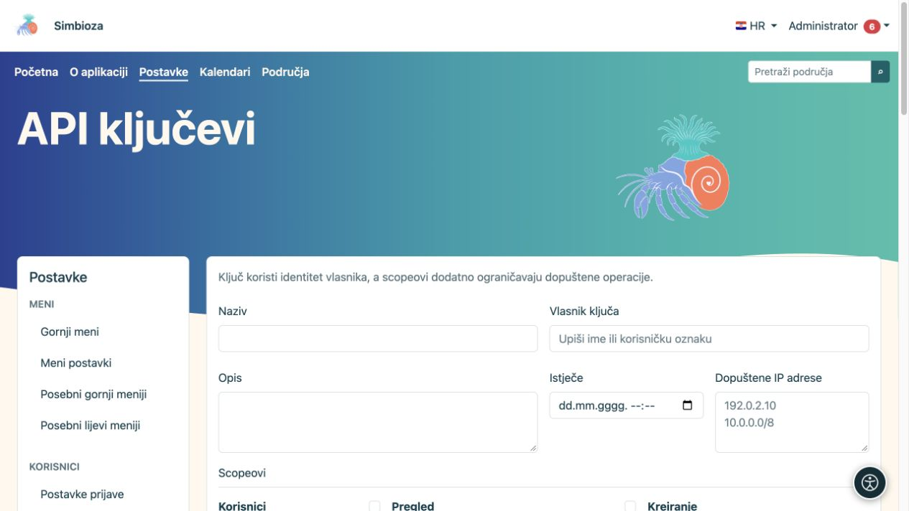
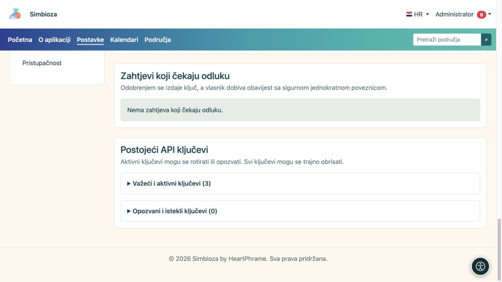

# Administracija API ključeva

**Za koga:** administrator odobrava i izdaje ključeve; prijavljeni korisnik može poslati osobni zahtjev. Otvorite **Postavke → Korisnici → API ključevi** kada je modul API instaliran i uključen.

API ključ omogućuje drugom programu rad u ime njegova **vlasnika**. Scopeovi, rok i IP ograničenje dodatno ga sužavaju; ne daju prava koja vlasnik nema. Osobi koja treba samo uređivati stranicu ili ispuniti anketu API ključ obično nije potreban.

## Kreirajte ključ

*Novi API ključ ima vlasnika, rok valjanosti, dopuštene adrese i zasebno odabrane opsege.*

1. Unesite prepoznatljiv naziv i opis namjene, primjerice naziv povezanog sustava.
2. Pronađite i odaberite **Vlasnika ključa**. Ne birajte administratora samo zato što je prvi na popisu.
3. Postavite **Istječe** ako pristup treba prestati određenog datuma.
4. U **Dopuštene IP adrese** upišite potrebna ograničenja; prazno polje dopušta sve IP adrese. Koristite valjane pojedinačne adrese ili mreže prema podržanom formatu.
5. Označite najmanji potreban skup scopeova. Ponuda ovisi o instaliranim i uključenim modulima.
6. Odaberite **Kreiraj API ključ** i odmah ga sigurno preuzmite/kopirajte u odredišni sustav.

**Rezultat:** ključ je izdan, a tajna se prikazuje samo jednom. Nakon osvježavanja tajnu nije moguće ponovno pročitati. Ne stavljajte je u upute, screenshotove, obične komentare ili javni kod.

## Obradite zahtjev korisnika

*Zahtjevi za odluku i postojeći aktivni ili opozvani ključevi odvojeni su od obrasca za novi ključ.*

Korisnik otvara **Moj račun → API pristup**, opisuje namjenu, tražene scopeove, rok i IP ograničenja te šalje zahtjev. Dok jedan zahtjev čeka odluku, novi se ne šalje.

Administrator u **Zahtjevi koji čekaju odluku** pregledava vlasnika i traženi opseg te odabire **Odobri zahtjev** ili **Odbij zahtjev**. Pri odbijanju može ostaviti napomenu. Odobreni vlasnik dobiva obavijest sa sigurnom jednokratnom poveznicom za prikaz ključa. Provjerite i [postavke obavijesti/e-pošte](admin-e-posta_hr.md) ako očekivana dostava nije stigla.

## Razlikujte rotaciju, opoziv i brisanje

| Radnja | Što se događa |
|---|---|
| Rotiraj | Izdaje novu tajnu; prethodna odmah prestaje vrijediti. Novi ključ spremite u povezani sustav. |
| Opozovi | Zaustavlja pristup ključem i zadržava zapis o ključu. Koristite kada pristup više nije potreban ili sumnjate da je tajna otkrivena. |
| Obriši | Trajno uklanja ključ nakon potvrde. Zaseban zapis radnje u dnevniku ostaje. |

Postojeći ključevi odvojeni su na važeće/aktivne i opozvane/istekle. **Zadnja uporaba** pomaže ustanoviti koristi li se ključ; nije popis svih zahtjeva. Istekao ili opozvan ključ ne oživljava se promjenom prikaza.

## Provjerite pristup

Neka osoba koja održava povezani program provjeri dopuštenu radnju i jednu zabranjenu radnju. Čitanje privatnog područja mora ostati zabranjeno vlasniku bez prava, čak i kada ključ ima scope za čitanje područja. Brisanje ili opoziv neka se provjeri stvarnim ponovnim zahtjevom, ne samo nestankom gumba.

Ovaj ekran izdaje pristupne ključeve; nije programerski obrazac za stvaranje svih vrsta sadržaja. Za konkretne zahtjeve i odgovore svih modula pogledajte [cijeli API priručnik](api-koristenje_hr.md); dostupni su i [primjeri za ankete](ankete-api_hr.md). Poslužiteljske API postavke, uključujući međudomenski pristup i webhook dostavu, podešava održavatelj instalacije; na ekranu ključeva nema univerzalnog prekidača koji tim postavkama zamjenjuje ovlasti.
