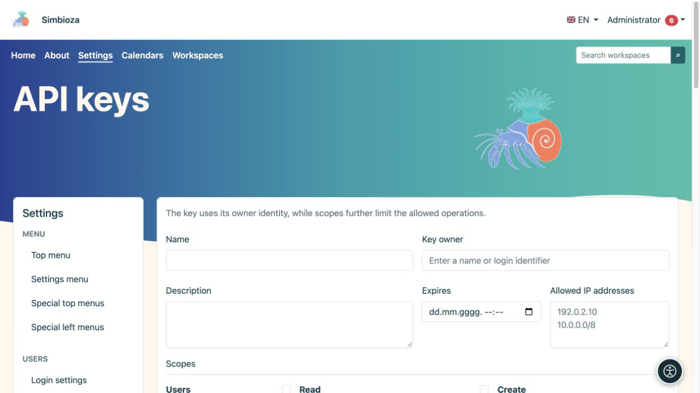
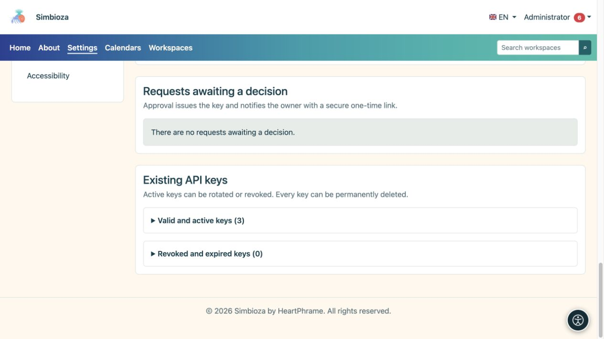

# Amministrazione delle chiavi API

> Le schermate mostrano l’interfaccia in inglese.

**Pubblico:** gli amministratori approvano ed emettono le chiavi; gli utenti registrati possono inviare richieste personali. Apri **Impostazioni → Utenti → Chiavi API** quando il modulo API è installato e abilitato.

Una chiave API consente a un altro programma di agire come suo **proprietario**. Gli ambiti, la scadenza e le restrizioni IP lo limitano ulteriormente; non concedono diritti di cui manca il titolare. Qualcuno che modifica solo pagine o risponde a un sondaggio di solito non ha bisogno di una chiave API.

## Crea una chiave

*Una nuova chiave API ha un proprietario, una scadenza, indirizzi consentiti e ambiti scelti separatamente.*

1. Inserisci un nome e uno scopo riconoscibili, ad esempio il nome del sistema connesso.
2. Trova e seleziona il **Proprietario della chiave**. Non selezionare un amministratore semplicemente perché appare per primo.
3. Imposta **Scadenza** quando l'accesso deve terminare in una data specifica.
4. Inserisci gli **indirizzi IP consentiti** obbligatori; un campo vuoto consente tutti gli IP. Utilizza indirizzi individuali o reti validi nel formato supportato.
5. Seleziona il set di ambiti più piccolo necessario. Le scelte disponibili dipendono dai moduli installati e abilitati.
6. Scegli **Crea chiave API** e copiala/archiviala immediatamente in modo sicuro nel sistema di destinazione.

**Risultato:** la chiave viene emessa e il suo segreto viene mostrato una sola volta. L'aggiornamento non ti consente di rileggerlo. Non inserirlo mai in istruzioni, screenshot, commenti ordinari o codice pubblico.

## Elaborare la richiesta di un utente

*Le richieste in attesa di decisione e le chiavi esistenti attive o revocate sono separate dal modulo della nuova chiave.*

Un utente apre **Il mio account → API accesso**, descrive lo scopo, gli ambiti richiesti, la scadenza e le restrizioni IP, quindi invia una richiesta. Non è possibile inviare un'altra richiesta mentre una è in sospeso.

In **Richieste in sospeso**, gli amministratori esaminano il proprietario e l'ambito richiesto, quindi scelgono **Approva richiesta** o **Rifiuta richiesta**. Il rifiuto può includere una nota. Un proprietario approvato riceve una notifica contenente un collegamento sicuro una tantum per rivelare la chiave. Controlla [notifiche/e-mail](admin-e-posta_it.md) se la consegna prevista non arriva.

## Distinguere rotazione, revoca e cancellazione

| Azione | Risultato |
|---|---|
| Ruotare | Rilascia un nuovo segreto; il segreto precedente smette immediatamente di funzionare. Memorizzare quello nuovo nel sistema connesso. |
| Revocare | Interrompe l'accesso alla chiave conservandone il record. Da utilizzare quando l'accesso non è più necessario o il segreto potrebbe essere stato scoperto. |
| Eliminare | Rimuove permanentemente la chiave dopo la conferma. Rimane l'evento separato di controllo delle attività. |

Le chiavi esistenti sono suddivise in sezioni valide/attive e revocate/scadute. **Ultimo utilizzo** aiuta a identificare se una chiave è in uso; non è una registrazione di ogni richiesta. Una chiave scaduta o revocata non viene riattivata modificando la visualizzazione.

## Verifica l'accesso

Chiedere al manutentore del programma connesso di testare un'azione consentita e una vietata. Un'area di lavoro privata deve rimanere illeggibile per un proprietario senza accesso anche se la chiave ha l'ambito di lettura dell'area di lavoro. Verifica l'eliminazione o la revoca con un'altra richiesta effettiva anziché semplicemente osservando un pulsante mancante.

Questa schermata emette credenziali; non è un modulo di programmazione per creare ogni tipo di contenuto. Per richieste e risposte effettive nei vari moduli, leggi la [guida completa API](api-koristenje_it.md); sono disponibili anche [esempi specifici per i sondaggi](ankete-api_it.md). Le impostazioni API lato server, compresi accesso multiorigine e consegna dei webhook, sono configurate dal responsabile dell'installazione; la schermata delle chiavi non dispone di un interruttore universale che sostituisca i controlli delle autorizzazioni.
