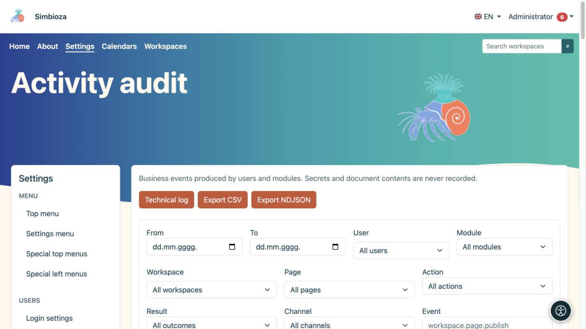
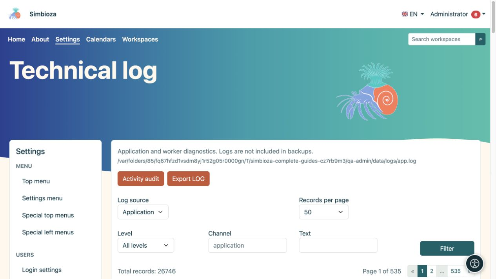

# Aktivitätsnachweise und technisches Protokoll

> Die Bildschirmaufnahmen zeigen die englische Benutzeroberfläche.

**Zielgruppe:** der Administrator der gesamten Installation. Öffnen Sie **Einstellungen → Protokolle**. Die beiden Ansichten beantworten unterschiedliche Fragen: **Aktivitätsprüfung** zeigt, wer was getan hat, während das **Technische Protokoll** hilft, Anwendungs- oder Nachrichtenverarbeitungsfehler zu erklären.

## Suchen Sie im Aktivitätsaudit nach einer Aktion

*Die Aktivitätsprüfung filtert Geschäftsaktionen nach Benutzer, Modul, Inhalt und Ergebnis.*

1. Öffnen Sie **Aktivitätsaudit**.
2. Wählen Sie einen Datumsbereich und bei Bedarf einen Benutzer, einen Arbeitsbereich oder eine Seite aus. Durchsuchbare Selektoren laden die Ergebnisse nach und nach; Wählen Sie **Mehr laden** für weitere Ergebnisse.
3. Grenzen Sie das Modul, die Aktion, das Ergebnis, den Kanal, das Ereignis oder das Ziel ein, sofern bekannt.
4. Wählen Sie **Filter** und lesen Sie die Zeile: Zeit, Benutzer, Ereignis, Ziel und Ergebnis.
5. Erweitern Sie **Details** nur, wenn Sie weitere Informationen benötigen. **Filter zurücksetzen** kehrt zu einer breiteren Ansicht zurück.

**Ergebnis:** Die Ansicht enthält die angeforderten Aktionen. Durch das Filtern werden keine Ereignisse geändert oder gelöscht.

Ein erfolgreiches Veröffentlichungsereignis unterscheidet sich von einem fehlgeschlagenen Versuch. Ereignisnamen können technische Bezeichner wie `workspace.page.publish` verwenden; diese identifizieren genau einen Aktionstyp. Die Zeiten werden in der Zeitzone der Anwendung angezeigt.

## Exportaktivität

**Export CSV** lädt eine für Office-Tools geeignete Tabelle herunter. **NDJSON exportieren** ist für Tools gedacht, die einzelne JSON-Datensätze verarbeiten. Exporte verwenden die Filter. Überprüfen Sie daher zuerst den Datumsbereich und den Umfang. Behandeln Sie die heruntergeladene Datei als Verwaltungsdaten, da sie Namen und Aktivitätsinformationen enthalten kann.

## Finden Sie einen technischen Fehler

*Das technische Protokoll verfügt über eine eigene Quelle, Ebene, einen eigenen Kanal, einen eigenen Textfilter und eine eigene Seitennavigation.*

1. Öffnen Sie **Technisches Protokoll**.
2. Wählen Sie die **Protokollquelle** aus. Ein Modul kann seine eigene vorhandene Quelle bereitstellen, beispielsweise das E-Mail-Worker-Protokoll.
3. Grenzen Sie **Ebene**, **Kanal** oder **Text** ein und wählen Sie dann **Filter**.
4. Vergleichen Sie die Nachrichtenzeit mit der Zeit der Benutzeraktion.
5. Wenn ein Betreuer Beweise benötigt, verwenden Sie **Export LOG** und geben Sie nur den erforderlichen Umfang an eine autorisierte Person weiter.

DEBUG, INFO, NOTICE, WARNING, ERROR, CRITICAL, ALERT und EMERGENCY beschreiben den Schweregrad des Protokolls. Beginnen Sie bei den meisten Untersuchungen mit ERROR und der relevanten Zeit; Nicht jede Warnung bedeutet, dass ein Vorgang fehlgeschlagen ist.

## Seitennavigation und Aufbewahrung

Beide Ansichten bieten 25, 50, 100 oder 200 Einträge pro Seite, mit Navigation oberhalb und unterhalb der Liste. Dadurch wird die Anzeige begrenzt, nicht die Anzahl der gespeicherten Ereignisse.

Die Betriebsprüfung wird in der Datenbank gespeichert; Technische Protokolle sind Dateien, die von der Installation verwaltet werden. **Technische Protokolle sind von Sicherungen ausgeschlossen.** Diese Bildschirme bieten keine Kontrollen zum Ändern der Aufbewahrungsrichtlinie oder zum Löschen jedes Ereignisses; Vereinbaren Sie solche Arbeiten mit dem zuständigen Betreuer. Fügen Sie keine Passwörter, Token oder den gesamten Dokumentinhalt in Diagnosenotizen ein.
