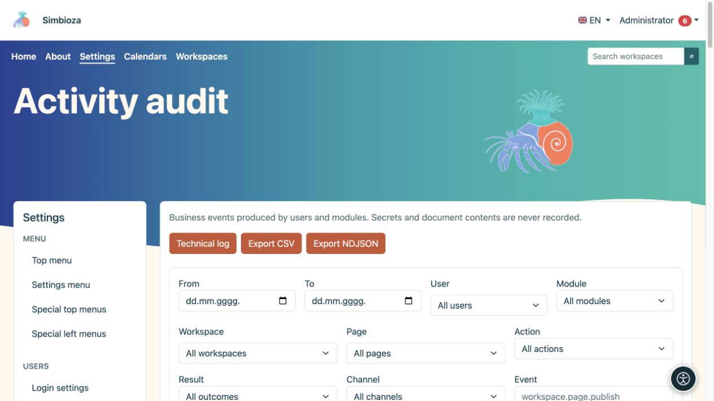
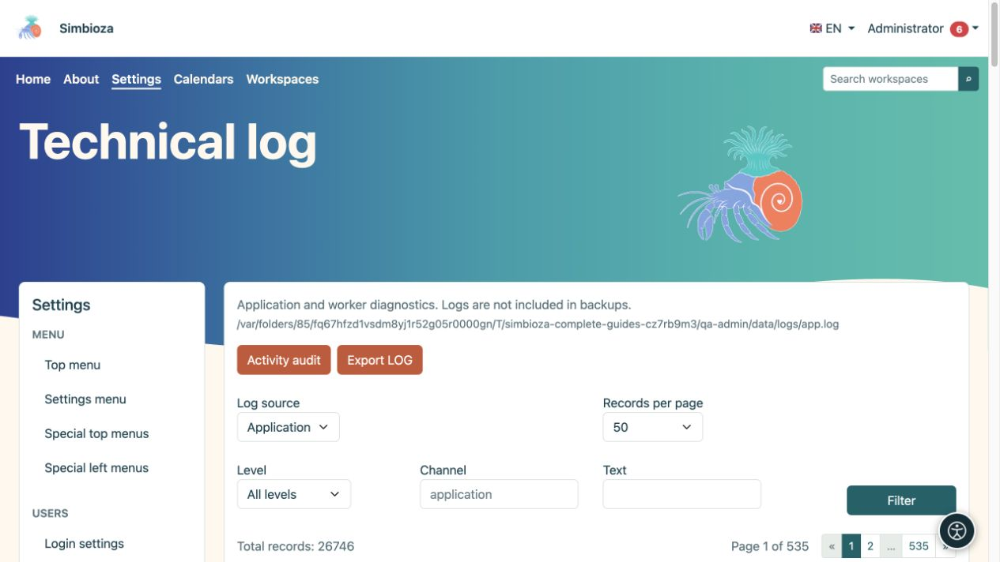

# Activity audit and technical log

**Audience:** the administrator of the entire installation. Open **Settings → Logs**. The two views answer different questions: **Activity audit** shows who did what, while the **Technical log** helps explain application or message-processing errors.

## Find an action in the activity audit

*The activity audit filters business actions by user, module, content, and outcome.*

1. Open **Activity audit**.
2. Select a date range and, where needed, a user, workspace, or page. Searchable selectors load results progressively; choose **Load more** for additional results.
3. Narrow the module, action, outcome, channel, event, or target when known.
4. Choose **Filter** and read the row: time, user, event, target, and result.
5. Expand **Details** only when you need more information. **Reset filters** returns to a broader view.

**Result:** the view contains the requested actions. Filtering does not alter or delete events.

A successful publication event is different from a failed attempt. Event names may use technical identifiers such as `workspace.page.publish`; these precisely identify an action type. Times are displayed in the application's time zone.

## Export activity

**Export CSV** downloads a table suitable for office tools. **Export NDJSON** is intended for tools processing individual JSON records. Exports use the filters, so check the date range and scope first. Treat the downloaded file as administration data because it may contain names and activity information.

## Find a technical error

*The technical log has its own source, level, channel, text filter, and pagination.*

1. Open **Technical log**.
2. Select the **Log source**. A module can provide its own existing source, such as the email-worker log.
3. Narrow the **Level**, **Channel**, or **Text**, then choose **Filter**.
4. Compare the message time with the time of the user's action.
5. If a maintainer needs evidence, use **Export LOG** and share only the necessary scope with an authorised person.

DEBUG, INFO, NOTICE, WARNING, ERROR, CRITICAL, ALERT, and EMERGENCY describe log severity. Start with ERROR and the relevant time in most investigations; not every warning means an operation failed.

## Pagination and retention

Both views offer 25, 50, 100, or 200 entries per page, with navigation above and below the list. This limits the display, not the number of events stored.

The business audit is stored in the database; technical logs are files maintained by the installation. **Technical logs are excluded from backups.** These screens do not provide controls to change retention policy or delete every event; arrange such operations with the responsible maintainer. Do not include passwords, tokens, or full document content in diagnostic notes.
