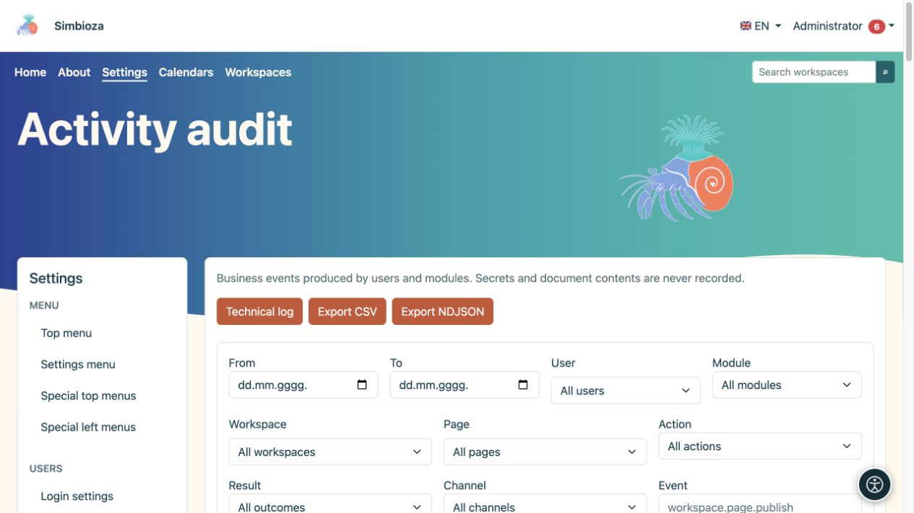
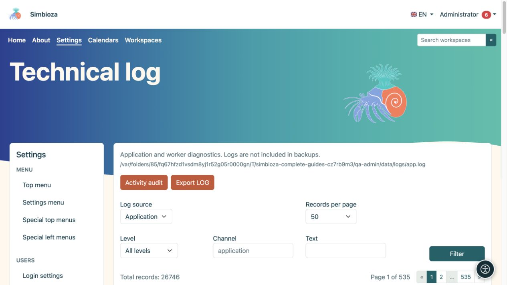

# Auditoría de actividad y registro técnico

> Las capturas de pantalla muestran la interfaz en inglés.

**Audiencia:** el administrador de toda la instalación. Abra **Configuración → Registros**. Las dos vistas responden a preguntas diferentes: **Auditoría de actividad** muestra quién hizo qué, mientras que el **Registro técnico** ayuda a explicar los errores de aplicación o procesamiento de mensajes.

## Buscar una acción en la auditoría de actividad

*La auditoría de actividad filtra las acciones comerciales por usuario, módulo, contenido y resultado.*

1. Abra **Auditoría de actividad**.
2. Seleccione un rango de fechas y, cuando sea necesario, un usuario, espacio de trabajo o página. Los selectores de búsqueda cargan los resultados progresivamente; elija **Cargar más** para obtener resultados adicionales.
3. Limite el módulo, acción, resultado, canal, evento u objetivo cuando lo conozca.
4. Elija **Filtro** y lea la fila: hora, usuario, evento, objetivo y resultado.
5. Expanda **Detalles** solo cuando necesite más información. **Restablecer filtros** vuelve a una vista más amplia.

**Resultado:** la vista contiene las acciones solicitadas. El filtrado no altera ni elimina eventos.

Un evento de publicación exitoso es diferente de un intento fallido. Los nombres de eventos pueden utilizar identificadores técnicos como `workspace.page.publish`; estos identifican precisamente un tipo de acción. Los horarios se muestran en la zona horaria de la aplicación.

## Actividad exportadora

**Exportar CSV** descarga una tabla adecuada para herramientas de oficina. **Exportar NDJSON** está destinado a herramientas que procesan registros JSON individuales. Las exportaciones utilizan los filtros, así que primero verifique el rango de fechas y el alcance. Trate el archivo descargado como datos de administración porque puede contener nombres e información de actividad.

## Encuentra un error técnico

*El registro técnico tiene su propia fuente, nivel, canal, filtro de texto y paginación.*

1. Abra **Registro técnico**.
2. Seleccione **Fuente de registro**. Un módulo puede proporcionar su propia fuente existente, como el registro del trabajador de correo electrónico.
3. Limite el **Nivel**, **Canal** o **Texto** y luego elija **Filtro**.
4. Compare el tiempo del mensaje con el tiempo de la acción del usuario.
5. Si un mantenedor necesita evidencia, use **Exportar REGISTRO** y comparta solo el alcance necesario con una persona autorizada.

DEBUG, INFO, NOTICE, WARNING, ERROR, CRITICAL, ALERT y EMERGENCY indican la gravedad de los registros. En la mayoría de las investigaciones, empiece por ERROR y el intervalo de tiempo pertinente; no todas las advertencias indican que haya fallado una operación.

## Paginación y retención

Ambas vistas ofrecen 25, 50, 100 o 200 entradas por página, con navegación por encima y por debajo de la lista. Esto limita la visualización, no la cantidad de eventos almacenados.

La auditoría empresarial se almacena en la base de datos; Los registros técnicos son archivos mantenidos por la instalación. **Los registros técnicos están excluidos de las copias de seguridad.** Estas pantallas no proporcionan controles para cambiar la política de retención o eliminar todos los eventos; organizar dichas operaciones con el mantenedor responsable. No incluya contraseñas, tokens ni el contenido completo del documento en las notas de diagnóstico.
