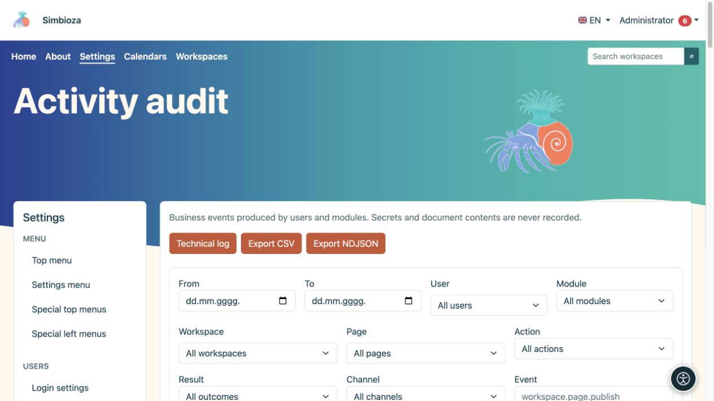
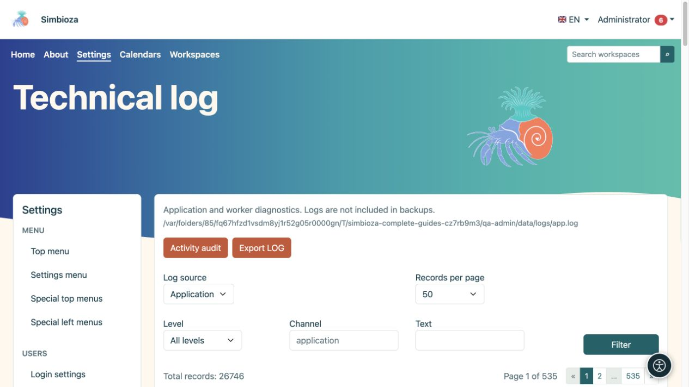

# Journal d’activité et journal technique

> Les captures d’écran présentent l’interface en anglais.

**Public :** l'administrateur de l'ensemble de l'installation. Ouvrez **Paramètres → Journaux**. Les deux vues répondent à des questions différentes : l'**Audit d'activité** montre qui a fait quoi, tandis que le **Journal technique** aide à expliquer les erreurs d'application ou de traitement des messages.

## Rechercher une action dans l'audit d'activité

*L'audit d'activité filtre les actions commerciales par utilisateur, module, contenu et résultat.*

1. Ouvrez **Audit d'activité**.
2. Sélectionnez une plage de dates et, si nécessaire, un utilisateur, un espace de travail ou une page. Les sélecteurs consultables chargent les résultats progressivement ; choisissez **Charger plus** pour des résultats supplémentaires.
3. Affinez le module, l’action, le résultat, le canal, l’événement ou la cible lorsqu’il est connu.
4. Choisissez **Filtre** et lisez la ligne : heure, utilisateur, événement, cible et résultat.
5. Développez **Détails** uniquement lorsque vous avez besoin de plus d'informations. **Réinitialiser les filtres** revient à une vue plus large.

**Résultat :** la vue contient les actions demandées. Le filtrage ne modifie ni ne supprime les événements.

Un événement de publication réussi est différent d’une tentative échouée. Les noms d'événements peuvent utiliser des identifiants techniques tels que `workspace.page.publish` ; ceux-ci identifient précisément un type d’action. Les heures sont affichées dans le fuseau horaire de l'application.

## Activité d'exportation

**Export CSV** télécharge un tableau adapté aux outils bureautiques. **Export NDJSON** est destiné aux outils traitant des enregistrements JSON individuels. Les exportations utilisent les filtres, vérifiez donc d'abord la plage de dates et la portée. Traitez le fichier téléchargé comme des données d'administration car il peut contenir des noms et des informations sur l'activité.

## Trouver une erreur technique

*Le journal technique a sa propre source, niveau, canal, filtre de texte et pagination.*

1. Ouvrez le **Journal technique**.
2. Sélectionnez la **Source du journal**. Un module peut fournir sa propre source existante, telle que le journal du courrier électronique.
3. Affinez le **Niveau**, le **Channel** ou le **Text**, puis choisissez **Filtre**.
4. Comparez l'heure du message avec l'heure de l'action de l'utilisateur.
5. Si un responsable a besoin de preuves, utilisez **Export LOG** et partagez uniquement la portée nécessaire avec une personne autorisée.

DEBUG, INFO, NOTICE, WARNING, ERROR, CRITICAL, ALERT et EMERGENCY indiquent le niveau de gravité du journal. Pour la plupart des diagnostics, commencez par ERROR et l’heure concernée ; un avertissement ne signifie pas toujours qu’une opération a échoué.

## Pagination et conservation

Les deux vues proposent 25, 50, 100 ou 200 entrées par page, avec une navigation au-dessus et en dessous de la liste. Cela limite l'affichage, pas le nombre d'événements stockés.

L'audit d'entreprise est stocké dans la base de données ; les journaux techniques sont des fichiers maintenus par l'installation. **Les journaux techniques sont exclus des sauvegardes.** Ces écrans ne fournissent pas de contrôles pour modifier la politique de rétention ou supprimer chaque événement ; organiser ces opérations avec le responsable. N'incluez pas de mots de passe, de jetons ou le contenu complet du document dans les notes de diagnostic.
