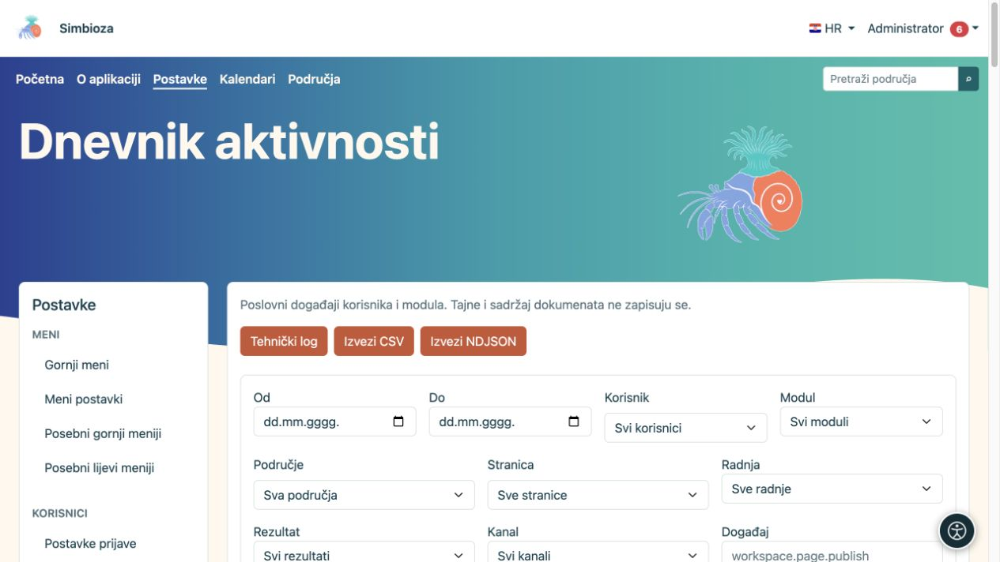
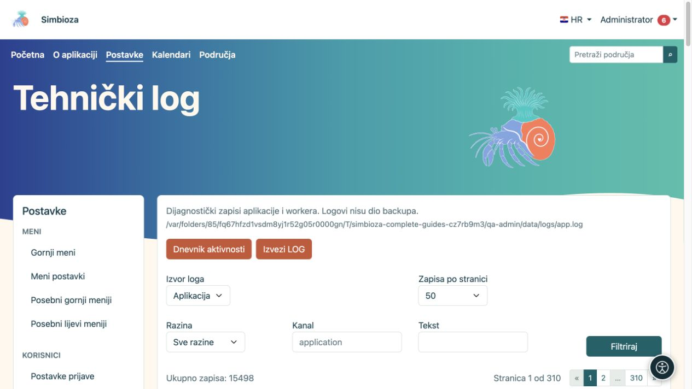

# Dnevnik aktivnosti i tehnički log

**Za koga:** administrator cijele instalacije. Otvorite **Postavke → Dnevnici**. Dva pregleda odgovaraju na različita pitanja: **Dnevnik aktivnosti** pokazuje tko je što učinio, a **Tehnički log** pomaže objasniti pogrešku aplikacije ili obrade poruka.

## Pronađite radnju u dnevniku aktivnosti

*Filtar dnevnika aktivnosti sužava poslovne radnje po korisniku, modulu, sadržaju i rezultatu.*

1. Otvorite **Dnevnik aktivnosti**.
2. Odaberite razdoblje; po potrebi korisnika, područje ili stranicu. Pretraživi odabiri učitavaju rezultate postupno; koristite **Učitaj još** kada trebate dodatne rezultate.
3. Suzite modul, radnju, rezultat, kanal, događaj ili cilj ako znate što tražite.
4. Odaberite **Filtriraj** i pročitajte redak: vrijeme, korisnik, događaj, cilj i rezultat.
5. Otvorite **Detalji** samo kada trebate dodatne podatke. **Poništi filtre** vraća širi pregled.

**Rezultat:** pregled je ograničen na tražene radnje. Filtriranje ne mijenja niti briše događaje.

Događaj uspješne objave i događaj neuspjelog pokušaja nisu isto. Naziv događaja može biti tehnička oznaka, primjerice `workspace.page.publish`; ona služi preciznom pronalaženju vrste radnje. Vrijeme se prikazuje prema vremenskoj zoni aplikacije.

## Izvoz aktivnosti

**Izvezi CSV** daje tabličnu datoteku prikladnu za uredske alate. **Izvezi NDJSON** namijenjen je alatima koji obrađuju pojedinačne JSON zapise. Izvoz koristi filtre; prije preuzimanja provjerite razdoblje i opseg. Datoteku čuvajte kao administrativni podatak, jer može sadržavati imena i podatke o radnjama.

## Pronađite tehničku pogrešku

*Tehnički log ima vlastiti izvor, razinu, kanal, tekstualni filtar i straničenje.*

1. Otvorite **Tehnički log**.
2. Odaberite **Izvor loga**. Pojedini modul može ponuditi vlastiti postojeći izvor, primjerice zapis obrade e-pošte.
3. Suzite **Razinu**, **Kanal** ili **Tekst**, pa odaberite **Filtriraj**.
4. Usporedite vrijeme poruke s vremenom korisničke radnje.
5. Ako trebate pomoć održavatelja, preuzmite **Izvezi LOG** i pošaljite samo potreban opseg ovlaštenoj osobi.

Izbori DEBUG, INFO, NOTICE, WARNING, ERROR, CRITICAL, ALERT i EMERGENCY opisuju ozbiljnost zapisa. Obično prvo tražite ERROR i vrijeme problema; ne zaključujte da je svako upozorenje kvar koji je prekinuo rad.

## Straničenje i čuvanje

Oba pregleda nude 25, 50, 100 ili 200 zapisa po stranici te navigaciju iznad i ispod popisa. To ograničava samo prikaz, ne količinu događaja u sustavu.

Poslovni dnevnik vodi se u bazi, a tehnički log u datotekama koje održava instalacija. **Tehnički logovi nisu dio sigurnosnih kopija.** Ovi ekrani nemaju gumb za promjenu politike čuvanja ili brisanje svih događaja; takve zahvate dogovorite s odgovornom osobom. Ne upisujte lozinke, tokene ili puni sadržaj dokumenata u dijagnostičke bilješke.
