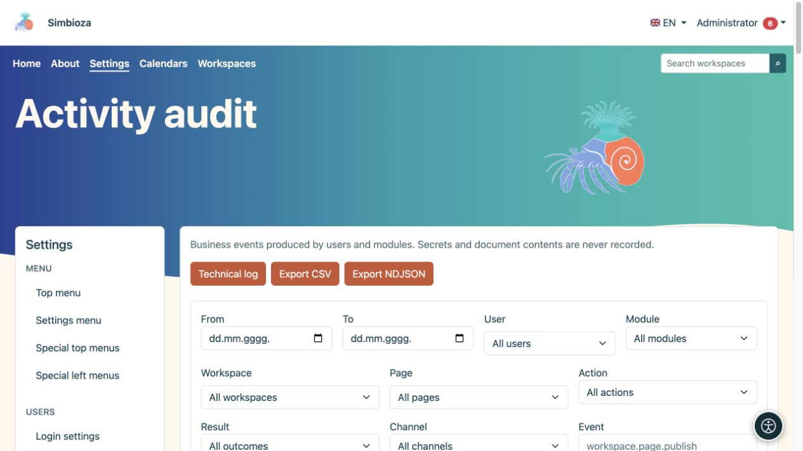
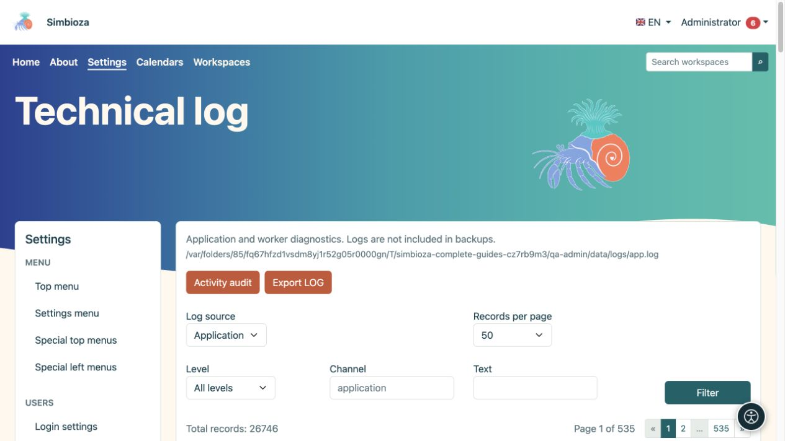

# Registro delle attività e registro tecnico

> Le schermate mostrano l’interfaccia in inglese.

**Pubblico:** l'amministratore dell'intera installazione. Apri **Impostazioni → Registri**. Le due visualizzazioni rispondono a domande diverse: il **Controllo attività** mostra chi ha fatto cosa, mentre il **Registro tecnico** aiuta a spiegare gli errori dell'applicazione o di elaborazione dei messaggi.

## Trovare un'azione nel registro delle attività

*Il controllo delle attività filtra le azioni aziendali per utente, modulo, contenuto e risultato.*

1. Apri **Registro delle attività**.
2. Seleziona un intervallo di date e, dove necessario, un utente, un'area di lavoro o una pagina. I selettori ricercabili caricano i risultati progressivamente; scegli **Carica altro** per ulteriori risultati.
3. Restringi il modulo, l'azione, il risultato, il canale, l'evento o il target quando noto.
4. Scegli **Filtro** e leggi la riga: ora, utente, evento, destinazione e risultato.
5. Espandi **Dettagli** solo quando hai bisogno di ulteriori informazioni. **Reimposta filtri** ritorna a una visualizzazione più ampia.

**Risultato:** la vista contiene le azioni richieste. Il filtraggio non altera né elimina gli eventi.

Un evento di pubblicazione riuscito è diverso da un tentativo fallito. I nomi degli eventi possono utilizzare identificatori tecnici come `workspace.page.publish`; questi identificano precisamente una tipologia di azione. Gli orari vengono visualizzati nel fuso orario dell'applicazione.

## Esportare le attività

**Esporta CSV** scarica una tabella adatta agli strumenti di Office. **L'esportazione NDJSON** è destinata agli strumenti che elaborano singoli record JSON. Le esportazioni utilizzano i filtri, quindi controlla prima l'intervallo di date e l'ambito. Tratta il file scaricato come dati amministrativi perché potrebbe contenere nomi e informazioni sull'attività.

## Trova un errore tecnico

*Il registro tecnico ha la propria fonte, livello, canale, filtro di testo e impaginazione.*

1. Apri **Registro tecnico**.
2. Seleziona la **Sorgente del registro**. Un modulo può fornire una propria sorgente esistente, per esempio il registro del processo di invio delle email.
3. Restringi il **Livello**, il **Canale** o il **Testo**, quindi scegli **Filtro**.
4. Confronta l'ora del messaggio con l'ora dell'azione dell'utente.
5. Se un manutentore ha bisogno di prove, utilizza **Esporta LOG** e condividi solo l'ambito necessario con una persona autorizzata.

DEBUG, INFO, NOTICE, WARNING, ERROR, CRITICAL, ALERT ed EMERGENCY descrivono la gravità dei messaggi del registro. Nella maggior parte delle verifiche, inizia da ERROR e dall'orario pertinente; non ogni avviso indica che un'operazione è fallita.

## Impaginazione e conservazione

Entrambe le visualizzazioni offrono 25, 50, 100 o 200 voci per pagina, con la navigazione sopra e sotto l'elenco. Ciò limita la visualizzazione, non il numero di eventi memorizzati.

L'audit aziendale è archiviato nel database; i log tecnici sono file gestiti dall'installazione. **I registri tecnici sono esclusi dai backup.** Queste schermate non forniscono controlli per modificare i criteri di conservazione o eliminare ogni evento; concordare tali operazioni con il manutentore responsabile. Non includere password, token o il contenuto completo del documento nelle note diagnostiche.
