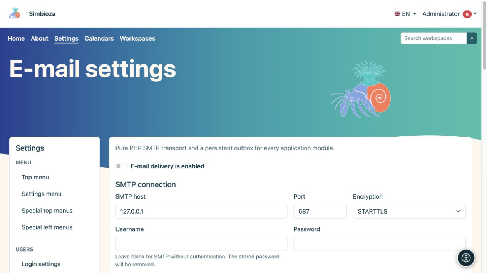
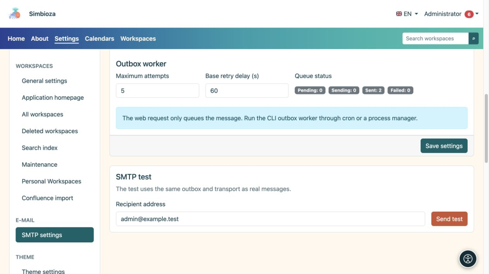
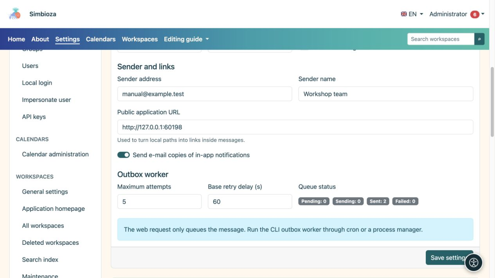

# E-Mail und Zustellung testen

> Die Bildschirmaufnahmen zeigen die englische Benutzeroberfläche.

**Zielgruppe:** der Administrator der gesamten Installation. Öffnen Sie **Einstellungen → E-Mail-Einstellungen**. Module, die Nachrichten senden, einschließlich Benachrichtigungen und Umfrageberichte, verwenden diese Einstellungen.

Erfragen Sie die Einstellungen beim Verantwortlichen Ihres Mailservers. Erraten Sie nicht den Host, den Port oder das Passwort.

## Konfigurieren Sie die Verbindung und den Absender

*Geben Sie zuerst die SMTP-Verbindung ein; die angezeigte lokale Adresse ist nur ein Beispiel für einen Testserver.*

1. Geben Sie den von Ihrem E-Mail-Anbieter bereitgestellten SMTP-Host, Port und Verschlüsselungsmethode ein.
2. Wenn eine Authentifizierung erforderlich ist, geben Sie einen Benutzernamen und ein Passwort ein. Ein leeres Passwort mit einem konfigurierten Benutzernamen behält das gespeicherte Passwort bei; ein leerer Benutzername deaktiviert die SMTP-Authentifizierung und löscht das gespeicherte SMTP-Passwort.
3. Geben Sie die **Absenderadresse** und den **Absendernamen** ein. Diese identifizieren den Absender gegenüber den Empfängern.
4. Überprüfen Sie die **URL der öffentlichen Anwendung**, einschließlich aller Unterverzeichnisse. Darauf basieren Nachrichtenlinks.
5. Aktivieren Sie **E-Mail-Zustellung ist aktiviert** und wählen Sie **Einstellungen speichern**.

**Ergebnis:** Die Anwendung verfügt über eine gespeicherte Übermittlungskonfiguration. Ein erfolgreiches Speichern allein bestätigt nicht, dass die E-Mail einen Empfänger erreicht hat.

| Feld | Zweck und Anfangswert |
|---|---|
| Port und Verschlüsselung | Der übliche Standardwert ist 587/STARTTLS; Verwenden Sie die tatsächlichen Werte Ihres Servers. TLS und keine Verschlüsselung sind separate Optionen. |
| Verbindungszeitüberschreitung | Maximale Wartezeit auf Verbindungsaufbau; Standard: 15 s, Bereich 1–120 s. |
| SMTP-Timeout | Kommunikations-Timeout; Standard: 30 s, Bereich 1–300 s. |
| Überprüfen Sie das Zertifikat TLS | Standardmäßig aktiviert; überprüft die Identität des Servers. |
| Selbstsigniertes Zertifikat zulassen | Standardmäßig deaktiviert. Stimmen Sie jede Änderung mit dem E-Mail-Betreuer ab. |
| Senden Sie E-Mail-Kopien von In-App-Benachrichtigungen | Ermöglicht diesen Kanal neben den persönlichen Vorlieben des Benutzers; es ersetzt nicht den Hauptabgabeschalter. |
| Maximale Versuche | Zustellversuche für eine Nachricht in der Warteschlange; Standardwert 5, Bereich 1–100. |
| Basis-Wiederholungsverzögerung | Startverzögerung vor erneutem Versuch; Standard: 60 s, Bereich 1–86.400 s. |

## Senden Sie eine Testnachricht

*Der SMTP-Test verwendet gespeicherte Einstellungen und sendet eine echte Nachricht an die eingegebene Adresse.*

1. Speichern Sie zunächst die Einstellungen; der Test verwendet die gespeicherte Konfiguration.
2. Geben Sie unter **SMTP-Test** eine Adresse ein, die Sie überprüfen können und an die Sie berechtigt sind, einen Test zu senden.
3. Wählen Sie **Test senden** und lesen Sie das Ergebnis.
4. Überprüfen Sie die empfangene Nachricht und den Junk-Mail-Ordner.

Der Test verwendet den tatsächlichen Postausgang und denselben Zustellungsmechanismus wie andere E-Mails. Wenn der Versand fehlschlägt, überprüfen Sie die Konfiguration, den **Warteschlangenstatus** und das [technische Protokoll](admin-dnevnici_de.md). Dabei handelt es sich nicht nur um eine Formularvorschau: Es wird eine echte Nachricht an die eingegebene Adresse gesendet.

## Warteschlange und regelmäßige Verarbeitung

*Der Absender, die öffentliche Anwendungsadresse und der Status der Nachrichtenwarteschlange dienen unterschiedlichen Zwecken.*

Der Warteschlangenstatus zeigt vorhandene Nachrichten und deren Status an. Durch das Speichern der SMTP-Einstellungen wird keine regelmäßige Verarbeitung geplant. Der Serverbetreuer muss eine regelmäßige Nachrichtenverarbeitung veranlassen. Überprüfen Sie für [Umfrageberichte](ankete-poslovi-izvjestaja_de.md) auch deren Zeitplan, Empfänger und Zustellungskanal.

Wenn die Konfiguration schreibgeschützt ist oder eine Migration fehlt, bitten Sie um eine Überprüfung der Installation. Das Passwort wird niemals an den Browser zurückgegeben. Ein leeres Feld bedeutet nicht, dass kein Passwort gespeichert ist.
