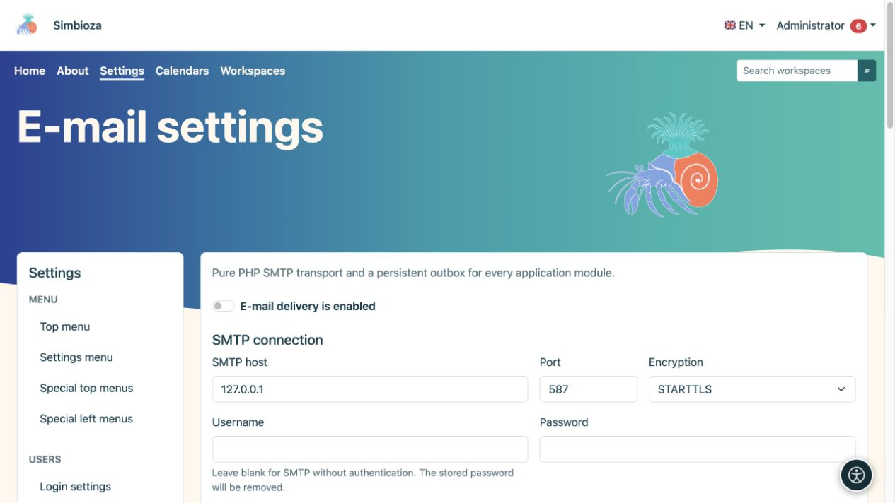
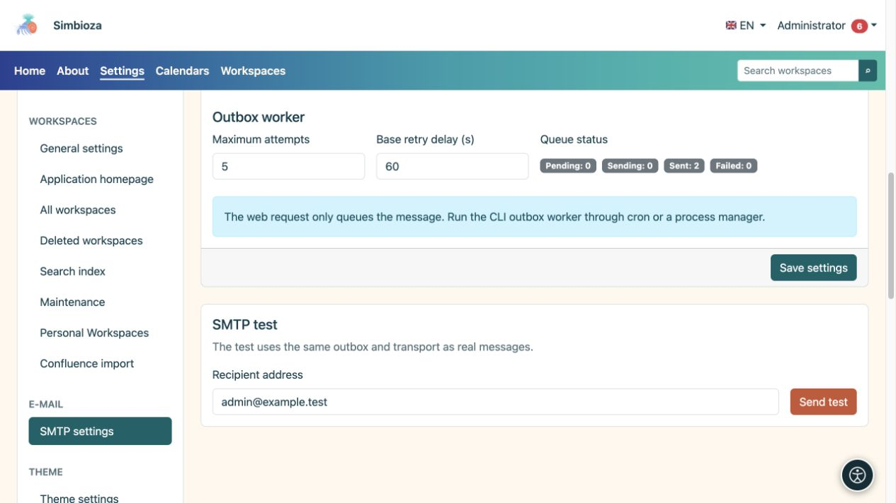
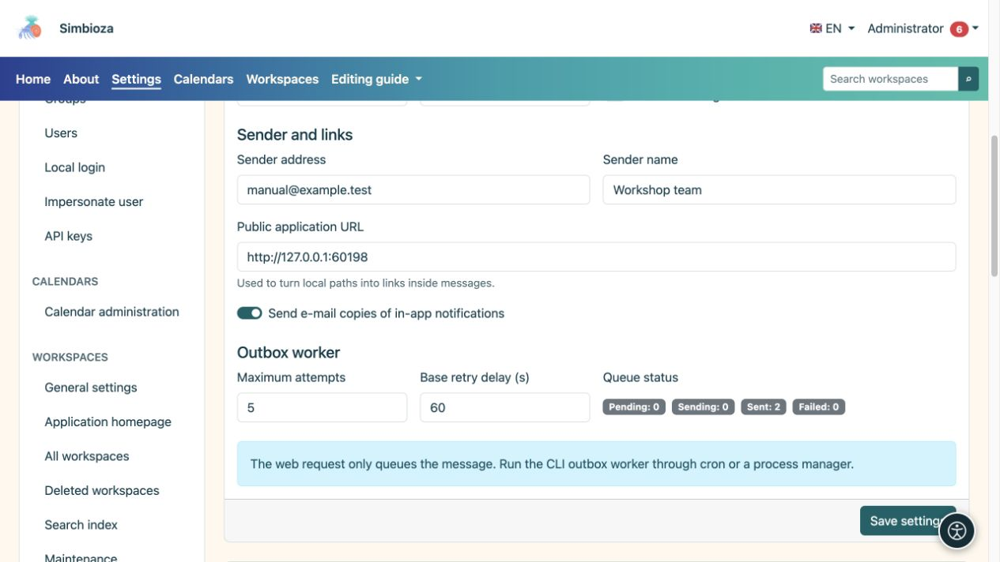

# Email and delivery testing

**Audience:** the administrator of the entire installation. Open **Settings → Email settings**. Modules that send messages, including notifications and survey reports, use these settings.

Obtain the settings from the person responsible for your mail server. Do not guess the host, port, or password.

## Configure the connection and sender

*Enter the SMTP connection first; the local address shown is only an example test server.*

1. Enter the SMTP host, port, and encryption method supplied by your mail provider.
2. If authentication is required, enter a username and password. A blank password with a configured username preserves the saved password; a blank username disables SMTP authentication and clears the saved SMTP password.
3. Enter the **Sender address** and **Sender name**. These identify the sender to recipients.
4. Check the **Public application URL**, including any subdirectory. Message links are based on it.
5. Enable **Email delivery is enabled** and choose **Save settings**.

**Result:** the application has a saved delivery configuration. A successful save alone does not confirm that mail reached a recipient.

| Field | Purpose and initial value |
|---|---|
| Port and encryption | The usual default is 587/STARTTLS; use your server's actual values. TLS and no encryption are separate choices. |
| Connection timeout | Maximum wait for connection establishment; default 15 s, range 1–120 s. |
| SMTP timeout | Communication timeout; default 30 s, range 1–300 s. |
| Verify TLS certificate | Enabled by default; verifies the server's identity. |
| Allow self-signed certificate | Disabled by default. Agree any change with the mail maintainer. |
| Send email copies of in-app notifications | Permits this channel alongside users' personal preferences; it does not replace the main delivery switch. |
| Maximum attempts | Delivery attempts for a queued message; default 5, range 1–100. |
| Base retry delay | Starting delay before retrying; default 60 s, range 1–86,400 s. |

## Send a test message

*The SMTP test uses saved settings and sends a real message to the entered address.*

1. Save the settings first; the test uses the saved configuration.
2. Under **SMTP test**, enter an address you can check and are authorised to send a test to.
3. Choose **Send test** and read the result.
4. Check the received message and the junk-mail folder.

The test uses the actual outbox and the same delivery mechanism as other mail. If sending fails, check the configuration, **Queue status**, and the [technical log](admin-dnevnici_en.md). This is not just a form preview: a real message is sent to the entered address.

## Queue and regular processing

*The sender, public application address, and message queue status serve different purposes.*

Queue status shows existing messages and their states. Saving SMTP settings does not itself schedule regular processing. The server maintainer must arrange periodic message processing. For [survey reports](ankete-poslovi-izvjestaja_en.md), also check their schedule, recipients, and delivery channel.

If configuration is read-only or a migration is missing, ask for the installation to be checked. The password is never returned to the browser; an empty field does not mean no password is stored.
