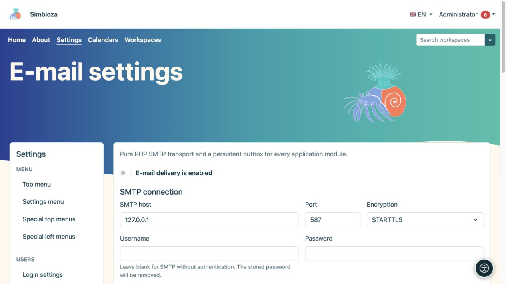
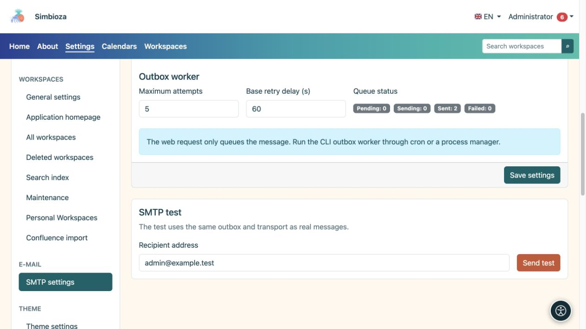
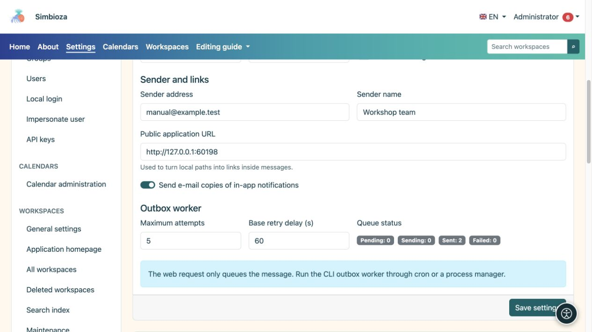

# Correo electrónico y pruebas de envío

> Las capturas de pantalla muestran la interfaz en inglés.

**Audiencia:** el administrador de toda la instalación. Abra **Configuración → Configuración de correo electrónico**. Los módulos que envían mensajes, incluidas notificaciones e informes de encuestas, utilizan esta configuración.

Obtenga la configuración de la persona responsable de su servidor de correo. No adivine el host, el puerto o la contraseña.

## Configurar la conexión y el remitente

*Ingrese primero la conexión SMTP; la dirección local que se muestra es solo un servidor de prueba de ejemplo.*

1. Ingrese el host SMTP, el puerto y el método de cifrado proporcionados por su proveedor de correo.
2. Si se requiere autenticación, ingrese un nombre de usuario y contraseña. Una contraseña en blanco con un nombre de usuario configurado conserva la contraseña guardada; un nombre de usuario en blanco deshabilita la autenticación SMTP y borra la contraseña SMTP guardada.
3. Ingrese la **Dirección del remitente** y el **Nombre del remitente**. Estos identifican al remitente ante los destinatarios.
4. Verifique la **URL de la aplicación pública**, incluido cualquier subdirectorio. Los enlaces de mensajes se basan en él.
5. Habilite **La entrega de correo electrónico está habilitada** y elija **Guardar configuración**.

**Resultado:** la aplicación tiene una configuración de entrega guardada. Un guardado exitoso por sí solo no confirma que el correo haya llegado al destinatario.

| Campo | Propósito y valor inicial. |
|---|---|
| Puerto y cifrado | El valor predeterminado habitual es 587/STARTTLS; utilice los valores reales de su servidor. TLS y sin cifrado son opciones independientes. |
| Tiempo de espera de conexión | Espera máxima para el establecimiento de la conexión; predeterminado 15 s, rango 1–120 s. |
| Tiempo de espera SMTP | Tiempo de espera de comunicación; predeterminado 30 s, rango 1–300 s. |
| Verificar el certificado TLS | Habilitado de forma predeterminada; verifica la identidad del servidor. |
| Permitir certificado autofirmado | Deshabilitado por defecto. Acuerde cualquier cambio con el responsable del correo. |
| Enviar copias por correo electrónico de notificaciones dentro de la aplicación | Permite este canal junto con las preferencias personales de los usuarios; no reemplaza el interruptor principal de entrega. |
| Intentos máximos | Intentos de entrega de un mensaje en cola; valor predeterminado 5, rango 1–100. |
| Retraso de reintento base | Retraso inicial antes de volver a intentarlo; predeterminado 60 s, rango 1–86 400 s. |

## Enviar un mensaje de prueba

*La prueba SMTP utiliza configuraciones guardadas y envía un mensaje real a la dirección ingresada.*

1. Guarde la configuración primero; la prueba utiliza la configuración guardada.
2. En **Prueba SMTP**, ingresa una dirección que pueda verificar y a la que estés autorizado a enviar una prueba.
3. Elija **Enviar prueba** y lea el resultado.
4. Verifique el mensaje recibido y la carpeta de correo no deseado.

La prueba utiliza la bandeja de salida real y el mismo mecanismo de entrega que el resto del correo. Si el envío falla, verifique la configuración, **Estado de la cola** y el [registro técnico](admin-dnevnici_es.md). Esto no es sólo una vista previa del formulario: se envíe un mensaje real a la dirección ingresada.

## Cola y procesamiento regular

*El remitente, la dirección de la aplicación pública y el estado de la cola de mensajes tienen diferentes propósitos.*

El estado de la cola muestra los mensajes existentes y sus estados. Guardar la configuración SMTP no programa en sí un procesamiento regular. El mantenedor del servidor debe organizar el procesamiento periódico de mensajes. Para [informes de encuestas](ankete-poslovi-izvjestaja_es.md), consulte también su programación, destinatarios y canal de entrega.

Si la configuración es de solo lectura o falta una migración, solicite que se verifique la instalación. La contraseña nunca se devuelve al navegador; un campo vacío no significa que no se almacene ninguna contraseña.
