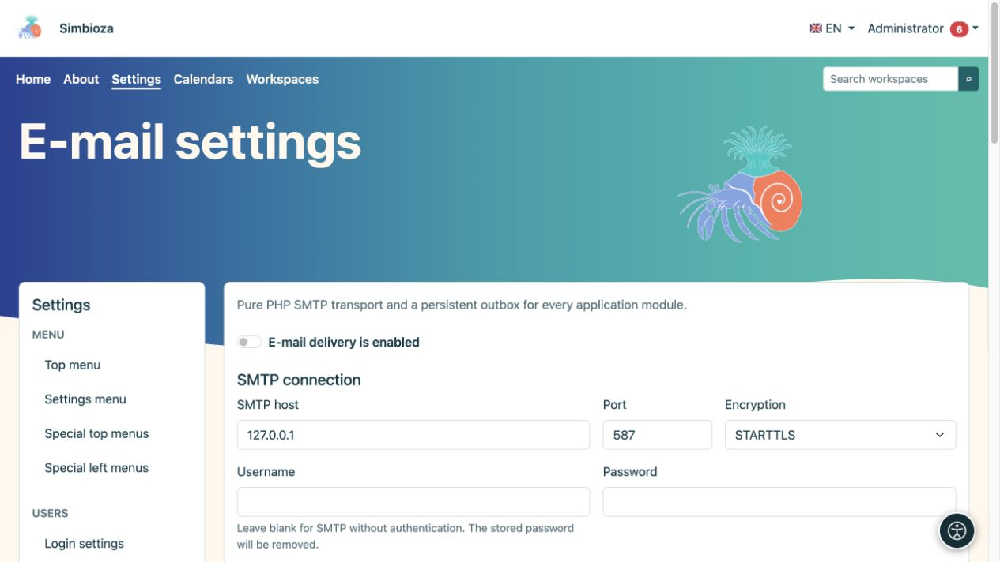
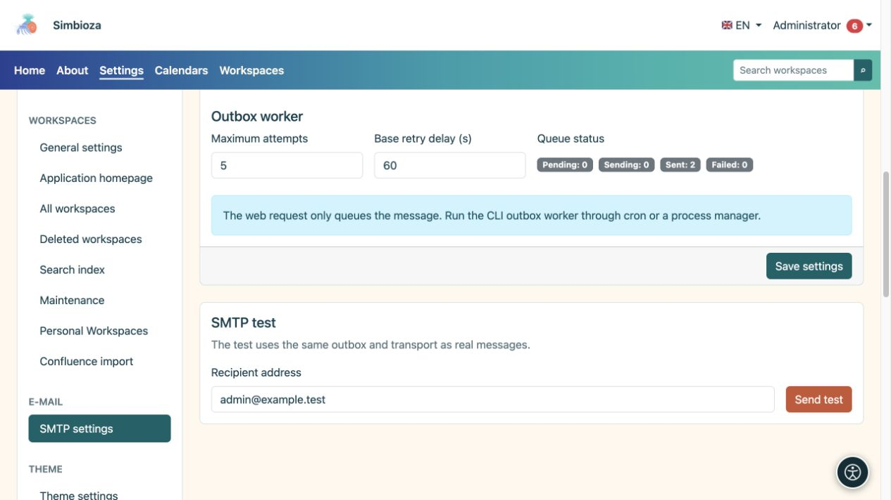
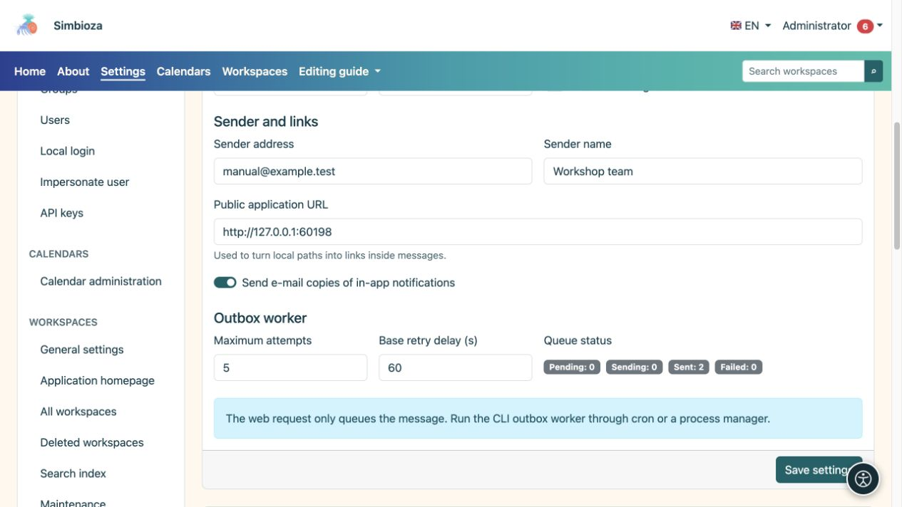

# Courriel et vérification de l’envoi

> Les captures d’écran présentent l’interface en anglais.

**Public :** l'administrateur de l'ensemble de l'installation. Ouvrez **Paramètres → Paramètres de messagerie**. Les modules qui envoient des messages, notamment des notifications et des rapports de sondage, utilisent ces paramètres.

Obtenez les paramètres auprès de la personne responsable de votre serveur de messagerie. Ne devinez pas l'hôte, le port ou le mot de passe.

## Configurer la connexion et l'expéditeur

*Entrez d'abord la connexion SMTP ; l'adresse locale indiquée n'est qu'un exemple de serveur de test.*

1. Saisissez l'hôte SMTP, le port et la méthode de cryptage fournis par votre fournisseur de messagerie.
2. Si une authentification est requise, entrez un nom d'utilisateur et un mot de passe. Un mot de passe vide avec un nom d'utilisateur configuré préserve le mot de passe enregistré ; un nom d'utilisateur vide désactive l'authentification SMTP et efface le mot de passe SMTP enregistré.
3. Saisissez l'**Adresse de l'expéditeur** et le **Nom de l'expéditeur**. Ceux-ci identifient l’expéditeur auprès des destinataires.
4. Vérifiez l'**URL de l'application publique**, y compris les éventuels sous-répertoires. Les liens de messages sont basés sur cela.
5. Activez **La livraison par e-mail est activée** et choisissez **Enregistrer les paramètres**.

**Résultat :** l'application dispose d'une configuration de diffusion enregistrée. Une sauvegarde réussie ne suffit pas à confirmer que le courrier est parvenu à un destinataire.

| Champ | Objet et valeur initiale |
|---|---|
| Port et cryptage | La valeur par défaut habituelle est 587/STARTTLS ; utilisez les valeurs réelles de votre serveur. TLS et aucun cryptage sont des choix distincts. |
| Délai de connexion | Attente maximale pour l'établissement de la connexion ; par défaut 15 s, plage 1 à 120 s. |
| Délai d'expiration SMTP | Délai de communication ; par défaut 30 s, plage 1 à 300 s. |
| Vérifier le certificat TLS | Activé par défaut ; vérifie l'identité du serveur. |
| Autoriser le certificat auto-signé | Désactivé par défaut. Acceptez tout changement avec le responsable du courrier. |
| Envoyer des copies par e-mail des notifications dans l'application | Autorise ce canal parallèlement aux préférences personnelles des utilisateurs ; il ne remplace pas l'interrupteur principal de distribution. |
| Tentatives maximales | Tentatives de livraison pour un message en file d'attente ; par défaut 5, plage 1 à 100. |
| Délai de nouvelle tentative de base | Délai de démarrage avant de réessayer ; par défaut 60 s, plage 1 à 86 400 s. |

## Envoyer un message test

*Le test SMTP utilise les paramètres enregistrés et envoie un message réel à l'adresse saisie.*

1. Enregistrez d'abord les paramètres ; le test utilise la configuration enregistrée.
2. Sous **Test SMTP**, saisissez une adresse que vous pouvez vérifier et à laquelle vous êtes autorisé à envoyer un test.
3. Choisissez **Envoyer le test** et lisez le résultat.
4. Vérifiez le message reçu et le dossier de courrier indésirable.

Le test utilise la boîte d'envoi réelle et le même mécanisme de livraison que les autres courriers. Si l'envoi échoue, vérifiez la configuration, l'**État de la file d'attente** et le [journal technique](admin-dnevnici_fr.md). Il ne s'agit pas d'un simple aperçu du formulaire : un véritable message est envoyé à l'adresse saisie.

## File d'attente et traitement régulier

*L'expéditeur, l'adresse publique de l'application et l'état de la file d'attente des messages servent à des fins différentes.*

L'état de la file d'attente affiche les messages existants et leurs états. L’enregistrement des paramètres SMTP ne planifie pas en soi un traitement régulier. Le responsable du serveur doit organiser le traitement périodique des messages. Pour les [rapports d'interrogation](ankete-poslovi-izvjestaja_fr.md), vérifiez également leur calendrier, leurs destinataires et leur canal de livraison.

Si la configuration est en lecture seule ou si une migration est manquante, demandez la vérification de l'installation. Le mot de passe n'est jamais renvoyé au navigateur ; un champ vide ne signifie pas qu'aucun mot de passe n'est stocké.
