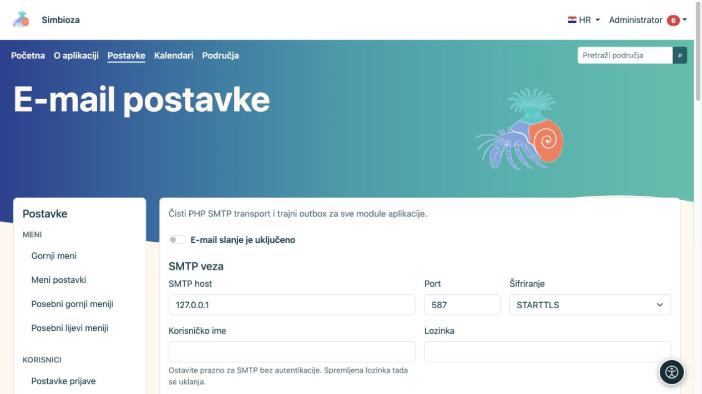
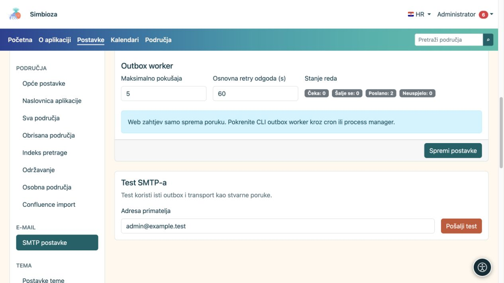
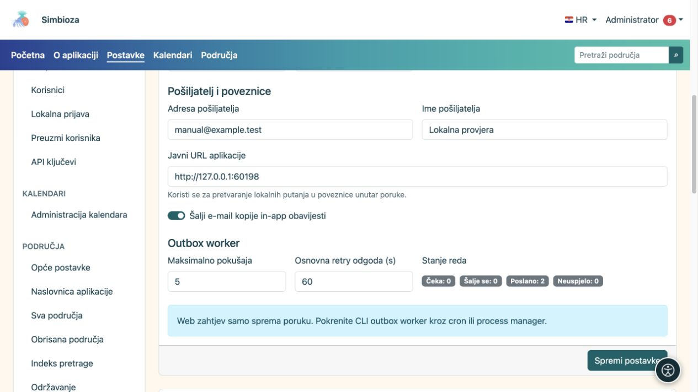

# E-pošta i provjera slanja

**Za koga:** administrator cijele instalacije. Otvorite **Postavke → E-mail postavke**. Ove postavke koriste moduli koji šalju poruke, primjerice obavijesti i izvještaji anketa.

Za podešavanje trebate podatke od osobe koja održava vaš poslužitelj e-pošte. Ne pogađajte host, port ili lozinku.

## Podesite vezu i pošiljatelja

*Najprije upišite SMTP vezu; prikazana lokalna adresa samo je primjer testnog poslužitelja.*

1. Upišite SMTP host, port i način šifriranja koje vam je dao pružatelj e-pošte.
2. Ako veza traži prijavu, upišite korisničko ime i lozinku. Prazna lozinka uz postojeće korisničko ime čuva već spremljenu lozinku; prazno korisničko ime isključuje SMTP prijavu i briše spremljenu SMTP lozinku.
3. Unesite **Adresu pošiljatelja** i **Ime pošiljatelja**. To je identitet koji primatelj vidi na poruci.
4. Provjerite **Javni URL aplikacije**, uključujući poddirektorij ako ga koristite. Iz njega nastaju poveznice u porukama.
5. Uključite **E-mail slanje je uključeno** i odaberite **Spremi postavke**.

**Rezultat:** aplikacija ima spremljenu konfiguraciju slanja. Sama poruka o spremanju još ne potvrđuje da je pošta stigla primatelju.

| Polje | Čemu služi i početna vrijednost |
|---|---|
| Port i šifriranje | Uobičajena zadana kombinacija je 587/STARTTLS; koristite vrijednosti svojeg poslužitelja. TLS i bez šifriranja zasebni su izbori. |
| Timeout veze | Koliko se čeka uspostava veze; zadano 15 s, dopušteno 1–120 s. |
| SMTP timeout | Koliko se čeka komunikacija; zadano 30 s, dopušteno 1–300 s. |
| Provjeri TLS certifikat | Zadano uključeno; provjerava identitet poslužitelja. |
| Dopusti self-signed certifikat | Zadano isključeno. Promjenu treba dogovoriti s osobom koja održava poštu. |
| Šalji e-mail kopije in-app obavijesti | Omogućuje taj kanal uz korisnikove osobne izbore; ne zamjenjuje glavni prekidač slanja. |
| Maksimalno pokušaja | Koliko puta se pokušava dostaviti poruka iz reda; zadano 5, dopušteno 1–100. |
| Osnovna retry odgoda | Polazište čekanja ponovnog pokušaja; zadano 60 s, dopušteno 1–86.400 s. |

## Pošaljite testnu poruku

*Test SMTP-a koristi spremljene postavke i šalje stvarnu poruku na upisanu adresu.*

1. Najprije spremite postavke; test koristi spremljenu konfiguraciju.
2. U **Test SMTP-a** upišite adresu kojoj imate pristup i na koju smijete poslati test.
3. Odaberite **Pošalji test** i pročitajte rezultat.
4. Provjerite primljenu poruku i mapu neželjene pošte.

Test koristi stvarni red poruka i isti način dostave kao ostala pošta. Ako slanje ne uspije, provjerite unesene podatke, **Stanje reda** i [tehnički log](admin-dnevnici_hr.md). Testna poruka nije samo provjera izgleda obrasca: stvarno se šalje na upisanu adresu.

## Red poruka i redovno izvršavanje

*Pošiljatelj, javna adresa aplikacije i stanje reda poruka imaju različite uloge.*

Stanje reda pokazuje postojeće poruke i njihove statuse. Spremanje SMTP-a ne postavlja samo po sebi raspored redovne obrade. Osoba koja održava poslužitelj treba osigurati redovno pokretanje obrade poruka. Kod [izvještaja anketa](ankete-poslovi-izvjestaja_hr.md) treba provjeriti i njihov raspored, primatelje te kanal dostave.

Ako piše da je konfiguracija samo za čitanje ili da nedostaje migracija, zatražite provjeru instalacije. Lozinka se ne vraća u preglednik; iz praznog polja ne zaključujte da nije spremljena.
