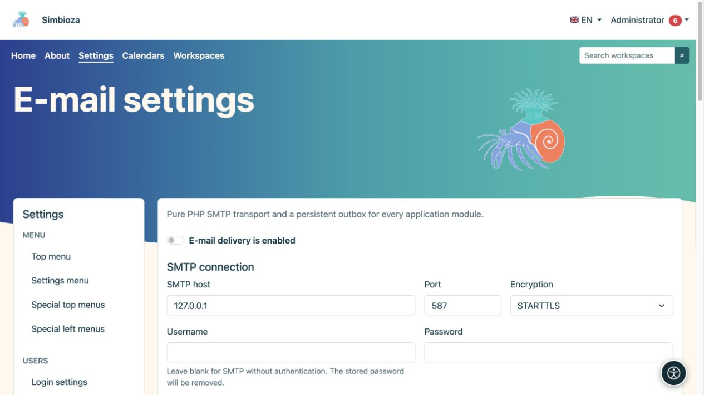
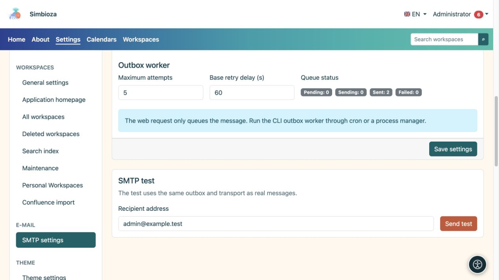
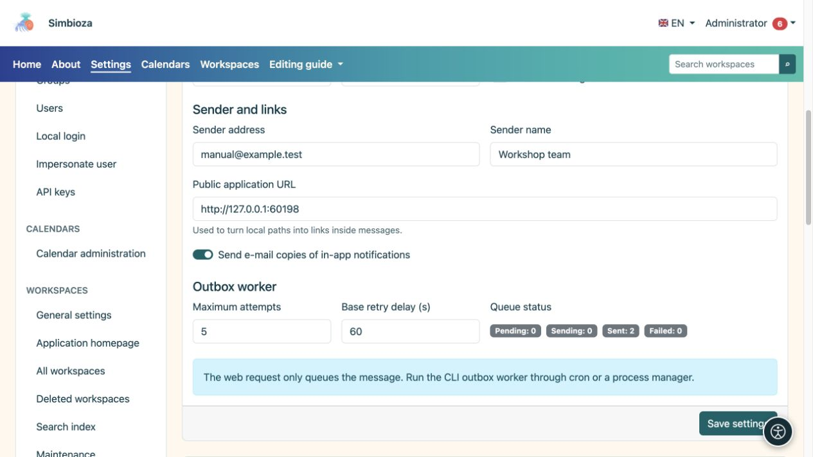

# Email e verifica dell’invio

> Le schermate mostrano l’interfaccia in inglese.

**Pubblico:** l'amministratore dell'intera installazione. Apri **Impostazioni → Impostazioni email**. I moduli che inviano messaggi, incluse notifiche e rapporti sui sondaggi, utilizzano queste impostazioni.

Richiedete le impostazioni alla persona responsabile del vostro server di posta. Non indovinare l'host, la porta o la password.

## Configurare la connessione e il mittente

*Inserisci prima la connessione SMTP; l'indirizzo locale mostrato è solo un esempio di server di prova.*

1. Inserisci l'host SMTP, la porta e il metodo di crittografia forniti dal tuo provider di posta.
2. Se è richiesta l'autenticazione, inserire un nome utente e una password. Una password vuota con un nome utente configurato conserva la password salvata; un nome utente vuoto disabilita l'autenticazione SMTP e cancella la password SMTP salvata.
3. Inserisci l'**Indirizzo mittente** e il **Nome mittente**. Questi identificano il mittente ai destinatari.
4. Controlla l'**URL dell'applicazione pubblica**, inclusa qualsiasi sottodirectory. I collegamenti ai messaggi si basano su di esso.
5. Abilita **L'invio di email è abilitato** e scegli **Salva impostazioni**.

**Risultato:** l'applicazione ha una configurazione di consegna salvata. Un salvataggio riuscito da solo non conferma che la posta abbia raggiunto un destinatario.

| Campo | Scopo e valore iniziale |
|---|---|
| Porta e crittografia | Il valore predefinito usuale è 587/STARTTLS; usa i valori effettivi del tuo server. TLS e nessuna crittografia sono scelte separate. |
| Timeout della connessione | Attesa massima per la creazione della connessione; predefinito 15 s, intervallo 1–120 s. |
| Timeout SMTP | Timeout della comunicazione; predefinito 30 s, intervallo 1–300 s. |
| Verifica il certificato TLS | Abilitato per impostazione predefinita; verifica l'identità del server. |
| Consenti certificato autofirmato | Disabilitato per impostazione predefinita. Concordare eventuali modifiche con il manutentore della posta. |
| Invia copie via email delle notifiche in-app | Consente questo canale insieme alle preferenze personali degli utenti; non sostituisce l'interruttore principale di erogazione. |
| Tentativi massimi | Tentativi di consegna per un messaggio in coda; predefinito 5, intervallo 1–100. |
| Ritardo tentativi base | Ritardo di avvio prima di riprovare; predefinito 60 s, intervallo 1–86.400 s. |

## Invia un messaggio di prova

*Il test SMTP utilizza le impostazioni salvate e invia un messaggio reale all'indirizzo inserito.*

1. Salvare prima le impostazioni; il test utilizza la configurazione salvata.
2. In **Test SMTP**, inserisci un indirizzo che puoi controllare e a cui sei autorizzato a inviare un test.
3. Scegli **Invia test** e leggi il risultato.
4. Controlla il messaggio ricevuto e la cartella della posta indesiderata.

Il test utilizza la posta in uscita effettiva e lo stesso meccanismo di consegna degli altri messaggi di posta. Se l'invio non riesce, controllare la configurazione, lo **Stato della coda** e il [registro tecnico](admin-dnevnici_it.md). Non si tratta solo di un'anteprima del modulo: viene inviato un vero e proprio messaggio all'indirizzo inserito.

## Coda ed elaborazione regolare

*Il mittente, l'indirizzo dell'applicazione pubblica e lo stato della coda dei messaggi hanno scopi diversi.*

Lo stato della coda mostra i messaggi esistenti e i relativi stati. Il salvataggio delle impostazioni SMTP non pianifica di per sé l'elaborazione regolare. Il manutentore del server deve organizzare l'elaborazione periodica dei messaggi. Per i [rapporti di sondaggio](ankete-poslovi-izvjestaja_it.md), controlla anche la pianificazione, i destinatari e il canale di consegna.

Se la configurazione è di sola lettura o manca una migrazione, chiedi che venga controllata l'installazione. La password non viene mai restituita al browser; un campo vuoto non significa che non è memorizzata alcuna password.
