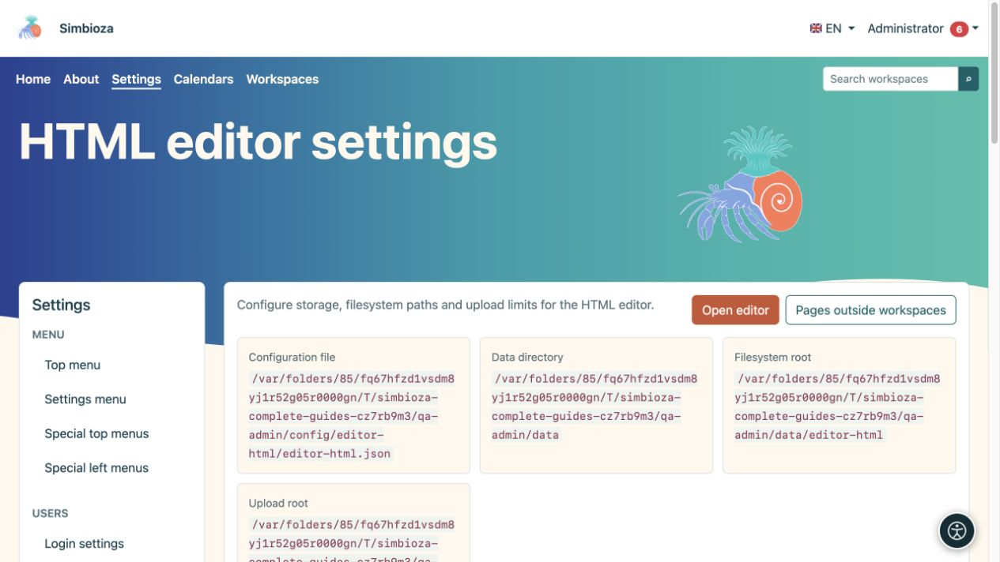
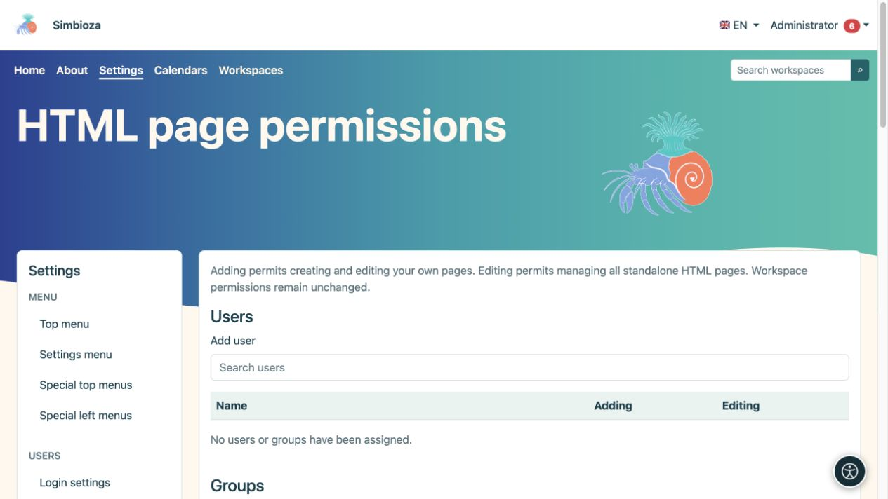
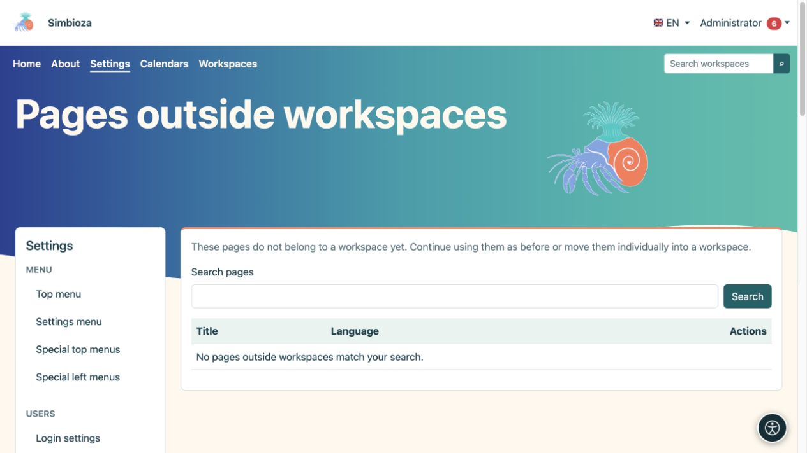

# Einstellungen des HTML-Editors

> Die Bildschirmaufnahmen zeigen die englische Benutzeroberfläche.

**Zielgruppe:** der Administrator der gesamten Installation. Öffnen Sie **Einstellungen → HTML-Editor**, um die Speicherung, Anzeige und zulässigen Anhänge von HTML zu konfigurieren. Die alltägliche Seitenbearbeitung wird im [Bearbeitungsleitfaden](uredivanje-stranica_de.md) behandelt.

## Verstehen Sie die Hauptfelder

*Einstellungen zeigen separate Speicherorte für Konfiguration, Daten, Inhalte und Anhänge.*

| Gruppe | Feld und Zweck |
|---|---|
| Lagerung | **Dateisystem** speichert Version HTML in Dateien; **Datenbank** speichert es in der Datenbank. Metadaten, Berechtigungen und Versionsdatensätze nutzen die Datenbank in beiden Modi. |
| Lagerung | **Dateisystempfad** ist ein Suffix unterhalb des Datenverzeichnisses der Anwendung, keine öffentliche Internetadresse. |
| Sicht | **Inhaltsverzeichnis standardmäßig anzeigen** steuert die anfängliche Anzeige der Überschriftengliederung. |
| Sicht | **Slug-Ansicht aktivieren** und **Slug-Pfad** stellen kurze Adressen für eigenständige Seiten bereit, zum Beispiel `/view/home`. Die Zugriffsberechtigungen gelten weiterhin. Arbeitsbereiche verwenden ihre eigene Adressierung. |
| Lokalisierung | **Standard-Editor-Sprache** ist die Fallback-Sprache; die Auswahlmöglichkeiten sind auf Installationssprachen beschränkt. |
| Uploads | **Upload-Pfad** bestimmt den Anhangspeicher unterhalb des Datenverzeichnisses. Anhänge bleiben Dateien, auch wenn HTML in der Datenbank gespeichert ist. |
| Uploads | **Maximale Upload-Größe** begrenzt eine einzelne Datei; zunächst 1.024 MB. Der Server kann eine niedrigere Grenze festlegen. |
| Uploads | **Chunk-Größe** steuert die Größe jedes Upload-Teils; zunächst 1 MB. Dabei geht es weder um die Anzahl der Teile noch um die endgültige Dateigröße. |
| Uploads | **Zulässige MIME-Typen** listet zulässige Inhaltstypen auf, einen pro Zeile. Zunächst sind JPEG, PNG, GIF, WebP, PDF, Klartext, MP4 und WebM enthalten. |

Wählen Sie nach der Bearbeitung **Einstellungen speichern**. Wenn sich verwaltete Pfade ändern, versucht das System, die zugehörigen Dateien sicher zu verschieben. Verschieben Sie sie nicht zuerst manuell und geben Sie keine beliebigen Systemverzeichnisse ein.

## Speichermodus ändern

Dadurch werden vorhandene Inhalte verschoben. Es handelt sich nicht um eine Einstellung für das Erscheinungsbild.

1. Erstellen Sie ein [Backup](admin-sigurnosne-kopije_de.md) und vereinbaren Sie einen geeigneten Zeitpunkt.
2. Wählen Sie den neuen Speichermodus. Eine Migrationsbestätigung wird geöffnet.
3. Lesen Sie die Quelle und das Ziel und wählen Sie dann **Migration starten**.
4. Warten Sie auf die letzte Nachricht und überprüfen Sie die Anzahl der verarbeiteten Elemente. Bearbeiten Sie nicht gleichzeitig Inhalte, die verschoben werden.
5. Öffnen Sie eine vorhandene Seite, eine frühere Version und einen Anhang. Überprüfen Sie auch das Speichern eines neuen Seitenwechsels.

**Ergebnis:** HTML-Inhalte werden in den ausgewählten Speicher übertragen und die Einstellung ändert sich nach Abschluss der Migration. Anhänge verbleiben im Dateisystem. Sollte die Verarbeitung unterbrochen werden, nutzen Sie die angebotenen Fortsetzungs- und Statuskontrollen; **Status löschen** ersetzt nicht eine erfolgreiche Datenübertragung.

## Berechtigungen für eigenständige Seiten

*In diesem Abschnitt ist das Hinzufügen und Bearbeiten gestattet; der Lesezugriff auf eine einzelne Seite wird auf dieser Seite konfiguriert.*

Globaler HTML-Editor **Berechtigungen** gelten für Seiten außerhalb von Arbeitsbereichen. Suchen Sie den Benutzer oder die Gruppe und gewähren Sie **Hinzufügen**, um eigene Seiten zu erstellen und zu bearbeiten, oder **Bearbeiten**, um alle eigenständigen HTML-Seiten zu verwalten. Wählen Sie **Berechtigungen speichern**. Das globale Formular wählt nicht das Lesepublikum jeder Seite aus.

Öffnen Sie für eine einzelne eigenständige Seite deren Zugriffseinstellungen und wählen Sie **Öffentlich – jeder**, **Alle angemeldeten Benutzer** oder **Nur autorisierte Personen und Gruppen**. Für eingeschränktes Lesen fügen Sie die erforderlichen Personen und Gruppen hinzu und speichern. Das Lesen deckt Anhänge ab, ermöglicht jedoch keine Bearbeitung. Arbeitsbereichsberechtigungen werden separat im Arbeitsbereich verwaltet.

## Seiten außerhalb von Arbeitsbereichen

*Die Liste findet eigenständige Seiten; ein leeres Ergebnis bedeutet, dass keines mit der aktuellen Suche übereinstimmt.*

Wenn Arbeitsbereiche später hinzugefügt wurden, öffnen Sie **Seiten außerhalb von Arbeitsbereichen**. Suchen Sie die Seite, wählen Sie den Zielarbeitsbereich aus, lesen Sie die Berechtigungsbestätigung und beginnen Sie mit der Verschiebung. **Ergebnis:** Es wird eine Arbeitsbereichsseite, wobei Inhalte und Anhänge verschoben und unterstützte Links durch den Prozess angepasst werden. Überprüfen Sie zuvor verwendete Links und den Zugriff mit einem Nicht-Administratorkonto. Bis zum Verschieben funktioniert eine Seite selbstständig weiter.

## Gelöschte Dokumente

Öffnen Sie **Gelöschte Dokumente** und suchen Sie das richtige Dokument. Überprüfen Sie den vorgeschlagenen Slug vor der Wiederherstellung. Wenn das Original belegt ist, schlägt das System möglicherweise ein anderes vor. Wählen Sie **Wiederherstellen** und überprüfen Sie dann Inhalt und Berechtigungen vor der weiteren Veröffentlichung.

Zusätzliches JavaScript und CSS unterliegen der separaten [Freigabe externer Skripte](admin-skripte_de.md). Für die normale Tabellensortierung und Seitennavigation verwenden Sie die integrierten **Tabelleneinstellungen** des Editors. Dafür ist keine externe Bibliothek erforderlich.
