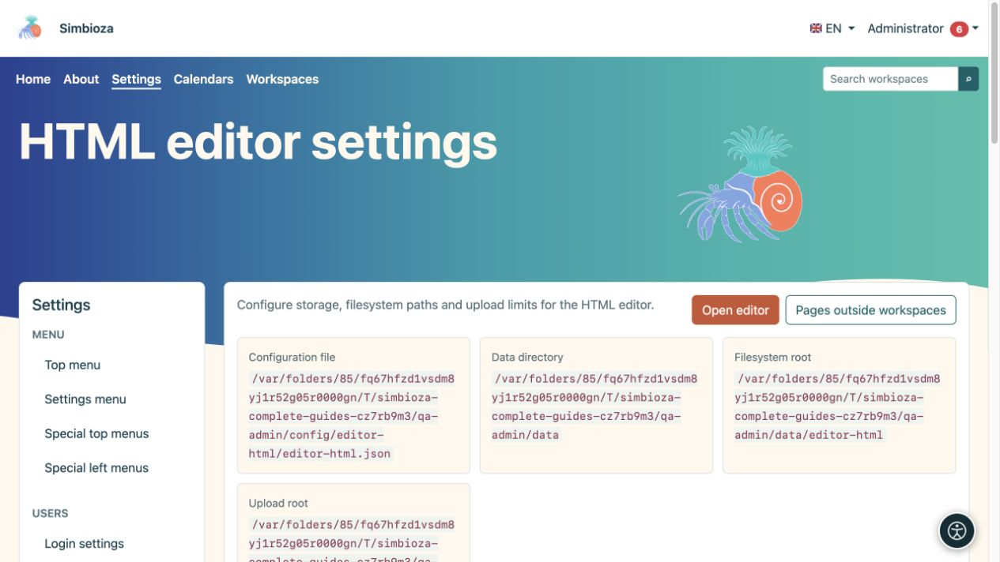
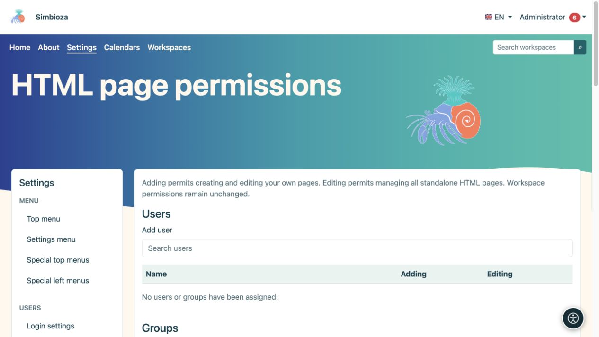
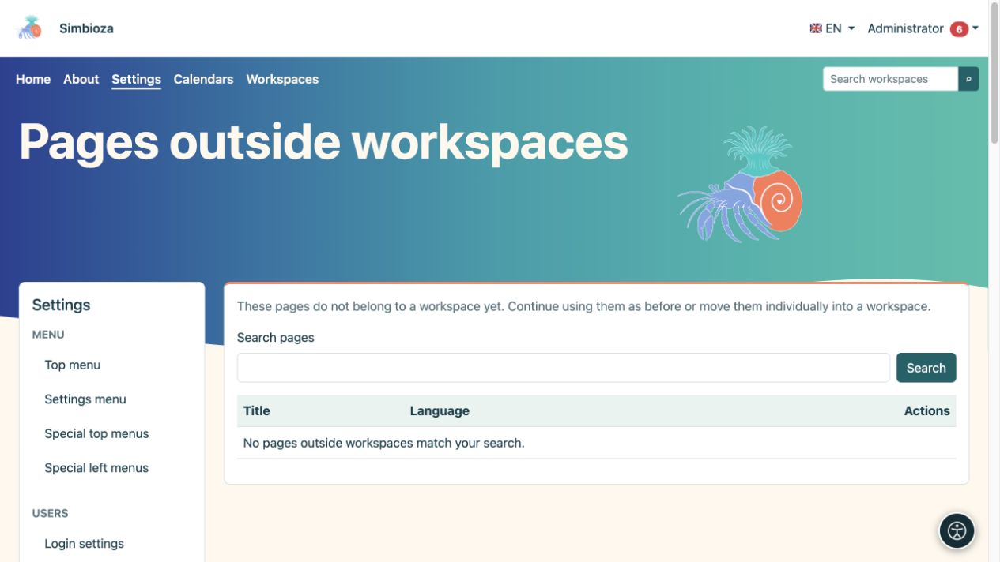

# HTML editor settings

**Audience:** the administrator of the entire installation. Open **Settings → HTML editor** to configure HTML storage, viewing, and allowed attachments. Everyday page editing is covered in the [editing guide](uredivanje-stranica_en.md).

## Understand the main fields

*Settings show separate locations for configuration, data, content, and attachments.*

| Group | Field and purpose |
|---|---|
| Storage | **Filesystem** stores version HTML in files; **Database** stores it in the database. Metadata, permissions, and version records use the database in both modes. |
| Storage | **Filesystem path** is a suffix beneath the application's data directory, not a public internet address. |
| View | **Show table of contents by default** controls the initial heading-outline display. |
| View | **Enable slug view** and **Slug path** provide short addresses for standalone pages, for example `/view/home`. Access permissions still apply. Workspaces use their own addressing. |
| Localisation | **Default editor language** is the fallback language; choices are limited to installation languages. |
| Uploads | **Upload path** determines attachment storage beneath the data directory. Attachments remain files even when HTML is stored in the database. |
| Uploads | **Maximum upload size** limits a single file; initially 1,024 MB. The server may impose a lower limit. |
| Uploads | **Chunk size** controls the size of each upload part; initially 1 MB. It is neither the number of parts nor the final file size. |
| Uploads | **Allowed MIME types** lists permitted content types, one per line. Initially JPEG, PNG, GIF, WebP, PDF, plain text, MP4, and WebM are included. |

Choose **Save settings** after editing. When managed paths change, the system attempts a safe move of the associated files; do not move them manually first or enter arbitrary system directories.

## Change storage mode

This moves existing content; it is not an appearance setting.

1. Create a [backup](admin-sigurnosne-kopije_en.md) and arrange a suitable time.
2. Select the new storage mode. A migration confirmation opens.
3. Read the source and destination, then choose **Start migration**.
4. Wait for the final message and check the processed-item count. Do not simultaneously edit content being moved.
5. Open an existing page, an earlier version, and an attachment. Also check saving a new page change.

**Result:** HTML content is transferred to the selected storage and the setting changes after migration completes. Attachments remain on the filesystem. If processing is interrupted, use the offered continuation and status controls; **Clear status** does not replace a successful data transfer.

## Standalone-page permissions

*This section grants adding and editing; reading access to an individual page is configured on that page.*

Global HTML editor **Permissions** apply to pages outside workspaces. Find the user or group and grant **Add** to create and edit their own pages, or **Edit** to manage all standalone HTML pages. Choose **Save permissions**. The global form does not choose the reading audience of every page.

For an individual standalone page, open its access settings and choose **Public — everyone**, **All signed-in users**, or **Authorised people and groups only**. For restricted reading, add the required people and groups and save. Reading covers attachments but does not grant editing. Workspace permissions are managed separately in the workspace.

## Pages outside workspaces

*The list finds standalone pages; an empty result means none matches the current search.*

If Workspaces was added later, open **Pages outside workspaces**. Find the page, select the destination workspace, read the permission confirmation, and start the move. **Result:** it becomes a workspace page, with content and attachments moved and supported links adjusted by the process. Check previously used links and access with a non-administrator account. Until moved, a page continues to work independently.

## Deleted documents

Open **Deleted documents** and find the correct document. Check the proposed slug before restoring; if the original is occupied, the system may propose another. Choose **Restore**, then check content and permissions before further publication.

Additional JavaScript and CSS use the separate [external-script approval](admin-skripte_en.md) procedure. For ordinary table sorting and pagination, use the editor's built-in **Table settings**; no external library is required.
