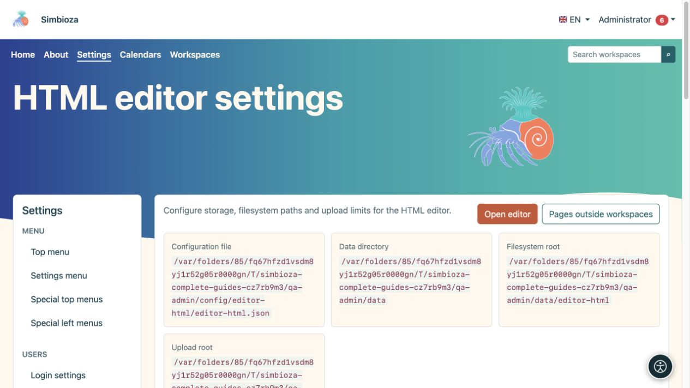
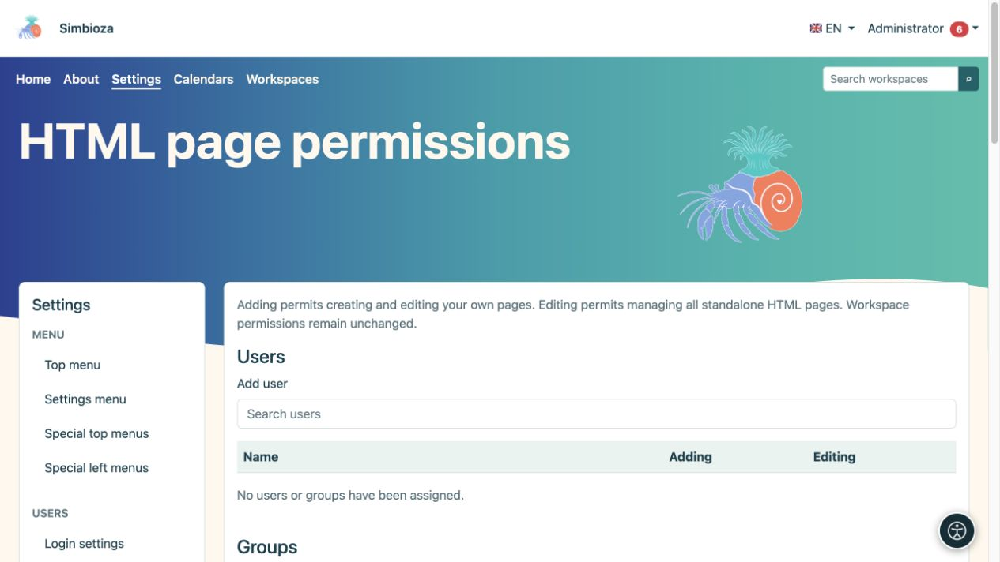
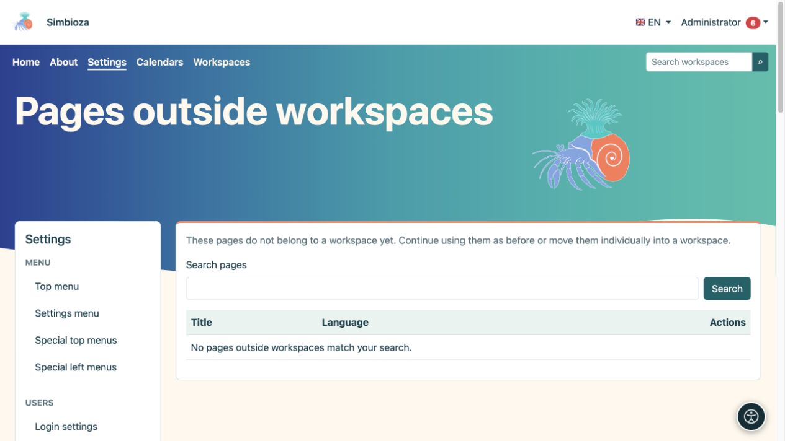

# Configuración del editor HTML

> Las capturas de pantalla muestran la interfaz en inglés.

**Audiencia:** el administrador de toda la instalación. Abra **Configuración → HTML editor** para configurar HTML almacenamiento, visualización y archivos adjuntos permitidos. La edición diaria de páginas se trata en la [guía de edición](uredivanje-stranica_es.md).

## Comprender los campos principales.

*La configuración muestra ubicaciones separadas para la configuración, los datos, el contenido y los archivos adjuntos.*

| Grupo | Campo y propósito |
|---|---|
| Almacenamiento | **Sistema de archivos** almacena la versión HTML en archivos; **Base de datos** lo almacena en la base de datos. Los registros de metadatos, permisos y versiones utilizan la base de datos en ambos modos. |
| Almacenamiento | **Ruta del sistema de archivos** es un sufijo debajo del directorio de datos de la aplicación, no una dirección pública de Internet. |
| Vista | **Mostrar tabla de contenido de forma predeterminada** controla la visualización inicial del esquema del título. |
| Vista | **Habilitar vista de slug** y **Ruta de slug** proporcionan direcciones cortas para páginas independientes, por ejemplo `/view/home`. Los permisos de acceso aún se aplican. Los espacios de trabajo utilizan su propio direccionamiento. |
| Localización | **Idioma del editor predeterminado** es el idioma alternativo; Las opciones se limitan a los idiomas de instalación. |
| Subidas | **Ruta de carga** determina el almacenamiento de archivos adjuntos debajo del directorio de datos. Los archivos adjuntos siguen siendo archivos incluso cuando HTML se almacena en la base de datos. |
| Subidas | **El tamaño máximo de carga** limita un solo archivo; inicialmente 1.024 MB. El servidor puede imponer un límite inferior. |
| Subidas | **Tamaño del fragmento** controla el tamaño de cada parte cargada; Inicialmente 1 MB. No es ni el número de partes ni el tamaño del archivo final. |
| Subidas | **Tipos MIME permitidos** enumera los tipos de contenido permitidos, uno por línea. Inicialmente se incluyen JPEG, PNG, GIF, WebP, PDF, texto sin formato, MP4 y WebM. |

Elija **Guardar configuración** después de editar. Cuando las rutas administradas cambian, el sistema intenta mover de forma segura los archivos asociados; no los mueva manualmente primero ni ingrese a directorios arbitrarios del sistema.

## Cambiar modo de almacenamiento

Esto mueve el contenido existente; no es una configuración de apariencia.

1. Cree una [copia de seguridad](admin-sigurnosne-kopije_es.md) y programe un horario adecuado.
2. Seleccione el nuevo modo de almacenamiento. Se abre una confirmación de migración.
3. Lea el origen y el destino, luego elija **Iniciar migración**.
4. Espere el mensaje final y verifique el recuento de elementos procesados. No edite simultáneamente el contenido que se está moviendo.
5. Abra una página existente, una versión anterior y un archivo adjunto. También verifique guardar un nuevo cambio de página.

**Resultado:** El contenido HTML se transfiere al almacenamiento seleccionado y la configuración cambia una vez completada la migración. Los archivos adjuntos permanecen en el sistema de archivos. Si se interrumpe el procesamiento, utilice los controles de estado y continuación ofrecidos; **Borrar estado** no reemplaza una transferencia de datos exitosa.

## Permisos de página independiente

*Esta sección permite agregar y editar; El acceso de lectura a una página individual se configura en esa página.*

Editor global HTML **Los permisos** se aplican a páginas fuera de los espacios de trabajo. Busque el usuario o grupo y otorgue **Agregar** para crear y editar sus propias páginas, o **Editar** para administrar todas las páginas independientes HTML. Elija **Guardar permisos**. La forma global no elige la audiencia lectora de cada página.

Para una página independiente individual, abra su configuración de acceso y elija **Público: todos**, **Todos los usuarios que hayan iniciado sesión** o **Solo personas y grupos autorizados**. Para lectura restringida, agregue las personas y grupos requeridos y guarde. La lectura cubre los archivos adjuntos pero no permite la edición. Los permisos del espacio de trabajo se administran por separado en el espacio de trabajo.

## Páginas fuera de los espacios de trabajo

*La lista encuentra páginas independientes; un resultado vacío significa que ninguno coincide con la búsqueda actual.*

Si se agregaron espacios de trabajo más tarde, abra **Páginas fuera de los espacios de trabajo**. Busque la página, seleccione el espacio de trabajo de destino, lea la confirmación del permiso y comience el movimiento. **Resultado:** se convierte en una página de espacio de trabajo, con contenido y archivos adjuntos movidos y enlaces admitidos ajustados por el proceso. Consulte los enlaces utilizados anteriormente y accede con una cuenta que no sea de administrador. Hasta que se mueve, una página continúa funcionando de forma independiente.

## Documentos eliminados

Abra **Documentos eliminados** y busque el documento correcto. Verifique el slug propuesto antes de restaurar; si el original está ocupado, el sistema podrá proponer otro. Elija **Restaurar** y luego verifique el contenido y los permisos antes de seguir publicando.

El código JavaScript y CSS adicional sigue el procedimiento separado de [aprobación de scripts externos](admin-skripte_es.md). Para ordenar y paginar tablas de forma habitual, use la **Configuración de la tabla** integrada en el editor; no necesita una biblioteca externa.
