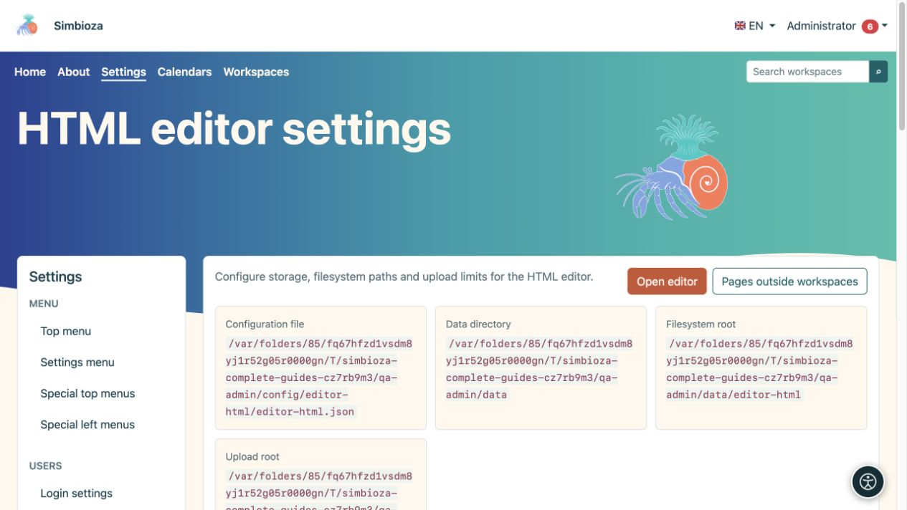
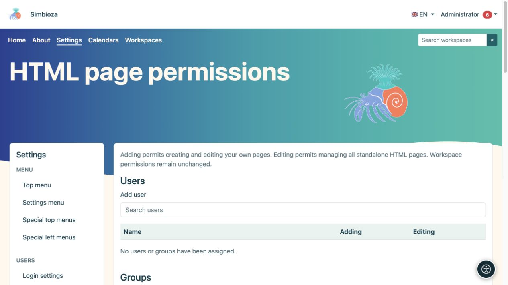
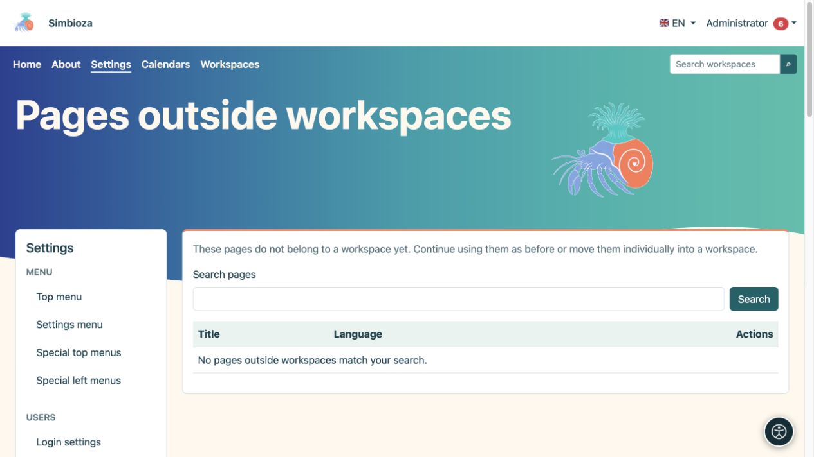

# Paramètres de l’éditeur HTML

> Les captures d’écran présentent l’interface en anglais.

**Public :** l'administrateur de l'ensemble de l'installation. Ouvrez **Paramètres → éditeur HTML** pour configurer le stockage HTML, l'affichage et les pièces jointes autorisées. L'édition quotidienne des pages est couverte dans le [guide d'édition](uredivanje-stranica_fr.md).

## Comprendre les principaux domaines

*Les paramètres affichent des emplacements distincts pour la configuration, les données, le contenu et les pièces jointes.*

| Groupe | Domaine et objectif |
|---|---|
| Stockage | **Filesystem** stocke la version HTML dans des fichiers ; **Base de données** le stocke dans la base de données. Les métadonnées, les autorisations et les enregistrements de version utilisent la base de données dans les deux modes. |
| Stockage | **Le chemin du système de fichiers** est un suffixe sous le répertoire de données de l'application, et non une adresse Internet publique. |
| Voir | **Afficher la table des matières par défaut** contrôle l'affichage initial du plan du titre. |
| Voir | **Activer la vue slug** et **Chemin Slug** fournissent des adresses courtes pour les pages autonomes, par exemple `/view/home`. Les autorisations d'accès s'appliquent toujours. Les espaces de travail utilisent leur propre adressage. |
| Localisation | **La langue de l'éditeur par défaut** est la langue de secours ; les choix sont limités aux langues d’installation. |
| Téléchargements | **Chemin de téléchargement** détermine le stockage des pièces jointes sous le répertoire de données. Les pièces jointes restent des fichiers même lorsque HTML est stocké dans la base de données. |
| Téléchargements | **La taille maximale de téléchargement** limite un seul fichier ; initialement 1 024 Mo. Le serveur peut imposer une limite inférieure. |
| Téléchargements | **Taille du morceau** contrôle la taille de chaque partie de téléchargement ; initialement 1 Mo. Il ne s'agit ni du nombre de pièces ni de la taille finale du fichier. |
| Téléchargements | **Types MIME autorisés** répertorie les types de contenu autorisés, un par ligne. Initialement, JPEG, PNG, GIF, WebP, PDF, texte brut, MP4 et WebM sont inclus. |

Choisissez **Enregistrer les paramètres** après la modification. Lorsque les chemins gérés changent, le système tente de déplacer en toute sécurité les fichiers associés ; ne les déplacez pas manuellement au préalable et n'entrez pas dans des répertoires système arbitraires.

## Changer le mode de stockage

Cela déplace le contenu existant ; ce n'est pas un paramètre d'apparence.

1. Créez une [sauvegarde](admin-sigurnosne-kopije_fr.md) et fixez une heure appropriée.
2. Sélectionnez le nouveau mode de stockage. Une confirmation de migration s'ouvre.
3. Lisez la source et la destination, puis choisissez **Démarrer la migration**.
4. Attendez le message final et vérifiez le nombre d'éléments traités. Ne modifiez pas simultanément le contenu en cours de déplacement.
5. Ouvrez une page existante, une version antérieure et une pièce jointe. Vérifiez également l'enregistrement d'un nouveau changement de page.

**Résultat :** Le contenu HTML est transféré vers le stockage sélectionné et le paramètre change une fois la migration terminée. Les pièces jointes restent sur le système de fichiers. Si le traitement est interrompu, utilisez les contrôles de continuation et d'état proposés ; **Un statut clair** ne remplace pas un transfert de données réussi.

## Autorisations de page autonome

*Cette section autorise l'ajout et la modification ; l'accès en lecture à une page individuelle est configuré sur cette page.*

Éditeur global HTML **Les autorisations** s'appliquent aux pages en dehors des espaces de travail. Recherchez l'utilisateur ou le groupe et accordez **Ajouter** pour créer et modifier ses propres pages, ou **Modifier** pour gérer toutes les pages HTML autonomes. Choisissez **Enregistrer les autorisations**. Le formulaire global ne choisit pas le public de lecture de chaque page.

Pour une page autonome individuelle, ouvrez ses paramètres d'accès et choisissez **Public — tout le monde**, **Tous les utilisateurs connectés** ou **Personnes et groupes autorisés uniquement**. Pour une lecture restreinte, ajoutez les personnes et les groupes requis et enregistrez. La lecture couvre les pièces jointes mais n'autorise pas l'édition. Les autorisations de l'espace de travail sont gérées séparément dans l'espace de travail.

## Pages en dehors des espaces de travail

*La liste trouve des pages autonomes ; un résultat vide signifie qu'aucun résultat ne correspond à la recherche actuelle.*

Si Espaces de travail a été ajouté ultérieurement, ouvrez **Pages en dehors des espaces de travail**. Recherchez la page, sélectionnez l'espace de travail de destination, lisez la confirmation d'autorisation et démarrez le déplacement. **Résultat :** elle devient une page d'espace de travail, avec le contenu et les pièces jointes déplacés et les liens pris en charge ajustés par le processus. Vérifiez les liens précédemment utilisés et accédez avec un compte non-administrateur. Jusqu'à ce qu'elle soit déplacée, une page continue de fonctionner de manière indépendante.

## Documents supprimés

Ouvrez **Documents supprimés** et recherchez le bon document. Vérifiez le slug proposé avant de restaurer ; si l'original est occupé, le système peut en proposer un autre. Choisissez **Restaurer**, puis vérifiez le contenu et les autorisations avant de poursuivre la publication.

JavaScript et CSS supplémentaires utilisent la procédure distincte [approbation de script externe](admin-skripte_fr.md). Pour le tri et la pagination de tableaux ordinaires, utilisez les **Paramètres de tableau** intégrés à l'éditeur ; aucune bibliothèque externe n'est requise.
