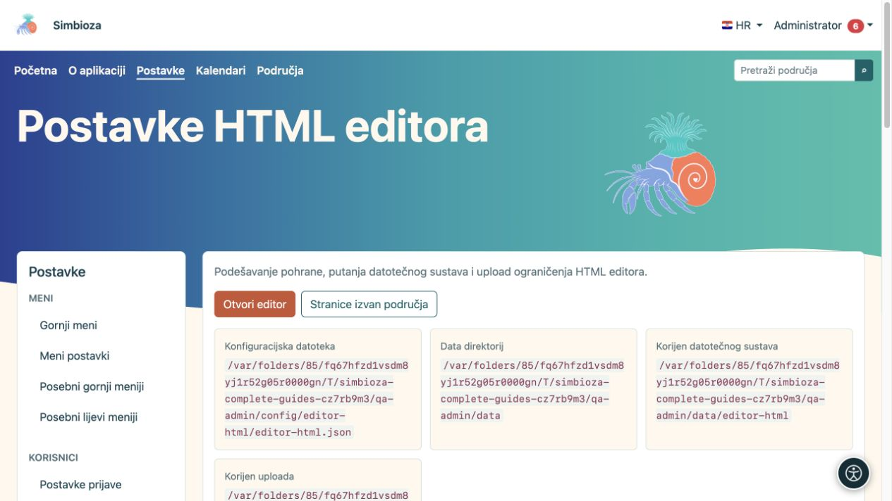
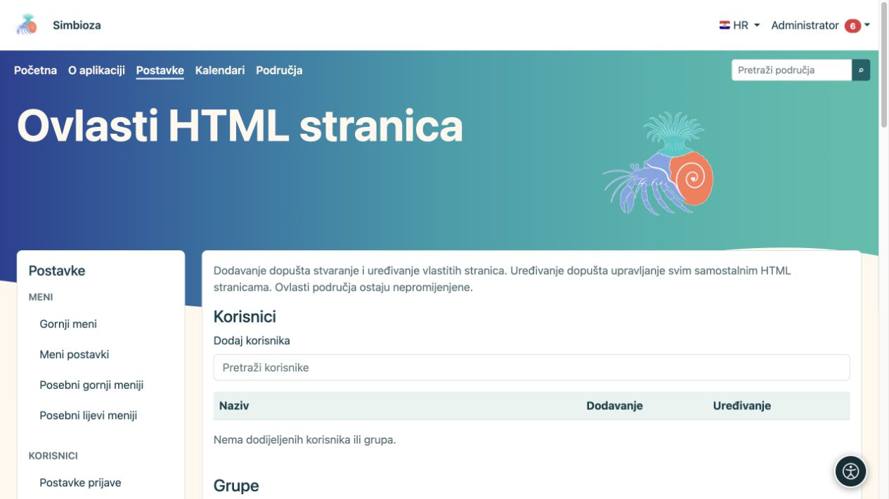
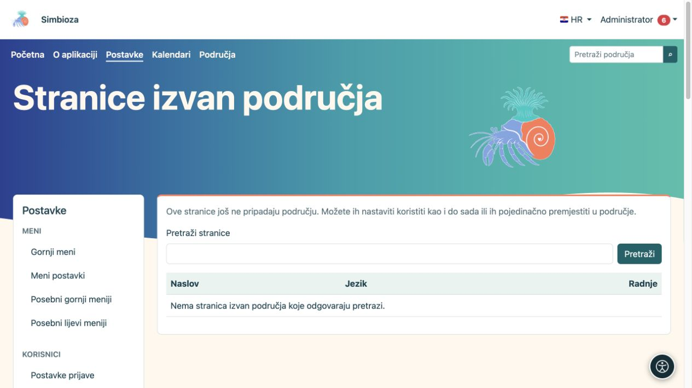

# Postavke HTML editora

**Za koga:** administrator cijele instalacije. Otvorite **Postavke → HTML editor**. Ovdje određujete pohranu HTML sadržaja, pregled i dopuštene privitke. Svakodnevno uređivanje stranice opisuje [vodič za uređivanje](uredivanje-stranica_hr.md).

## Što mijenjaju glavna polja

*Postavke prikazuju odvojene putanje konfiguracije, podataka, sadržaja i privitaka.*

| Skupina | Polje i smisao |
|---|---|
| Pohrana | **Datotečni sustav** sprema HTML verzija u datoteke, a **Baza** u bazu. Metapodaci, prava i povijest vode se kroz bazu u oba načina. |
| Pohrana | **Putanja datotečnog sustava** nastavak je ispod aplikacijskog podatkovnog direktorija. Ne upisuje se javna internetska adresa. |
| Pregled | **Prikaži sadržaj po zadanom** određuje početni prikaz sadržaja/navigacije naslova. |
| Pregled | **Omogući slug pregled** i **Putanja za slug** omogućuju kratku adresu samostalnih stranica, primjerice `/view/naslovnica`. Prava pristupa i dalje vrijede. Područja imaju vlastiti način adresiranja. |
| Lokalizacija | **Zadani jezik editora** koristi se kao pričuvni jezik; odabir se ograničava na jezike instalacije. |
| Uploadi | **Upload putanja** određuje mjesto privitaka ispod podatkovnog spremišta. Privitci su datoteke i kada se HTML sprema u bazu. |
| Uploadi | **Maksimalna veličina upload-a** ograničava jednu datoteku; početno 1.024 MB. Poslužitelj može imati i niži vlastiti limit. |
| Uploadi | **Veličina dijela** određuje veličinu prijenosnog dijela; početno 1 MB. To nije broj dijelova ni konačna veličina datoteke. |
| Uploadi | **Dopušteni MIME tipovi** popis je dopuštenih vrsta sadržaja, po jedan u retku. Početno uključuje JPEG, PNG, GIF, WebP, PDF, obični tekst, MP4 i WebM. |

Nakon izmjene odaberite **Spremi postavke**. Pri promjeni upravljanih putanja sustav pokušava sigurno premjestiti pripadajuće datoteke; nemojte ih prethodno ručno preseljavati niti upisivati proizvoljne sistemske direktorije.

## Promijenite način pohrane

Ovo je premještanje postojećeg sadržaja, a ne obična promjena izgleda.

1. Izradite [sigurnosnu kopiju](admin-sigurnosne-kopije_hr.md) i dogovorite termin promjene.
2. Odaberite novi način pohrane. Otvara se potvrda migracije.
3. Pročitajte izvor i odredište te odaberite **Pokreni migraciju**.
4. Pričekajte završnu poruku i provjerite broj obrađenih stavki. Ne pokušavajte istodobno uređivati sadržaj koji se premješta.
5. Otvorite postojeću stranicu, povijesnu verziju i privitak. Provjerite i novo spremanje stranice.

**Rezultat:** HTML sadržaj prenesen je u odabrano spremište, a postavka je promijenjena nakon dovršene migracije. Privitci ostaju na datotečnom sustavu. Ako je postupak prekinut, koristite ponuđeni nastavak i status; **Očisti status** nije zamjena za uspješno premještanje podataka.

## Ovlasti samostalnih stranica

*U ovom odjeljku dodjeljuju se dodavanje i uređivanje; čitanje pojedine stranice podešava se na samoj stranici.*

Globalne **Ovlasti** HTML editora odnose se na stranice izvan područja. Pronađite korisnika ili grupu te dodijelite **Dodavanje** za stvaranje i uređivanje vlastitih stranica ili **Uređivanje** za upravljanje svim samostalnim HTML stranicama. Odaberite **Spremi prava**. Globalni obrazac ne određuje publiku svih stranica.

Na pojedinačnoj samostalnoj stranici otvorite njezine postavke pristupa i odaberite **Javno — svi**, **Svi prijavljeni korisnici** ili **Samo ovlaštene osobe i grupe**. Za ograničeno čitanje dodajte potrebne osobe i grupe te spremite. Čitanje uključuje privitke, ali ne daje uređivanje. Prava područja zasebno se uređuju u području.

## Stranice izvan područja

*Popis pronalazi samostalne stranice; prazan rezultat znači da nijedna ne odgovara trenutačnoj pretrazi.*

Ako su Područja naknadno dodana, otvorite **Stranice izvan područja**. Pronađite stranicu, odaberite odredišno područje, pročitajte potvrdu prava i pokrenite premještanje. **Rezultat:** stranica postaje stranica područja, uz premještanje sadržaja i privitaka te prilagodbu poveznica koje postupak obrađuje. Provjerite ranije korištene poveznice i pristup osobe koja nije administrator. Dok je ne premjestite, stranica nastavlja raditi samostalno.

## Obrisani dokumenti

Otvorite **Obrisani dokumenti** i pronađite pravi dokument. Provjerite ponuđeni slug prije povrata; ako je stari zauzet, sustav može ponuditi novi. Odaberite **Vrati** pa provjerite sadržaj i prava prije daljnje objave.

Dodatni JavaScript i CSS imaju zaseban postupak [odobravanja vanjskih skripti](admin-skripte_hr.md). Za obično sortiranje i straničenje tablice koristite ugrađene **Postavke tablice** u editoru; vanjska biblioteka nije potrebna.
