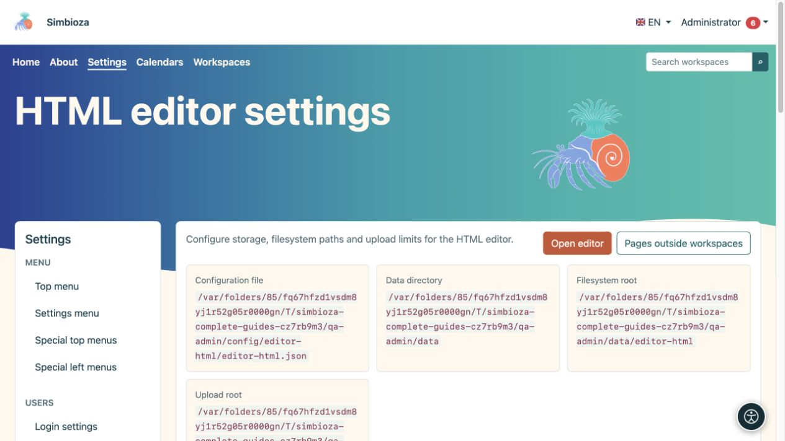
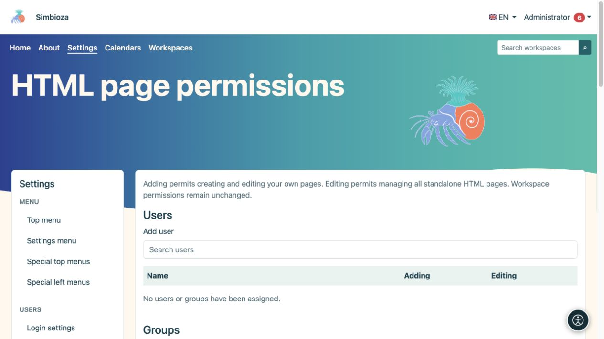
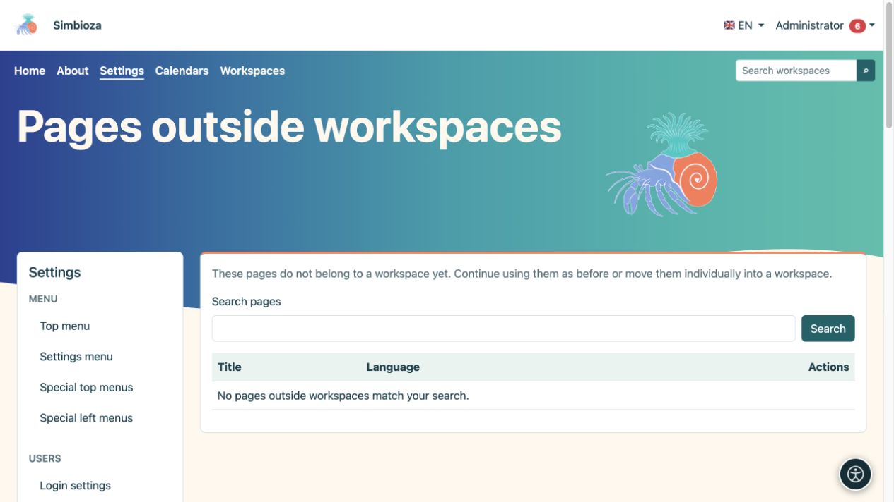

# Impostazioni dell'editor HTML

> Le schermate mostrano l’interfaccia in inglese.

**Pubblico:** l'amministratore dell'intera installazione. Apri **Impostazioni → HTML editor** per configurare l'archiviazione, la visualizzazione e gli allegati consentiti di HTML. La modifica quotidiana delle pagine è trattata nella [guida alla modifica](uredivanje-stranica_it.md).

## Comprendere i principali ambiti

*Le impostazioni mostrano posizioni separate per configurazione, dati, contenuti e allegati.*

| Gruppo | Campo e scopo |
|---|---|
| Archiviazione | **Filesystem** memorizza la versione HTML nei file; **Database** lo memorizza nel database. Metadati, autorizzazioni e record di versione utilizzano il database in entrambe le modalità. |
| Archiviazione | **Percorso file system** è un suffisso sotto la directory dei dati dell'applicazione, non un indirizzo Internet pubblico. |
| Visualizzazione | **Mostra indice per impostazione predefinita** determina la visualizzazione iniziale dell'elenco dei titoli. |
| Visualizzazione | **Abilita visualizzazione slug** e **Percorso slug** forniscono indirizzi brevi per pagine autonome, ad esempio `/view/home`. Le autorizzazioni di accesso continuano a essere valide. Le aree di lavoro utilizzano il proprio indirizzamento. |
| Localizzazione | **La lingua dell'editor predefinita** è la lingua di riserva; le scelte sono limitate alle lingue di installazione. |
| Caricamenti | Il **Percorso di caricamento** determina l'archiviazione degli allegati nella directory dei dati. Gli allegati rimangono file anche quando HTML è archiviato nel database. |
| Caricamenti | **La dimensione massima del caricamento** limita un singolo file; inizialmente 1.024 MB. Il server può imporre un limite inferiore. |
| Caricamenti | **Dimensione blocco** controlla la dimensione di ciascuna parte caricata; inizialmente 1 MB. Non è né il numero di parti né la dimensione finale del file. |
| Caricamenti | **Tipi MIME consentiti** elenca i tipi di contenuto consentiti, uno per riga. Inizialmente sono inclusi JPEG, PNG, GIF, WebP, PDF, testo normale, MP4 e WebM. |

Scegli **Salva impostazioni** dopo la modifica. Quando i percorsi gestiti cambiano, il sistema tenta uno spostamento sicuro dei file associati; non spostarli prima manualmente né inserire directory di sistema arbitrarie.

## Cambia modalità di archiviazione

Questo sposta il contenuto esistente; non è un'impostazione dell'aspetto.

1. Crea un [backup](admin-sigurnosne-kopije_it.md) e fissa un orario adeguato.
2. Seleziona la nuova modalità di archiviazione. Si apre una conferma di migrazione.
3. Leggi l'origine e la destinazione, quindi scegli **Avvia migrazione**.
4. Attendi il messaggio finale e controlla il conteggio degli articoli elaborati. Non modificare contemporaneamente il contenuto da spostare.
5. Apri una pagina esistente, una versione precedente e un allegato. Controlla anche il salvataggio di un nuovo cambio di pagina.

**Risultato:** il contenuto HTML viene trasferito nell'archivio selezionato e l'impostazione cambia al termine della migrazione. Gli allegati rimangono nel filesystem. Se l'elaborazione viene interrotta, usa i comandi disponibili per proseguire e controllare lo stato; **Cancella stato** non sostituisce un trasferimento dei dati riuscito.

## Autorizzazioni per pagine autonome

*Questa sezione consente l'aggiunta e la modifica; l'accesso in lettura a una singola pagina è configurato su quella pagina.*

Le **Autorizzazioni** globali dell'editor HTML si applicano alle pagine esterne alle aree di lavoro. Trova l'utente o il gruppo e concedi **Aggiungi** per creare e modificare le proprie pagine, oppure **Modifica** per gestire tutte le pagine HTML indipendenti. Scegli **Salva autorizzazioni**. Il modulo globale non determina i lettori di ogni pagina.

Per una singola pagina autonoma, apri le relative impostazioni di accesso e scegli **Pubblico: tutti**, **Tutti gli utenti che hanno effettuato l'accesso** o **Solo persone e gruppi autorizzati**. Per la lettura limitata, aggiungi le persone e i gruppi richiesti e salva. La lettura copre gli allegati ma non garantisce la modifica. Le autorizzazioni dell'area di lavoro vengono gestite separatamente nell'area di lavoro.

## Pagine esterne alle aree di lavoro

*L'elenco trova pagine autonome; un risultato vuoto significa che nessuno corrisponde alla ricerca corrente.*

Se le aree di lavoro sono state aggiunte successivamente, apri **Pagine esterne alle aree di lavoro**. Trova la pagina, seleziona l'area di lavoro di destinazione, leggi la conferma dell'autorizzazione e avvia lo spostamento. **Risultato:** diventa una pagina di area di lavoro, con contenuti e allegati spostati e collegamenti supportati regolati dal processo. Controlla i collegamenti utilizzati in precedenza e accedi con un account non amministratore. Finché non viene spostata, una pagina continua a funzionare in modo indipendente.

## Documenti eliminati

Apri **Documenti eliminati** e trova il documento corretto. Controllare lo slug proposto prima del ripristino; se l'originale risulta occupato il sistema potrà proporne un altro. Scegli **Ripristina**, quindi controlla il contenuto e le autorizzazioni prima di un'ulteriore pubblicazione.

JavaScript e CSS aggiuntivi utilizzano la procedura separata di [approvazione dello script esterno](admin-skripte_it.md). Per l'ordinamento e l'impaginazione ordinaria delle tabelle, utilizza le **Impostazioni tabella** integrate nell'editor; non è richiesta alcuna libreria esterna.
