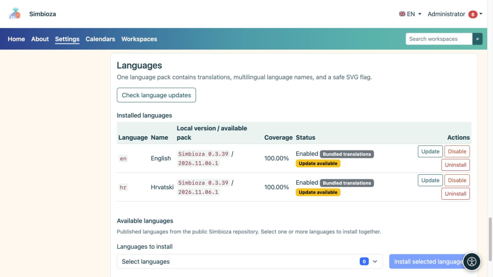

# Sprachen der Benutzeroberfläche

> Die Bildschirmaufnahmen zeigen die englische Benutzeroberfläche.

**Zielgruppe:** der Administrator der gesamten Installation. Öffnen Sie **Einstellungen → Setup und Module → Sprachen**, um eine andere Sprache anzubieten oder Übersetzungen zu aktualisieren.

Die Sprache der Benutzeroberfläche steuert die Schaltflächen- und Menübezeichnungen. Übersetzungen von Seiten- und Umfrageinhalten werden separat bearbeitet. Durch die Installation der englischen Benutzeroberfläche werden Inhalte, die ein Autor auf Kroatisch geschrieben hat, nicht automatisch übersetzt.

## Fügen Sie eine Sprache hinzu

*Installierte Sprachen zeigen ihre Version und ihren Status; Neue Sprachen werden in einem separaten Selektor unterhalb der Liste ausgewählt.*

1. Wählen Sie im Abschnitt „Verfügbare Sprachen“ die veröffentlichten Sprachen aus, die Sie benötigen.
2. Wählen Sie **Ausgewählte Sprachen installieren** und warten Sie auf das Ergebnis.
3. Überprüfen Sie den Namen, die Version, die Abdeckung und den Status jeder installierten Sprache.
4. Aktivieren Sie eine installierte Sprache, wenn diese deaktiviert ist.
5. Wählen Sie es im Sprachmenü der Anwendung aus und überprüfen Sie mehrere Bildschirme.

**Ergebnis:** Eine aktivierte installierte Sprache steht Benutzern und in relevanten Inhaltsübersetzungsselektoren zur Verfügung. Die Anwendung bietet nicht automatisch jede Sprache an, die Simbioza technisch unterstützt.

## Verstehen Sie die Versionen

- **Gebündelte Übersetzungen** werden mit der Anwendung geliefert und zeigen die Version Simbioza an.
- **Sprachpaket** ist ein separat heruntergeladenes und überprüftes Übersetzungspaket. Die Revision kann sich ohne eine neue Anwendungsversion ändern.
- **Manuelle Übersetzung – Revision unbekannt** bedeutet, dass eine benutzerdefinierte Übersetzung ohne aufgezeichnete offizielle Revision vorhanden ist. Überprüfen Sie Ihre Änderungen, bevor Sie sie durch ein offizielles Paket ersetzen.
- **Abdeckung** beschreibt den Schlüsselsatz; es ist nicht garantiert, dass jeder Satz von einem Muttersprachler überprüft wurde.

## Übersetzungen aktualisieren

Wählen Sie **Sprachaktualisierungen prüfen**. Wenn **Update** angezeigt wird, lesen Sie, welche Sprache geändert wird, und führen Sie das Update durch. Eine Prüfung allein ersetzt keine Übersetzungen. Bei einem erfolgreichen Update bleibt der zuvor aktivierte Status der Sprache erhalten.

Wenn die Prüfung fehlschlägt, löschen Sie die Arbeitsübersetzung nicht. Versuchen Sie es später erneut oder bitten Sie um eine Überprüfung der Paketquelle. Wenn Konfigurationsberechtigungen die GUI-Installation verhindern, kann der Serververwalter das auf dem Bildschirm angezeigte Verfahren CLI verwenden.

## Deaktivieren oder entfernen Sie eine Sprache

**Deaktivieren** entfernt eine Sprache aus der aktiven Auswahl, ohne ihr Paket zu löschen. **Uninstall** entfernt die installierten Sprachressourcen und erfordert eine sorgfältigere Entscheidung. Das System weigert sich möglicherweise, eine für die Installation erforderliche Sprache zu deaktivieren oder zu entfernen. Durch diese Aktionen werden Seiteninhaltsübersetzungen nicht gelöscht.

## Verwenden Sie ein benutzerdefiniertes Paket

Verwenden Sie den Abschnitt zum Hochladen von Sprachpaketen für eine benutzerdefinierte Übersetzung. Bei der Datei handelt es sich um ein reines Datenpaket JSON, nicht um ein Programm PHP. Überprüfen Sie die Sprache und Ihren benutzerdefinierten Text, bevor Sie den Austausch bestätigen. Das System lehnt ungültige oder unvollständige Pakete ab; Benennen Sie eine Datei nicht in eine andere Sprache um, um die Validierung zu umgehen.
