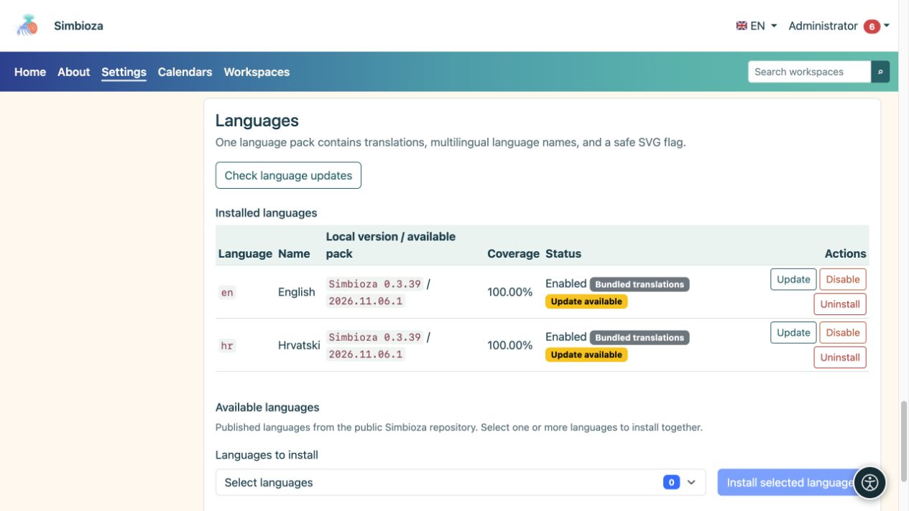

# Interface languages

**Audience:** the administrator of the entire installation. Open **Settings → Setup and modules → Languages** to offer another language or refresh translations.

The interface language controls button and menu labels. Page and survey content translations are edited separately. Installing the English interface does not automatically translate content an author wrote in Croatian.

## Add a language

*Installed languages show their version and status; new languages are chosen in a separate selector below the list.*

1. In the available-languages section, select the published languages you need.
2. Choose **Install selected languages** and wait for the result.
3. Check each installed language's name, version, coverage, and state.
4. Enable an installed language if it is disabled.
5. Select it in the application's language menu and check several screens.

**Result:** an enabled installed language is available to users and in relevant content-translation selectors. The application does not automatically offer every language Simbioza technically supports.

## Understand the versions

- **Bundled translations** ship with the application and show the Simbioza version.
- **Language pack** is a separately downloaded and verified translation package. Its revision can change without a new application release.
- **Manual translation — revision unknown** means a custom translation exists without a recorded official revision. Review your changes before replacing it with an official pack.
- **Coverage** describes the set of keys; it does not guarantee that a native speaker reviewed every phrase.

## Refresh translations

Choose **Check language updates**. If **Update** appears, read which language will change and run its update. Checking alone does not replace translations. A successful update preserves the language's previous enabled state.

If the check fails, do not delete the working translation. Retry later or ask for the package source to be checked. Where configuration permissions prevent GUI installation, the server maintainer can use the CLI procedure shown on screen.

## Disable or remove a language

**Disable** removes a language from the active selection without deleting its package. **Uninstall** removes its installed language resources and requires a more careful decision. The system may refuse to disable or remove a language required by the installation. These actions do not delete page-content translations.

## Use a custom pack

Use the language-pack upload section for a custom translation. The file is a data-only JSON pack, not a PHP program. Check the language and your custom text before confirming replacement. The system rejects invalid or incomplete packs; do not relabel a file as another language to bypass validation.
