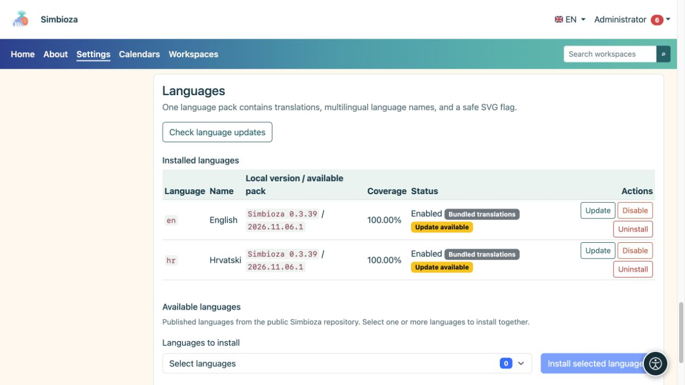

# Idiomas de la interfaz

> Las capturas de pantalla muestran la interfaz en inglés.

**Audiencia:** el administrador de toda la instalación. Abra **Configuración → Configuración y módulos → Idiomas** para ofrecer otro idioma o actualizar las traducciones.

El idioma de la interfaz controla los botones y las etiquetas del menú. Las traducciones del contenido de las páginas y de las encuestas se editan por separado. La instalación de la interfaz en inglés no traduce automáticamente el contenido que un autor escribió en croata.

## Agregar un idioma

*Los idiomas instalados muestran su versión y estado; Los nuevos idiomas se eligen en un selector separado debajo de la lista.*

1. En la sección de idiomas disponibles, seleccione los idiomas publicados que necesita.
2. Elija **Instalar idiomas seleccionados** y espere el resultado.
3. Verifique el nombre, la versión, la cobertura y el estado de cada idioma instalado.
4. Habilite un idioma instalado si está deshabilitado.
5. Selecciónelo en el menú de idiomas de la aplicación y consulte varias pantallas.

**Resultado:** un idioma instalado habilitado está disponible para los usuarios y en los selectores de traducción de contenido relevantes. La aplicación no ofrece automáticamente todos los idiomas que Simbioza admite técnicamente.

## entender las versiones

- **Las traducciones incluidas** se envían con la aplicación y muestran la versión Simbioza.
- **Paquete de idioma** es un paquete de traducción verificado y descargado por separado. Su revisión puede cambiar sin una nueva versión de la aplicación.
- **Traducción manual: revisión desconocida** significa que existe una traducción personalizada sin una revisión oficial registrada. Revise sus cambios antes de reemplazarlo con un paquete oficial.
- **Cobertura** describe el juego de llaves; no garantiza que un hablante nativo haya revisado cada frase.

## Actualizar traducciones

Elija **Verificar actualizaciones de idioma**. Si aparece **Actualizar**, lee qué idioma cambiará y ejecuta su actualización. La verificación por sí sola no reemplaza las traducciones. Una actualización exitosa conserva el estado habilitado anterior del idioma.

Si la verificación falla, no elimine la traducción de trabajo. Vuelva a intentarlo más tarde o solicite que se verifique la fuente del paquete. Cuando los permisos de configuración impiden la instalación de la GUI, el mantenedor del servidor puede utilizar el procedimiento CLI que se muestra en la pantalla.

## Deshabilitar o eliminar un idioma

**Desactivar** elimina un idioma de la selección activa sin eliminar su paquete. **Desinstalar** elimina los recursos de idioma instalados y requiere una decisión más cuidadosa. El sistema puede negarse a desactivar o eliminar un idioma requerido por la instalación. Estas acciones no eliminan las traducciones del contenido de la página.

## Utilice un paquete personalizado

Utilice la sección de carga de paquetes de idiomas para obtener una traducción personalizada. El archivo es un paquete JSON de solo datos, no un programa PHP. Verifique el idioma y su texto personalizado antes de confirmar el reemplazo. El sistema rechaza paquetes no válidos o incompletos; no vuelva a etiquetar un archivo como otro idioma para evitar la validación.
