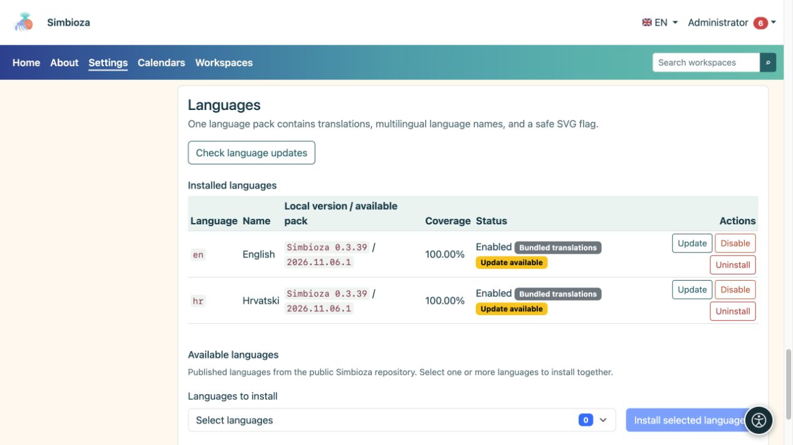

# Langues de l’interface

> Les captures d’écran présentent l’interface en anglais.

**Public :** l'administrateur de l'ensemble de l'installation. Ouvrez **Paramètres → Configuration et modules → Langues** pour proposer une autre langue ou actualiser les traductions.

La langue de l’interface contrôle les étiquettes des boutons et des menus. Les traductions du contenu des pages et des sondages sont éditées séparément. L'installation de l'interface anglaise ne traduit pas automatiquement le contenu écrit par un auteur en croate.

## Ajouter une langue

*Les langues installées affichent leur version et leur statut ; les nouvelles langues sont choisies dans un sélecteur séparé sous la liste.*

1. Dans la section langues disponibles, sélectionnez les langues publiées dont vous avez besoin.
2. Choisissez **Installer les langues sélectionnées** et attendez le résultat.
3. Vérifiez le nom, la version, la couverture et l'état de chaque langue installée.
4. Activez une langue installée si elle est désactivée.
5. Sélectionnez-le dans le menu langue de l'application et vérifiez plusieurs écrans.

**Résultat :** une langue installée activée est disponible pour les utilisateurs et dans les sélecteurs de traduction de contenu pertinents. L'application ne propose pas automatiquement toutes les langues prises en charge techniquement par Simbioza.

## Comprendre les versions

- **Traductions groupées** livrées avec l'application et affichent la version Simbioza.
- Le **Pack linguistique** est un package de traduction téléchargé et vérifié séparément. Sa révision peut changer sans nouvelle version de l'application.
- **Traduction manuelle — révision inconnue** signifie qu'une traduction personnalisée existe sans révision officielle enregistrée. Vérifiez vos modifications avant de le remplacer par un pack officiel.
- **Couverture** décrit l'ensemble de clés ; cela ne garantit pas qu’un locuteur natif ait révisé chaque phrase.

## Actualiser les traductions

Choisissez **Vérifier les mises à jour linguistiques**. Si **Mise à jour** apparaît, lisez quelle langue va changer et exécutez sa mise à jour. La vérification seule ne remplace pas les traductions. Une mise à jour réussie préserve l'état activé précédent de la langue.

Si la vérification échoue, ne supprimez pas la traduction de travail. Réessayez plus tard ou demandez que la source du package soit vérifiée. Lorsque les autorisations de configuration empêchent l'installation de l'interface graphique, le responsable du serveur peut utiliser la procédure CLI affichée à l'écran.

## Désactiver ou supprimer une langue

**Désactiver** supprime une langue de la sélection active sans supprimer son package. **Désinstaller** supprime les ressources linguistiques installées et nécessite une décision plus prudente. Le système peut refuser de désactiver ou de supprimer une langue requise par l'installation. Ces actions ne suppriment pas les traductions du contenu de la page.

## Utiliser un pack personnalisé

Utilisez la section de téléchargement du module linguistique pour une traduction personnalisée. Le fichier est un pack JSON contenant uniquement des données, et non un programme PHP. Vérifiez la langue et votre texte personnalisé avant de confirmer le remplacement. Le système rejette les packs invalides ou incomplets ; ne réétiquetez pas un fichier dans une autre langue pour contourner la validation.
