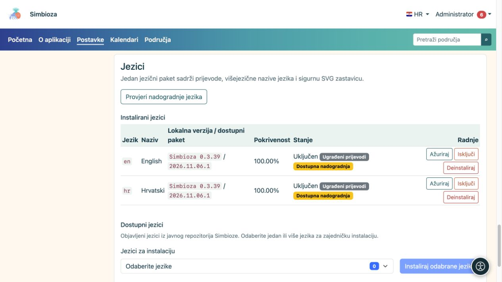

# Jezici sučelja

**Za koga:** administrator cijele instalacije. Otvorite **Postavke → Setup i moduli → Jezici** kada želite ponuditi dodatni jezik ili osvježiti prijevode.

Jezik sučelja određuje nazive gumba i izbornika. Prijevod sadržaja stranice ili ankete uređuje se zasebno. Instaliranje engleskog sučelja zato ne prevodi automatski tekst koji je autor napisao na hrvatskom.

## Dodajte jezik

*Instalirani jezici imaju verziju i stanje; novi se jezici odabiru u zasebnom biraču ispod popisa.*

1. U dijelu za dostupne jezike odaberite objavljene jezike koje trebate.
2. Odaberite **Instaliraj odabrane jezike** i pričekajte rezultat.
3. Na popisu instaliranih jezika provjerite naziv, verziju, pokrivenost i stanje.
4. Uključite jezik ako je instaliran, a isključen.
5. Odaberite ga u jezičnom izborniku aplikacije i provjerite nekoliko ekrana.

**Rezultat:** uključeni instalirani jezik dostupan je korisnicima i ondje gdje autori biraju jezike prijevoda. Ne nude se automatski svi jezici koje Simbioza tehnički podržava.

## Što znače verzije

- **Ugrađeni prijevodi** dolaze s aplikacijom i prikazuju verziju Simbioze.
- **Jezični paket** zasebno je preuzet, provjeren paket prijevoda. Njegova revizija može se promijeniti bez novog izdanja aplikacije.
- **Ručni prijevod — revizija nije poznata** znači da postoji vlastiti prijevod bez zabilježene službene revizije. Nemojte ga prepisati službenim paketom bez pregleda vlastitih izmjena.
- **Pokrivenost** pokazuje obuhvat ključeva; nije jamstvo da je svaki izraz pregledao izvorni govornik.

## Osvježite prijevode

Odaberite **Provjeri nadogradnje jezika**. Ako se pojavi **Ažuriraj**, pročitajte koji se jezik mijenja i pokrenite njegovu nadogradnju. Provjera sama ne zamjenjuje tekstove. Uspješna nadogradnja čuva prethodno stanje uključenosti jezika.

Ako provjera ne uspije, trenutačni prijevod ne treba brisati. Ponovite kasnije ili zatražite provjeru izvora paketa. Ako GUI nema mogućnost instalacije zbog prava spremanja, odgovorna osoba za poslužitelj može primijeniti CLI postupak prikazan na ekranu.

## Isključite ili uklonite jezik

**Isključi** uklanja jezik iz aktivne ponude bez brisanja njegova paketa. **Deinstaliraj** uklanja instalirane jezične resurse i traži pažljiviju odluku. Sustav može odbiti uklanjanje ili isključivanje jezika koji je potreban instalaciji. Ove radnje ne brišu prijevode sadržaja stranica.

## Vlastiti paket

Ako imate vlastiti prijevod, koristite dio za učitavanje jezičnog paketa. Datoteka je podatkovni JSON paket, a ne PHP program. Prije potvrde zamjene provjerite jezik i vlastite tekstove. Neispravan ili nepotpun paket sustav odbija; nemojte ga preimenovati u drugi jezik da biste zaobišli provjeru.
