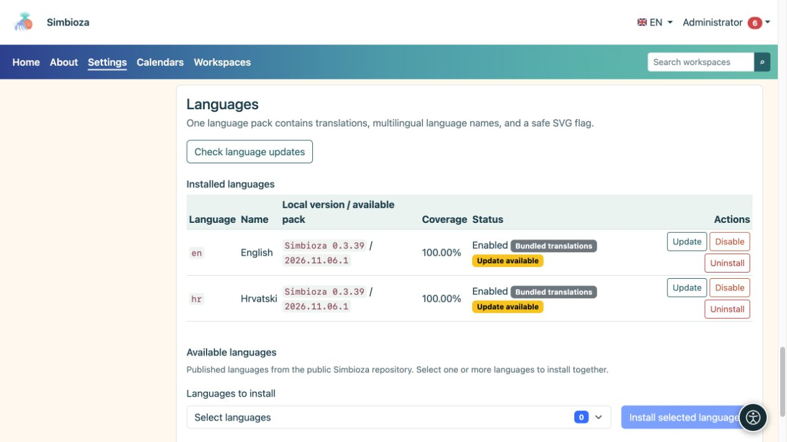

# Lingue dell'interfaccia

> Le schermate mostrano l’interfaccia in inglese.

**Pubblico:** l'amministratore dell'intera installazione. Apri **Impostazioni → Configurazione e moduli → Lingue** per offrire un'altra lingua o aggiornare le traduzioni.

La lingua dell'interfaccia controlla le etichette dei pulsanti e dei menu. Le traduzioni del contenuto della pagina e del sondaggio vengono modificate separatamente. L'installazione dell'interfaccia inglese non traduce automaticamente il contenuto scritto da un autore in croato.

## Aggiungi una lingua

*Le lingue installate mostrano la loro versione e il loro stato; le nuove lingue vengono scelte in un selettore separato sotto l'elenco.*

1. Nella sezione delle lingue disponibili, seleziona le lingue pubblicate di cui hai bisogno.
2. Scegli **Installa le lingue selezionate** e attendi il risultato.
3. Controlla il nome, la versione, la copertura e lo stato di ciascuna lingua installata.
4. Abilita una lingua installata se è disabilitata.
5. Selezionala nel menu della lingua dell'applicazione e controlla diverse schermate.

**Risultato:** una lingua installata abilitata è disponibile per gli utenti e nei selettori di traduzione dei contenuti pertinenti. L'applicazione non offre automaticamente tutte le lingue che Simbioza supporta tecnicamente.

## Comprendere le versioni

- **Traduzioni in bundle** vengono fornite con l'applicazione e mostrano la versione Simbioza.
- **Pacchetto lingue** è un pacchetto di traduzione scaricato e verificato separatamente. La sua revisione può cambiare senza un nuovo rilascio dell'applicazione.
- **Traduzione manuale - revisione sconosciuta** significa che esiste una traduzione personalizzata senza una revisione ufficiale registrata. Rivedi le modifiche prima di sostituirlo con un pacchetto ufficiale.
- **Copertura** descrive il set di chiavi; non garantisce che un madrelingua abbia rivisto ogni frase.

## Aggiorna le traduzioni

Scegli **Controlla aggiornamenti lingua**. Se viene visualizzato **Aggiorna**, leggi quale lingua cambierà ed esegui l'aggiornamento. Il solo controllo non sostituisce le traduzioni. Un aggiornamento riuscito conserva il precedente stato abilitato della lingua.

Se il controllo fallisce, non eliminare la traduzione funzionante. Riprova più tardi o chiedi di controllare l'origine del pacchetto. Laddove le autorizzazioni di configurazione impediscono l'installazione della GUI, il manutentore del server può utilizzare la procedura CLI mostrata sullo schermo.

## Disabilitare o rimuovere una lingua

**Disabilita** rimuove una lingua dalla selezione attiva senza eliminarne il pacchetto. **Disinstalla** rimuove le risorse linguistiche installate e richiede una decisione più attenta. Il sistema potrebbe rifiutarsi di disabilitare o rimuovere una lingua richiesta dall'installazione. Queste azioni non eliminano le traduzioni del contenuto della pagina.

## Utilizza un pacchetto personalizzato

Utilizza la sezione di caricamento del pacchetto lingua per una traduzione personalizzata. Il file è un pacchetto JSON di soli dati, non un programma PHP. Controlla la lingua e il testo personalizzato prima di confermare la sostituzione. Il sistema rifiuta i pacchi non validi o incompleti; non rietichettare un file come un'altra lingua per ignorare la convalida.
