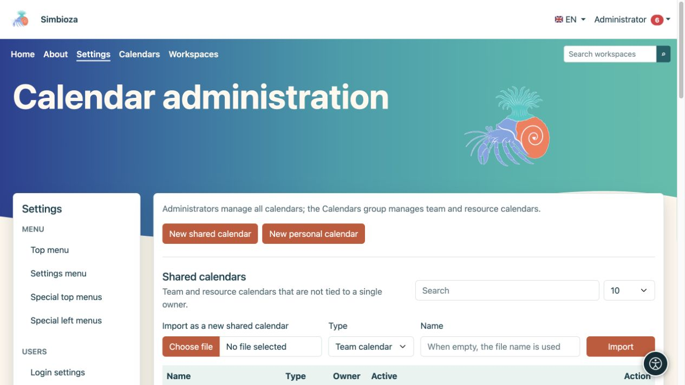
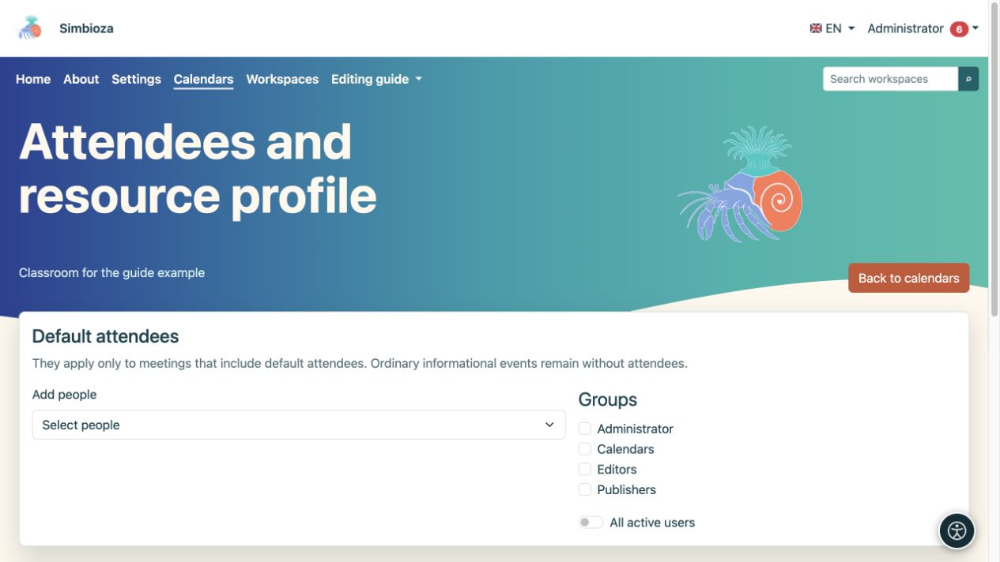
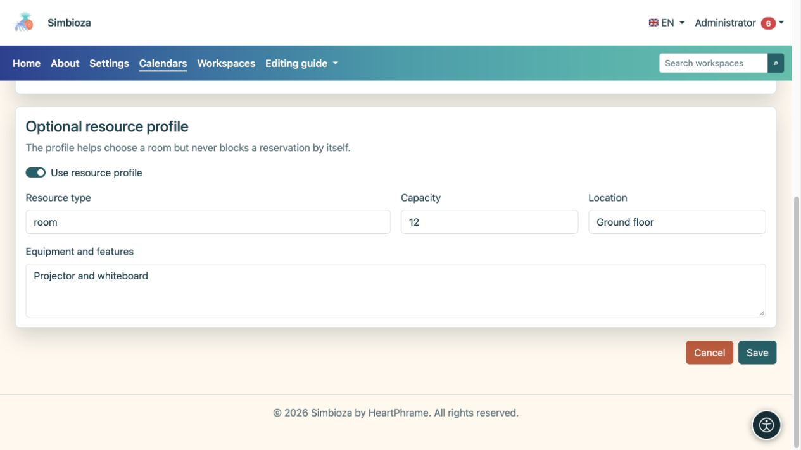

# Kalender verwalten

> Die Bildschirmaufnahmen zeigen die englische Benutzeroberfläche.

**Zielgruppe:** Der Installationsadministrator kann alle Kalender verwalten. Mitglieder der Systemgruppe **Kalender** verwalten Team- und Ressourcenkalender über **Kalender → Freigegebene Kalender verwalten**; die Mitgliedschaft gewährt keinen Zugriff auf alle Einstellungen oder die persönlichen Kalender anderer Personen.

Administratoren öffnen **Einstellungen → Kalender → Kalenderverwaltung**. Kalenderansichten, Ereignisse und Benutzerabonnements werden in [Kalender](kalendari_de.md) behandelt. Das Vereinbaren von Terminen wird unter [Besprechungen](sastanci_de.md) behandelt.

## Erstellen Sie einen gemeinsamen Kalender

*Die Verwaltung trennt freigegebene und persönliche Kalender und bietet den ICS-Import als neuen freigegebenen Kalender an.*

1. Wählen Sie **Neuer freigegebener Kalender**.
2. Wählen Sie **Teamkalender** für die Ereignisse eines Teams oder **Ressourcenkalender** für einen Raum oder eine Ausrüstung.
3. Geben Sie einen eindeutigen Namen und eine Beschreibung ein und wählen Sie dann eine Farbe für die kombinierte Ansicht.
4. Lassen Sie **Aktiv** aktiviert, wenn der Kalender sofort verwendet wird.
5. Konfigurieren Sie den Lesezugriff und fügen Sie Personen oder Gruppen hinzu, die zusätzliche Rechte benötigen.
6. Wählen Sie **Kalender speichern** und öffnen Sie ihn dann in der Liste.

**Ergebnis:** Der freigegebene Kalender existiert und ist gemäß seinen gespeicherten Berechtigungen sichtbar. Ein neuer Kalender ist nicht automatisch öffentlich.

## Sichtbarkeit und Berechtigungen verstehen

| Kontrolle | Wirkung |
|---|---|
| Authentifizierte Benutzer können lesen | Alle angemeldeten Benutzer können ohne individuelle Berechtigungen lesen. |
| Öffentliche Lesung | Besucher können lesen, ohne sich anzumelden. Nur für öffentliche Informationen aktivieren. |
| Lesen Sie neben einer Person/Gruppe | Die ausgewählten Personen bzw. Mitglieder können neben anderen bestehenden Rechten lesen. |
| Schreiben Sie neben eine Person/Gruppe | Ermöglicht die Bearbeitung von Kalenderinhalten im zulässigen Umfang. |
| Ereignisse auf der öffentlichen Seite anzeigen | Schließt Ereignisse aus einem öffentlich lesbaren Kalender in die öffentliche Ansicht ein. Durch die Auswahl wird die Leseberechtigung nicht umgangen. |
| Link auf der öffentlichen Seite anzeigen | Zeigt einen Link zu einem öffentlich verfügbaren Kalender an. |
| Öffentliche Ordnung | Steuert die Reihenfolge der öffentlichen Anzeige; ein neues Formular beginnt bei 100. |

Suchen Sie weitere Personen in der Benutzerauswahl. Legen Sie Lesen und Schreiben für jede Person oder Gruppe getrennt fest. Prüfen Sie auch die Gruppenmitgliedschaften: Eine eingeschränkte Zuweisung hebt eine weitere, umfassendere Berechtigung nicht auf.

## Persönliche Kalender

Administratoren können den Abschnitt „Persönlicher Kalender“ öffnen und einen Kalender für einen ausgewählten Eigentümer erstellen. Wählen Sie den Besitzer und die Voreinstellung **Offiziell**, **Persönlich** oder **Benutzerdefiniert**; Geben Sie ein eindeutiges Namenssuffix für einen benutzerdefinierten Kalender ein. Sein Name leitet sich vom Anzeigenamen des Benutzers ab. Dies ist nicht das Verfahren zum Erstellen des freigegebenen Kalenders einer Organisation.

Listen bieten eine Suche und 10, 25, 50 oder 100 Zeilen pro Seite. Wählen Sie **Bearbeiten** in der richtigen Zeile; das Speichern eines Kalenders ändert nichts an einem anderen.

## Standardteilnehmer und Ressourcendetails

*Wählen Sie in den ausgewählten Kalendereinstellungen Standardteilnehmer und -gruppen aus.*

Öffnen Sie **Teilnehmer und Ressourcen** für den entsprechenden Kalender. Fügen Sie Personen hinzu, wählen Sie Gruppen aus oder wählen Sie **Alle aktiven Benutzer**. Diese Teilnehmer sind nur die Standardteilnehmer für eine Besprechung, die Standardteilnehmer enthält. Eine gewöhnliche Informationsveranstaltung bleibt ohne Teilnehmer.

Für einen Ressourcenkalender können Sie ein Ressourcenprofil aktivieren und dessen Typ, Kapazität, Standort und Ausrüstung eingeben. Das Profil hilft Menschen bei der Auswahl einer Ressource, blockiert jedoch nicht selbst eine Buchung aufgrund von Kapazität oder Ausstattung. Bei der Planung eines Meetings werden Genehmigungsregeln und zeitliche Verfügbarkeit geprüft.

*Das optionale Ressourcenprofil beschreibt Typ, Kapazität, Standort und Ausstattung.*

## Importieren, exportieren und löschen

Eine ICS-Datei kann als neuer freigegebener Kalender oder in einen vorhandenen Kalender importiert werden. Lesen Sie im letzteren Fall vor der Bestätigung die Option zum Abgleichen von Ereignis-UIDs. Downloads von Kalenderereignissen als ICS exportieren; es ersetzt kein [vollständiges Backup](admin-sigurnosne-kopije_de.md) der Berechtigungen und Besprechungen.

Verwenden Sie **Kalender löschen** erst, nachdem Sie den ausgewählten Kalender und die Bestätigungsnachricht überprüft haben. Bei vorübergehender Nichtbenutzung sollten Sie es zunächst deaktivieren. Überprüfen Sie nach dem Ändern des öffentlichen Lesezugriffs den Kalender, während Sie abgemeldet sind und über ein Konto verfügen, das über keine zusätzlichen Rechte verfügt.

Bei der allgemeinen CalDAV-Aktivierung handelt es sich um eine Installationskonfiguration, die vom Serverbetreuer verwaltet wird. Dieser Bildschirm hat keinen Schalter für alle CalDAV-Clients. Der Clientzugriff auf Benutzerebene wird im [Kalenderhandbuch](kalendari_de.md) beschrieben.
