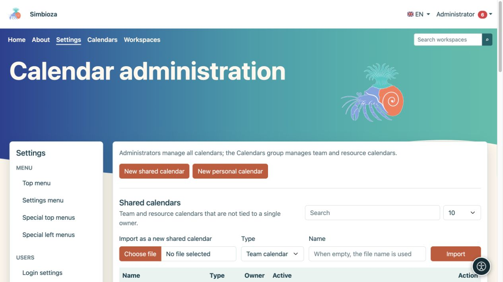
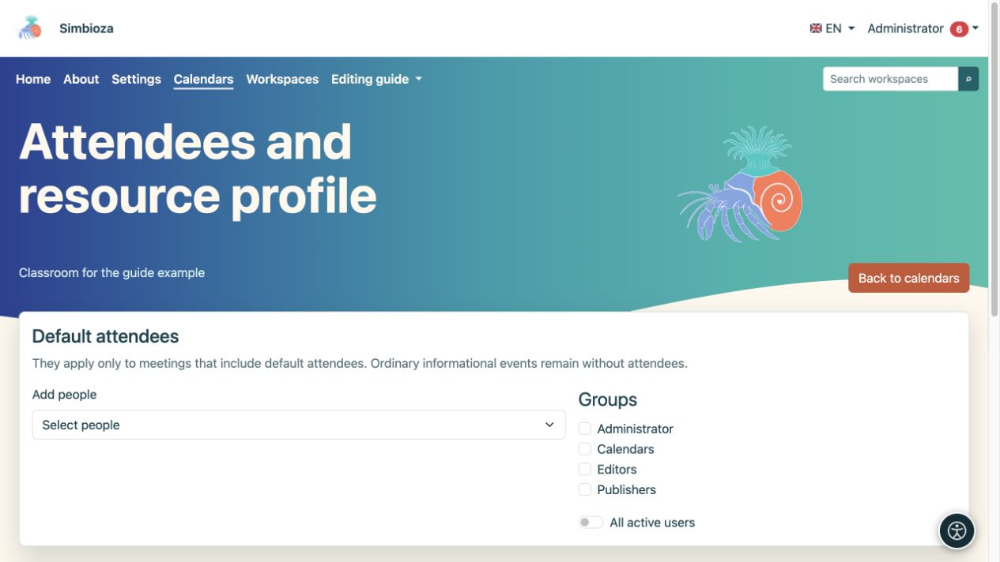
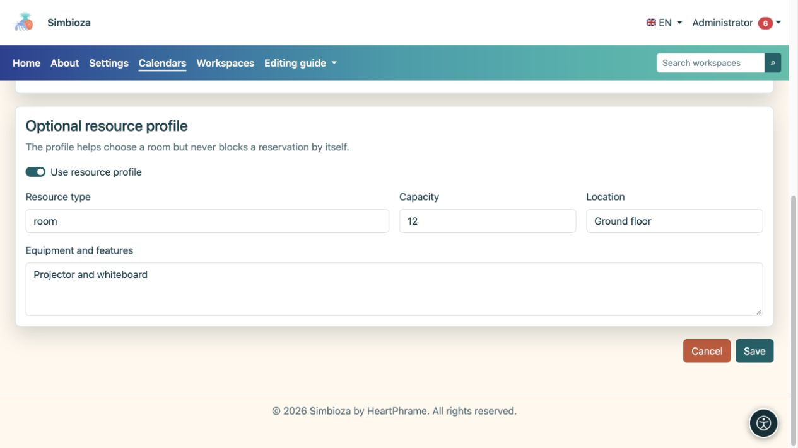

# Calendar administration

**Audience:** the installation administrator can manage all calendars. Members of the **Calendars** system group manage team and resource calendars through **Calendars → Manage shared calendars**; membership does not grant access to all Settings or other people's personal calendars.

Administrators open **Settings → Calendars → Calendar administration**. Calendar views, events, and user subscriptions are covered in [Calendars](kalendari_en.md); arranging appointments is covered in [Meetings](sastanci_en.md).

## Create a shared calendar

*Administration separates shared and personal calendars and offers ICS import as a new shared calendar.*

1. Choose **New shared calendar**.
2. Select **Team calendar** for a team's events or **Resource calendar** for a room or equipment.
3. Enter a clear name and description, then choose a colour for the combined view.
4. Keep **Active** enabled if the calendar will be used immediately.
5. Configure read access and add people or groups needing additional rights.
6. Choose **Save calendar**, then open it from the list.

**Result:** the shared calendar exists and is visible according to its saved permissions. A new calendar is not automatically public.

## Understand visibility and permissions

| Control | Effect |
|---|---|
| Authenticated users can read | All signed-in users can read without individual grants. |
| Public read | Visitors can read without signing in. Enable only for public information. |
| Read beside a person/group | The selected people or members can read, alongside other existing rights. |
| Write beside a person/group | Allows calendar-content editing within the permitted scope. |
| Show events on the public page | Includes events from a publicly readable calendar in the public view. Selecting it does not bypass read permission. |
| Show link on the public page | Shows a link to a publicly available calendar. |
| Public order | Controls public display order; a new form starts at 100. |

Find new people in the user selector. Select read and write separately for each person or group. Review group membership too: a restricted row does not cancel a separate broader grant.

## Personal calendars

Administrators can open the personal-calendar section and create a calendar for a selected owner. Choose the owner and the **Official**, **Personal**, or **Custom** preset; enter a unique name suffix for a custom calendar. Its name is derived from the user's display name. This is not the procedure for creating an organisation's shared calendar.

Lists offer search and 10, 25, 50, or 100 rows per page. Choose **Edit** on the correct row; saving one calendar does not change another.

## Default attendees and resource details

*Choose default attendees and groups in the selected calendar settings.*

Open **Attendees and resource** for the relevant calendar. Add people, select groups, or choose **All active users**. These attendees are defaults only for a meeting that includes default attendees; an ordinary informational event remains without attendees.

For a resource calendar, you can enable a resource profile and enter its type, capacity, location, and equipment. The profile helps people choose a resource, but does not itself block a booking because of capacity or equipment. Approval rules and time availability are checked when planning a meeting.

*The optional resource profile describes the type, capacity, location, and equipment.*

## Import, export, and deletion

An ICS file can be imported as a new shared calendar or into an existing calendar. In the latter case, read the option for matching event UIDs before confirming. Export downloads calendar events as ICS; it does not replace a [complete backup](admin-sigurnosne-kopije_en.md) of permissions and meetings.

Use **Delete calendar** only after checking the selected calendar and confirmation message. For temporary non-use, consider disabling it first. After changing public read access, check the calendar while signed out and with an account that has no additional rights.

General CalDAV enablement is installation configuration managed by the server maintainer; this screen has no switch for all CalDAV clients. User-level client access is described in the [calendar guide](kalendari_en.md).
