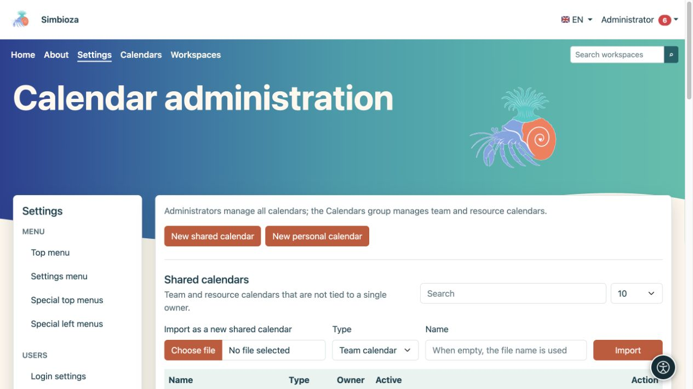
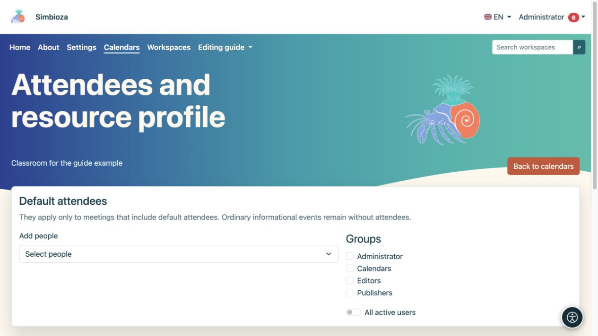
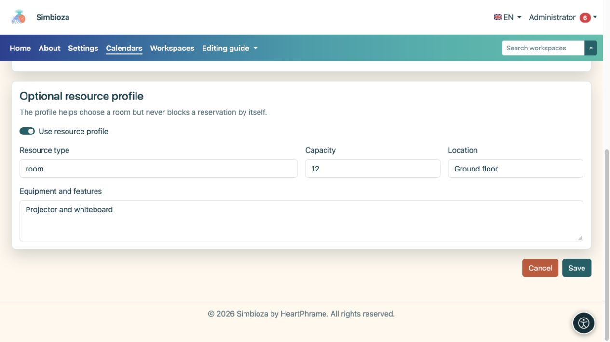

# Administrar calendarios

> Las capturas de pantalla muestran la interfaz en inglés.

**Audiencia:** el administrador de la instalación puede gestionar todos los calendarios. Los miembros del grupo del sistema **Calendarios** administran calendarios de equipos y recursos a través de **Calendarios → Administrar calendarios compartidos**; La membresía no otorga acceso a todas las configuraciones ni a los calendarios personales de otras personas.

Los administradores abren **Configuración → Calendarios → Administración de calendario**. Las vistas de calendario, eventos y suscripciones de usuarios se tratan en [Calendarios](kalendari_es.md); La organización de citas se trata en [Reuniones](sastanci_es.md).

## Crear un calendario compartido

*La administración separa los calendarios compartidos y personales y ofrece la importación de ICS como un nuevo calendario compartido.*

1. Elija **Nuevo calendario compartido**.
2. Seleccione **Calendario de equipo** para los eventos de un equipo o **Calendario de recursos** para una sala o equipo.
3. Ingrese un nombre y una descripción claros, luego elija un color para la vista combinada.
4. Mantenga **Activo** habilitado si el calendario se utilizará inmediatamente.
5. Configure el acceso de lectura y agregue personas o grupos que necesiten derechos adicionales.
6. Elija **Guardar calendario** y luego ábralo desde la lista.

**Resultado:** el calendario compartido existe y es visible según sus permisos guardados. Un nuevo calendario no es público automáticamente.

## Comprender la visibilidad y los permisos

| Control | Efecto |
|---|---|
| Los usuarios autenticados pueden leer | Todos los usuarios que hayan iniciado sesión pueden leer sin permisos individuales. |
| Lectura pública | Los visitantes pueden leer sin iniciar sesión. Habilite solo para información pública. |
| Leer junto a una persona/grupo | Las personas o miembros seleccionados pueden leer, además de otros derechos existentes. |
| Escribir al lado de una persona/grupo | Permite la edición del contenido del calendario dentro del alcance permitido. |
| Mostrar eventos en la página pública | Incluye eventos de un calendario legible públicamente en la vista pública. Seleccionarlo no omite el permiso de lectura. |
| Mostrar enlace en la página pública | Muestra un enlace a un calendario disponible públicamente. |
| orden publico | Controla el orden de exhibición pública; un nuevo formulario comienza en 100. |

Busque a otras personas en el selector de usuarios. Seleccione por separado los permisos de lectura y escritura para cada persona o grupo. Revise también la pertenencia a grupos: una asignación restringida no anula otro permiso más amplio concedido por otra vía.

## Calendarios personales

Los administradores pueden abrir la sección de calendario personal y crear un calendario para un propietario seleccionado. Elija el propietario y el ajuste preestablecido **Oficial**, **Personal** o **Personalicedo**; ingrese un sufijo de nombre único para un calendario personalizado. Su nombre se deriva del nombre para mostrar del usuario. Este no es el procedimiento para crear el calendario compartido de una organización.

Las listas ofrecen búsqueda y 10, 25, 50 o 100 filas por página. Elija **Editar** en la fila correcta; guardar un calendario no cambia otro.

## Asistentes predeterminados y detalles de recursos

*Elija asistentes y grupos predeterminados en la configuración del calendario seleccionado.*

Abra **Asistentes y recursos** para ver el calendario correspondiente. Agregue personas, seleccione grupos o elija **Todos los usuarios activos**. Estos asistentes son predeterminados sólo para una reunión que incluye asistentes predeterminados; un evento informativo ordinario se queda sin asistentes.

Para un calendario de recursos, puede habilitar un perfil de recursos e ingresar su tipo, capacidad, ubicación y equipo. El perfil ayuda a las personas a elegir un recurso, pero no bloquea una reserva por su capacidad o equipamiento. Las reglas de aprobación y la disponibilidad de tiempo se verifican al planificar una reunión.

*El perfil de recursos opcional describe el tipo, la capacidad, la ubicación y el equipo.*

## Importar, exportar y eliminar

Un archivo ICS se puede importar como un nuevo calendario compartido o en un calendario existente. En el último caso, lea la opción para hacer coincidir los UID de eventos antes de confirmar. Exportar descargas de eventos del calendario como ICS; no reemplaza una [copia de seguridad completa](admin-sigurnosne-kopije_es.md) de permisos y reuniones.

Utilice **Eliminar calendario** solo después de verificar el calendario seleccionado y el mensaje de confirmación. En caso de falta de uso temporal, considere desactivarlo primero. Después de cambiar el acceso de lectura pública, consulte el calendario sin iniciar sesión y con una cuenta que no tenga derechos adicionales.

La habilitación general CalDAV es la configuración de instalación administrada por el mantenedor del servidor; esta pantalla no tiene ningún interruptor para todos los clientes CalDAV. El acceso de cliente a nivel de usuario se describe en la [guía de calendario](kalendari_es.md).
