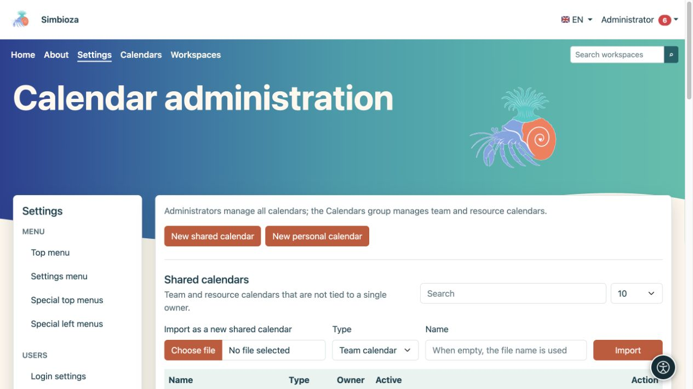
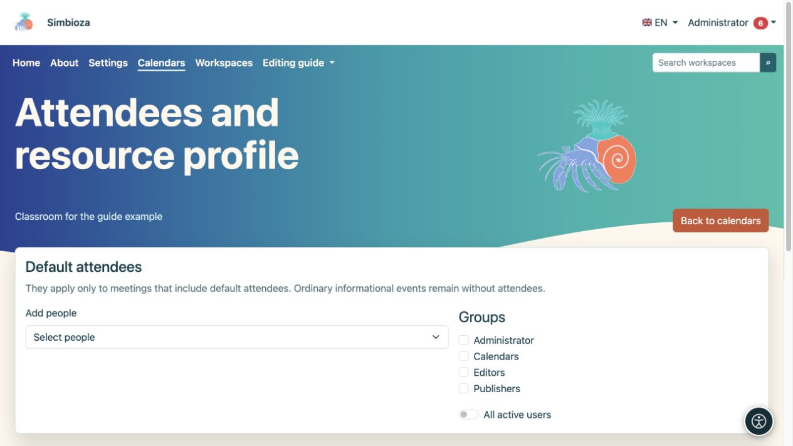
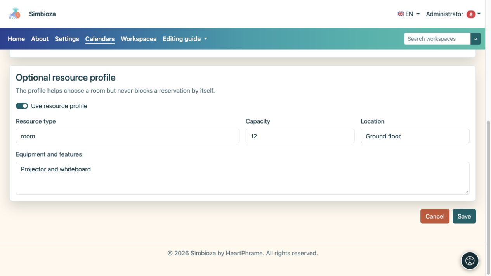

# Administration des calendriers

> Les captures d’écran présentent l’interface en anglais.

**Public :** l'administrateur d'installation peut gérer tous les calendriers. Les membres du groupe système **Calendriers** gèrent les calendriers des équipes et des ressources via **Calendriers → Gérer les calendriers partagés** ; l'adhésion ne donne pas accès à tous les paramètres ou aux calendriers personnels d'autres personnes.

Les administrateurs ouvrent **Paramètres → Calendriers → Administration du calendrier**. Les vues du calendrier, les événements et les abonnements des utilisateurs sont traités dans [Calendriers](kalendari_fr.md) ; l'organisation des rendez-vous est abordée dans [Réunions](sastanci_fr.md).

## Créer un calendrier partagé

*L'administration sépare les calendriers partagés et personnels et propose l'importation ICS en tant que nouveau calendrier partagé.*

1. Choisissez **Nouveau calendrier partagé**.
2. Sélectionnez **Calendrier d'équipe** pour les événements d'une équipe ou **Calendrier de ressources** pour une salle ou un équipement.
3. Entrez un nom et une description clairs, puis choisissez une couleur pour la vue combinée.
4. Gardez **Active** activé si le calendrier doit être utilisé immédiatement.
5. Configurez l'accès en lecture et ajoutez des personnes ou des groupes ayant besoin de droits supplémentaires.
6. Choisissez **Enregistrer le calendrier**, puis ouvrez-le dans la liste.

**Résultat :** le calendrier partagé existe et est visible en fonction de ses autorisations enregistrées. Un nouveau calendrier n'est pas automatiquement public.

## Comprendre la visibilité et les autorisations

| Contrôle | Effet |
|---|---|
| Les utilisateurs authentifiés peuvent lire | Tous les utilisateurs connectés peuvent lire sans autorisation individuelle. |
| Lecture publique | Les visiteurs peuvent lire sans se connecter. Activer uniquement pour les informations publiques. |
| Lire à côté d'une personne/d'un groupe | Les personnes ou membres sélectionnés peuvent lire, aux côtés d'autres droits existants. |
| Écrivez à côté d'une personne/d'un groupe | Permet la modification du contenu du calendrier dans la portée autorisée. |
| Afficher les événements sur la page publique | Inclut les événements d’un calendrier lisible publiquement dans la vue publique. Le sélectionner ne contourne pas l’autorisation de lecture. |
| Afficher le lien sur la page publique | Affiche un lien vers un calendrier accessible au public. |
| Ordre public | Contrôle l’ordre d’affichage public ; un nouveau formulaire commence à 100. |

Recherchez les personnes à ajouter dans le sélecteur d’utilisateurs. Sélectionnez séparément les droits de lecture et d’écriture pour chaque personne ou groupe. Vérifiez également l’appartenance aux groupes : une restriction sur une ligne n’annule pas un autre droit plus large.

## Calendriers personnels

Les administrateurs peuvent ouvrir la section du calendrier personnel et créer un calendrier pour un propriétaire sélectionné. Choisissez le propriétaire et le préréglage **Officiel**, **Personnel** ou **Personnalisé** ; saisissez un suffixe de nom unique pour un calendrier personnalisé. Son nom est dérivé du nom d'affichage de l'utilisateur. Il ne s'agit pas de la procédure à suivre pour créer le calendrier partagé d'une organisation.

Les listes proposent une recherche et 10, 25, 50 ou 100 lignes par page. Choisissez **Modifier** sur la bonne ligne ; enregistrer un calendrier n’en change pas un autre.

## Participants par défaut et détails des ressources

*Choisissez les participants et les groupes par défaut dans les paramètres du calendrier sélectionnés.*

Ouvrez **Participants et ressources** pour le calendrier concerné. Ajoutez des personnes, sélectionnez des groupes ou choisissez **Tous les utilisateurs actifs**. Ces participants sont les participants par défaut uniquement pour une réunion qui inclut des participants par défaut ; un événement d'information ordinaire reste sans participants.

Pour un calendrier de ressources, vous pouvez activer un profil de ressource et saisir son type, sa capacité, son emplacement et son équipement. Le profil aide les gens à choisir une ressource, mais ne bloque pas lui-même une réservation en raison de la capacité ou de l'équipement. Les règles d'approbation et la disponibilité du temps sont vérifiées lors de la planification d'une réunion.

*Le profil de ressource facultatif décrit le type, la capacité, l'emplacement et l'équipement.*

## Importation, exportation et suppression

Un fichier ICS peut être importé en tant que nouveau calendrier partagé ou dans un calendrier existant. Dans ce dernier cas, lisez l’option de correspondance des UID d’événement avant de confirmer. Exporter les événements du calendrier des téléchargements au format ICS ; il ne remplace pas une [sauvegarde complète](admin-sigurnosne-kopije_fr.md) des autorisations et des réunions.

Utilisez **Supprimer le calendrier** uniquement après avoir vérifié le calendrier sélectionné et le message de confirmation. En cas de non-utilisation temporaire, pensez à le désactiver au préalable. Après avoir modifié l'accès public en lecture, vérifiez le calendrier lorsque vous êtes déconnecté et avec un compte qui n'a aucun droit supplémentaire.

L'activation générale CalDAV est la configuration de l'installation gérée par le responsable du serveur ; cet écran n'a pas de commutateur pour tous les clients CalDAV. L'accès client au niveau utilisateur est décrit dans le [guide du calendrier](kalendari_fr.md).
